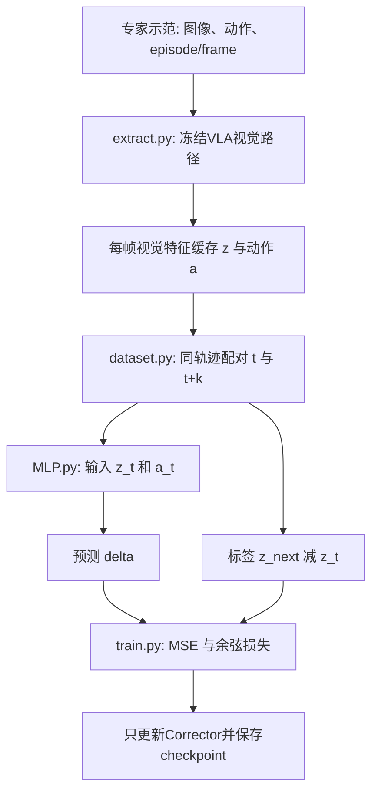

# VLA-Corrector源码导读：从一条示范到视觉变化预测

2026-11-07。本文先读固定参考版本927a06d；以论文机制为依据，工程适配另行标注。
今天优先读数据集、MLP.forward和损失。监控/OGG先建立调用关系，不要求一次重写整套系统。

实际动手接口已经搭好，见[五处核心实践](corrector/practice.md)；环境/数据位置与Notebook模式见[存储与评测说明](corrector_storage_and_evaluation.md)。

## 1．先区分两个模型、三条调用链

SmolVLA是冻结的动作策略，输入观测，生成动作块。Corrector是另外训练的视觉变化预测器。
Corrector的delta不是机器人关节速度，也不是Flow Matching中积分用的速度；它与视觉特征形状相同。



| 阶段     | 入口和实际调用                                                                                     | 输入                               | 输出                                       |
| -------- | -------------------------------------------------------------------------------------------------- | ---------------------------------- | ------------------------------------------ |
| 缓存构建 | extract.main→extract→_build_extractor→SmolVLAExtractor→encode_item                             | 一帧两路图像和对应动作             | 每帧z、a、episode索引及元信息              |
| 训练     | train.main→train→SiglipDynamicsDataset→DataLoader→model→_combined_loss                        | 批量z_t、a_t和真实delta            | Corrector参数/checkpoint，不生成机器人动作 |
| 在线执行 | lerobot_eval_modified_detection→视觉编码→SiglipDynamicsPredictor.predict_delta_z→到期比较→报警 | 当前观测、实际待执行动作、历史预测 | 是否截断动作队列，以及恢复查询的引导信息   |

源文件都在outputs/source_audit/vla-corrector中，不直接修改它们；项目实现和适配放在studies与scripts。

## 2．实际数据从哪里来：不只有MP4

本地实际检查的是HuggingFaceVLA/libero固定revision，任务24的episode813/818/825。
Parquet每行有两路PNG字节、8维机器人状态、7维动作、timestamp、frame_index和episode_index。
不是只含视频，因此可以直接恢复每帧图像与监督动作；单独拿旧评测MP4没有这些完整对齐信息。

实际episode813首帧：

```text
episode_index = 813
frame_index = 0
timestamp = 0.0
第一相机尺寸 = 256×256，左上像素RGB = (134,135,129)
action = [0.101785712, -0.077678569, -0.0, 0.0,
          0.028928572, -0.027857143, -1.0]
```

下一帧timestamp约0.10000000149，frame_index为1。数据元信息10FPS；所以这份数据k=1约对应0.1秒。
浮点时间小误差是存储表示问题。不能把k=1直接当成之前20Hz在线环境的一步，两者时间语义还需对齐。
这里列的是示范中原始动作数值，不擅自称为米/弧度，不是当前checkpoint已标准化动作。

图像处理主线：PNG字节→PIL RGB→NumPy的[H,W,3]→Torch的[1,3,H,W]浮点[0,1]→resize/pad→[-1,1]→embed_image。
同一画面的内容不会因permute而改变，改变的是三个轴的排列；除255才改变像素数值尺度。
视觉特征的具体数值需要真实权重推理，当前尚未执行这次GPU提取，不伪造z的测量结果。

## 3．extract.py：贵的视觉推理先做一次，后续训练复用

重点读[SmolVLAExtractor](../../outputs/source_audit/vla-corrector/src/siglip_dynamics/extract.py)和BaseVisualExtractor.encode_item。

```python
feats = []
for raw_img in imgs:
    feats.append(self.encode_single_image(raw_img))
z = torch.cat(feats, dim=1)
return z[0].to(dtype=torch.float32).cpu().numpy()
```

- imgs是两路相机图像组成的Python列表，不是batch=2；每路内部仍是batch=1。
- encode_single_image调用实际策略的embed_image，输出[1,L_cam,D]；含视觉网络和connector投影，不是语言Transformer最后一层。
- append把两份输出保存在列表；cat沿token轴拼成[1,L_cam1+L_cam2,D]，不会把两相机像素拼成一张图。
- z[0]取batch中的唯一一项，得到[L,D]，不是只保留第一个相机。
- cpu().numpy()让结果可以写入NumPy文件，后续训练不必再次加载VLA。

该SmolVLA的投影宽度是960；两相机token数以本次实际输出为准，不能直接把旧示例中的141当作缓存长度。
语言与状态并没有拼进这个z。它们仍参与VLA动作策略；这里只提取Corrector所用的视觉条件。

原实现对每个视觉token量化：

```python
absmax = np.max(np.abs(z), axis=1)              # [L,D] → [L]
scale = np.maximum(absmax / 127.0, 1e-8)       # 一个token共用一个scale
q = np.clip(np.round(z / scale[:, None]), -127, 127).astype(np.int8)
```

scale[:,None]把[L]变成[L,1]，让每一行的D个特征除以该行scale。它不是给每列加位置编号。
q只保存-127到127的整数；另保存float16 scale，读取时用q*scale近似恢复float32特征。
量化有误差，不能声称恢复后与原z完全相同。z_q.npy省空间，训练时才反量化。
动作不由图像推算，直接读取同帧记录的action；动作归一化必须与之后在线监控收到的动作一致。

### 我们在外围做的工程适配

原extract在整个输出目录中用mode='w+'创建缓存，重新执行会覆盖；metadata最后才写。它不是中断续跑器。
新入口按episode处理，先写临时缓存，再复制、验SHA并写COMPLETE.json；已完成轨迹重启后验SHA跳过。
突然断连时重做当前未完成episode，不承诺从任意帧无损续跑。第一次仅三轨迹验链路。

视觉提取和量化调用固定上游实现；动作改为调用当前checkpoint保存的preprocessor，并保存raw_actions.npy供核对。
这是明示的0.6.1接口/尺度适配，不是声称完全照搬原QUANTILES选项。
原始帧数据已经是LeRobot图像，不额外按在线LIBERO原始相机观测再翻转一次。

## 4．dataset.py：怎样把缓存变成可训练的样本

### 4.1 只建立行号对，不复制两套完整特征

原_load_quantized_frame_cache中，i指当前episode开始行，j找到该episode结束后的第一行。

```python
hist_start = i + (self.h_window - 1)
for t in range(hist_start, j - self.k_step):
    self.pairs.append((t, t + self.k_step))
```

range不包含右端点。例如一条155帧轨迹占[0,155)，k=1、h=1时t从0到153，产生154对。
k=10时t从0到144，产生145对；最后10帧缺少未来标签，不能配对。
h_window=1表示只输入当前视觉帧；h>1会排除开头历史不足的位置，当前MLP训练明确要求h=1。

你的for实现与它的关键判断一致。当前方案显式检查连续帧和同episode；没有必要为了像源码改成嵌套while。
上游默认缓存内部帧连续，我们现在也明确要求这个前提；漏帧时拒绝，而不是悄悄按行距配对。

### 4.2 __getitem__真正构造输入与标签

```python
t, t_next = self.pairs[idx]
z_hist_np = self._dequantize(...)
z_t_np = z_hist_np[-1]
z_next_np = self._dequantize(...)
a_t_np = np.asarray(self.a_t_np[t], dtype=np.float32)
delta_np = z_next_np - z_t_np
```

idx是第几个训练样本，t是缓存中的第几行；它们不是同一个概念，也不是机器人关节序号。
history在h=1时是[1,L,D]；[-1]取最后一帧，得到[L,D]。delta与z_t同形状。
torch.from_numpy把数组转换成Torch Tensor，单样本返回字典：

```text
z_t:     [L,D]
z_hist:  [1,L,D]
a_t:     [7]
delta_z: [L,D]
```

DataLoader拿B个字典，按同名字段堆叠，才得到[B,L,D]、[B,1,L,D]、[B,7]、[B,L,D]。
训练shuffle只改变抽取样本顺序；不会重新定义哪两个帧配对，因为pairs已固定。
新的逐episode缓存需要数据集列表/ConcatDataset组合；不直接把父目录当成一个上游缓存，也不把不同episode首尾相减。

## 5．MLP.py：最值得你亲手重写的forward

这段没有Q/K/V、RoPE或Flow Matching积分。它是一个条件残差MLP。
先假定DataLoader已经提供z_t[B,L,D]与a_t[B,7]。原代码的无batch兼容分支只负责unsqueeze，不产生额外样本。

```python
bsz, lsz, _ = z_t.shape
a_emb = self.action_proj(a_t)
a_emb = a_emb[:, None, :].expand(bsz, lsz, -1)
x = torch.cat([z_t, a_emb], dim=-1)
x = self.in_proj(x)
for i, block in enumerate(self.blocks):
    x = block(x)
    if i < len(self.transitions):
        x = self.transitions[i](x)
x = self.out_norm(x)
delta_z = self.out_proj(x)
```

| 语句               | 形状变化                    | 意义                                                 |
| ------------------ | --------------------------- | ---------------------------------------------------- |
| action_proj        | [B,7]→[B,C]，原配置C=256   | 将7维动作映射成可学习动作特征；Linear做a乘W转置再加b |
| [:,None,:]         | [B,C]→[B,1,C]              | 增加token轴，数值不变                                |
| expand             | [B,1,C]→[B,L,C]            | 同一实际动作条件提供给全部视觉token，-1表示保持C     |
| cat dim=-1         | [B,L,D]与[B,L,C]→[B,L,D+C] | 对每个token连接视觉特征和动作特征，没有把token数加倍 |
| in_proj            | [B,L,D+C]→[B,L,W0]         | 学习两种信息的组合                                   |
| blocks/transitions | [B,L,Wi]→[B,L,Wi+1]        | 同宽残差处理，宽度变化时另做投影                     |
| out_proj           | [B,L,W_last]→[B,L,D]       | 每个token预测D维视觉变化                             |

对于D=960、C=256，cat后的最后维是1216；不是动作直接变成960个物理量。
nn.Linear对最后一维做相同变换，B和L轴保留；权重在所有token位置共享。

_MLPBlock内部是LayerNorm→Linear→SiLU→Dropout→Linear→Dropout，最后return x+y。
这里残差x+y有助于深层映射优化；它与目标delta=z_next-z_t是两种不同的“残差”，不要混淆。
这些MLP层没有显式跨token注意力；视觉token已有编码器提供的上下文。不能把MLP解释成第二个视觉Transformer。
config里的4m/20m/100m是预设名称，实际参数量要调用num_parameters，不把名字当精确实测。

## 6．train.py：这次你已经掌握的训练核心怎样复用

```python
pred = model(z_t, a_t)
loss, mse, cos = _combined_loss(pred, delta_z, loss_type, beta)
optimizer.zero_grad(set_to_none=True)
loss.backward()
torch.nn.utils.clip_grad_norm_(model.parameters(), grad_clip_norm)
optimizer.step()
```

模型参数只属于Corrector；视觉特征已经在磁盘上，不参与这次计算图，所以不用为每个batch再做VLA反向。
与前几天train_one_batch的区别主要是输入/标签和模型换了，不是要重新发明训练步骤。

原_combined_loss：mse=F.mse_loss(pred,target)；cos=1-批内平均cosine_similarity；BOTH时total=mse+beta*cos。
MSE检查幅度，余弦检查整个变化向量的方向。余弦先把每个样本的[L,D]展平，再沿特征维求相似度；不是对batch样本彼此比相似度。
即使方向相同，幅度差很大时余弦损失也可能为0，MSE仍非0；只看其中一个会漏掉信息。
近零delta的方向不稳定，要记录范数并设计验证，不把误差峰自动当失败。

重要区别：原train默认random_split拆配对样本，相邻样本可能共享帧；我们后续按episode分组，再构造各自配对。
这是更保守的泛化评测协议，属于明示差异；应先对齐训练实现，再比较泛化，不能说它与论文全部评测设置完全相同。
目前三轨迹的317/152对只用于链路检查，不足以声称学到了可靠视觉动力学。

原checkpoint主要保存state_dict、配置与epoch等，不等于完整optimizer/scheduler/RNG续训状态；原入口也没有完整resume路径。
我们后续训练适配要另存last状态以应对Colab断连；今天的数据续跑不等于训练续跑已经实现。

## 7．在线部分：预测什么时候与真值相遇

在控制时刻t取z_t与即将执行的a_t，predict_delta_z得到delta_hat；保存(t+k, delta_hat)并保留历史z_t。
执行env.step后，新观测到来。到t+k时，取当时预测，比较z_(t+k)-z_t与delta_hat，才有误差信号。
不能在t时拿未来真值做报警，否则是信息泄漏；也不能把当前预测与另一时刻的变化随意相减。

原脚本将误差送入RobustAdaptiveThreshold、持续超限和冷却规则。触发后清空action_plan与raw_action_plan，再获取新动作块。
MLP只是预测器，报警阈值状态机在评测脚本；policy内部普通select_action队列也不是该脚本的外部action_plan。
后续接入0.6.1时必须明确由谁持有/清空队列，不能清空一个未使用的队列后以为已经重规划。

原在线检测在几乎零变化时还加了小随机扰动，源码可见；它影响重复性。当前先记录这一行为，不无声改掉，也不当作理论上必须的步骤。

## 8．OGG先掌握关系，不急着重写

打断后，普通重规划可能仍在同一视角下抓空。OGG试图在随后的那一次动作块生成中引导候选动作。
用tau表示Flow Matching生成时间，t表示环境控制步，避免混成同一“时间”：

```text
当前噪声动作 A_tau 和速度 v_tau
→ 干净动作估计 A0_hat = A_tau - tau*v_tau
→ 取动作块首动作 a0
→ 冻结Corrector预测它的视觉变化
→ 与期望变化减已发生偏离得到的纠正方向比较
→ 对速度变量求梯度，修改采样速度，再继续积分
```

网络权重冻结并不禁止对输入求梯度。原实现给v_in.requires_grad_(True)，在torch.enable_grad中运行这条链。
直接调用带no_grad的predict_delta_z接口不能产生引导梯度；标准LeRobot rollout外层inference_mode也需适配。
所以“只监控+普通重规划”是第一阶段子机制，不等于完整OGG复现。

## 9．今天的实践顺序与验收

1. 已完成：你写的配对循环通过真实472帧，补类型/连续性检查；无需背诵源码while写法。
2. 先读第4–6节，对着源码解释一个样本怎样成为batch、MLP输入输出、标签和loss。
3. 再由你亲写短MLP.forward与_combined_loss；我先提供接口/审查，暂不提前替你写完。
4. 本地准备与归档已完成；新[数据Notebook](../../scripts/corrector_data_prepare.ipynb)支持远程恢复环境、CPU下载筛选、显式GPU提取、只读校验。
5. 首次提取只验三条轨迹，真实记录L/D、归一化动作、缓存大小与耗时。通过后扩展完整任务数据，按episode保留验证集。

CPU可重跑：

```bash
python scripts/corrector_pair_audit.py
python scripts/corrector_data_workbench.py prepare \
  --dataset-root outputs/training_audit_20261105/raw_dataset \
  --output-root outputs/corrector_data_20261107/pilot \
  --work-root outputs/corrector_data_20261107/work
```

python需选择已有pyarrow/Pillow的本地环境。GPU提取尚未实测，不把代码准备记作特征已完成或预测器已训练。
阅读来源：[论文v2](https://arxiv.org/abs/2607.01804v2)、[固定源码](https://github.com/ZJU-OmniAI/vla-corrector/tree/927a06da8f00d7df483459e9039219e076c846de)。
