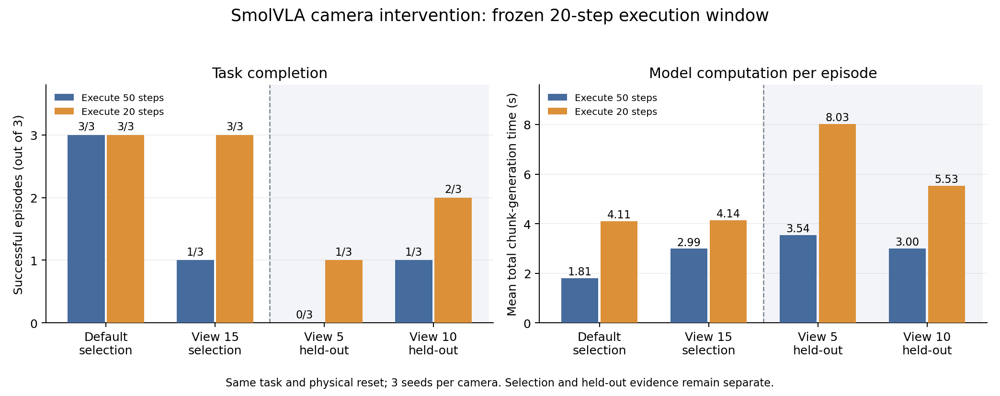
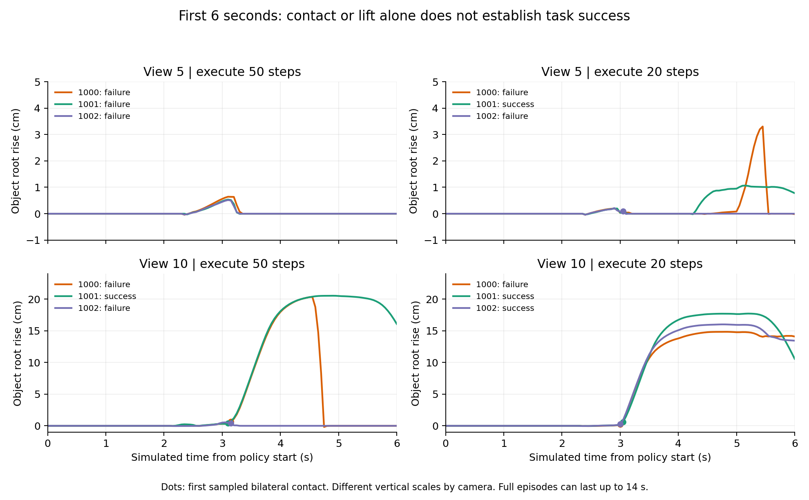

# SmolVLA 相机扰动：抓取诊断与执行窗口对照

更新：2026-11-01。状态：执行窗口实验共 30 个实际评测回合已完成（选择/预算 18 回合，保留视角 12 回合，复用不重复计数）。
Colab 断连后已从 Drive 恢复保留阶段全部原始文件，并在本地 CPU 补齐汇总；暂不安排 GPU 实验。

阅读入口：[计时、队列与仿真时间解释](timing_and_queue.md)；[六段视频人工复核与数据交叉检查](video_review_20261101.md)。

## 问题与实验范围

在一个 LIBERO-plus 任务中，相机视角改变后，SmolVLA 有时不能建立有效夹持，随后继续执行空抓放动作。
本实验检查：保持模型权重与去噪积分配置，缩短每次执行的动作前缀，能否改善这一现象，以及需要增加多少计算。

范围仅为同一任务、同一物理初始化和三个随机种子；这是机制诊断与工程对照，不是完整 benchmark 或跨任务泛化结论。
目标为 `alphabet_soup_1`，基础任务指令统一为 `pick the alphabet soup and place it in the basket`。

## 控制与复现入口

- 策略：`lerobot/smolvla_libero`，revision `a24f1f380461b665158d52acd140152c79e8b36d`。
- LIBERO-plus：`4976dc30028e805ff8094b55501d532c48fec182`，LeRobot 0.6.1，Colab T4 会话。
- 条件：基础 BDDL 默认相机、`view_15_15_100_0_0_initstate_0`；正式评测前统一语言并核对初始仿真状态。
- 设置：`chunk_size=50`、`num_steps=10`、相对控制、20 Hz；只将 `n_action_steps` 从 50 改为 10。
- 种子：1000、1001、1002。每对核对实际第一份噪声、语言 tokens/mask、初始状态与相机参数。
- 加载后核对实际策略配置和动作队列容量，避免只改了配置显示却没有改变队列行为。
- 目标位姿与接触真值仅用于诊断记录，没有添加到策略输入。
- 入口：[libero_plus_camera_check.ipynb](../../scripts/libero_plus_camera_check.ipynb) 第 11、14a、16–17 节。

原始归档：`smolvla_replan_20261031_001`（私有保存，不公开云盘链接）。
本地数据在 `outputs/smolvla_replan_20261031_001/`，其中 analysis/replanning_summary.csv 为云端汇总，
review_provenance.json 记录本轮下载的 31 份计时、配置、配对审计与汇总文件来源。

## 结果

| 相机 | 执行窗口 | 成功回合 | 每回合平均预测次数 | 每回合动作块生成总耗时均值 |
| --- | ---: | ---: | ---: | ---: |
| 默认 | 50 | 3/3 | 3.00 | 1.81 s |
| 默认 | 10 | 3/3 | 14.33 | 8.54 s |
| 默认 | 20 | 3/3 | 7.00 | 4.11 s |
| view_15 | 50 | 1/3 | 5.00 | 2.99 s |
| view_15 | 10 | 3/3 | 15.67 | 9.33 s |
| view_15 | 20 | 3/3 | 7.00 | 4.14 s |

view_15 的配对结果：seed=1000、1002 从失败变为成功，seed=1001 保持成功；默认条件三个种子均保持成功。
50→10 对照中，view_15 动作块生成总成本约增至 3.12 倍，默认条件约增至 4.73 倍。
这些是整回合成本比，回合长度不同，不能直接当作固定长度轨迹的倍率。

20 步候选的六回合全部成功。view_15 三个种子均在约 2.95 s 对应的控制区间检测到双侧接触，
最大抬升约 17.49、18.00、18.84 cm；默认三个种子的双侧接触约在 2.75 s，随后正常提起。
view_15 每回合模型生成总耗时约 4.14 s，比 10 步的 9.33 s 降低约 55.6%；默认条件降低约 51.9%。
因此选择阶段固定 20 步作为后续候选，不继续密集扫描窗口。

20 步的原始 CSV 归档：`smolvla_replan_budget_20261031_001`（私有保存）。
本地已核对六份 CSV 与 Notebook 的 12 行基线/候选记录一致，来源位于
`outputs/smolvla_replan_budget_20261031_001/csv_review_provenance.json`。
预算阶段复用 50 步结果，仅新增六回合；当前窗口实验共 18 个独立回合，不将复用结果重复计数。

view_15 /10 在首 6 秒均记录到同物理样本双侧接触，首个接触区间末时刻分别约 3.30、3.10、3.10 s，
目标 root 的最大抬升分别约 16.78、16.84、17.48 cm。
view_15 /50 的两个失败样本此前仅记录到左指接触、未记录右指接触，抬升不足 1 cm。
这支持“执行窗口改变伴随夹持建立情况改善”，尚不能识别全部内部因果机制。
抬升指标用于诊断是否拿起，不是越高越好的任务目标。

所有 6 对审计均通过。计时文件中的预测次数等于 `ceil(实际控制步数 / n_action_steps)`，说明执行窗口确实改变了重规划次数。
探测回合被后续循环复用，独立回合总数是 12，而不是把探测重复计数后的 14。

## 计算预算与实时边界

计时在 `_get_action_chunk()` 前后进行 CUDA 同步，包含该方法内准备与 GPU 计算，排除权重加载。
另外保存了包含环境创建和加载的总调用耗时，二者不混为一谈。

| 执行窗口 | 记录的动作块数 | 单块均值 | 单块 95 分位（最近次序统计量） | 最大值 | 对应仿真执行时长 |
| --- | ---: | ---: | ---: | ---: | ---: |
| 50 | 24 | 0.600 s | 0.627 s | 0.630 s | 2.5 s |
| 10 | 90 | 0.596 s | 0.631 s | 0.665 s | 0.5 s |

10 步组全部 90 次动作块生成都超过 0.5 s，因此当前设备不能以该速度稳定供给假设的连续 20 Hz 动作流。
仿真会在推理期间等待，成功回合不等于实时部署成功。
20 步组由六回合汇总得到的单块均值约 0.589 s，对应 1 s 执行窗口；本轮尚未下载该组逐块时延分布，不能填造其 95 分位。
即使 1 s 窗口大于单块推理时间，也只改善摊销吞吐预算；当前队列空后同步预测的实现仍会等待，
真正连续控制还需要异步预取和端到端时延验证。

含加载/环境创建的总调用均值在默认条件约从 57.48 s 增至 65.61 s，view_15 则从 82.31 s 降至 68.46 s。
后者包含失败超时减少的收益，不能据此声称单块推理变快或模型计算变少。

## 结论边界

可以报告：在本任务、初始化和三个种子中，缩短执行前缀改善了视角扰动下的完成情况，并增加了模型调用成本。
不能报告：普遍提升了 66.7 个百分点、修复了视觉编码器、达到 20 Hz 实时部署、发现了新算法。
相同首噪声不代表全程随机性相同；两种窗口还改变后续噪声抽样及重规划时刻，不能把收益完全归因于视觉更新频率。

## 保留视角验证：12 回合已完成，改善有限

窗口在本阶段前固定为 20 步，参考为 50 步。固定版本完整名称匹配得到 view_5 / ID 656、view_10 / ID 661，
后缀均为 `_15_100_0_0_initstate_0`；仍使用 seed=1000/1001/1002、同任务和初始化。
这两个视角没有参与窗口选择，但种子沿用，因此不是新任务、新初始化或新随机种子验证。

| 保留相机 | 50 步成功回合 | 20 步成功回合 | 50 步模型总耗时均值 | 20 步模型总耗时均值 |
| --- | ---: | ---: | ---: | ---: |
| view_5 | 0/3 | 1/3 | 3.54 s | 8.03 s |
| view_10 | 1/3 | 2/3 | 3.00 s | 5.53 s |

六对中两对从失败变成功、四对成功状态不变、没有成功变失败；合计从 1/6 变为 3/6。
view_5 的改善来自 seed=1001；view_10 的改善来自 seed=1002。
这批结果支持有限改善，同时表明 20 步并未解决所有相机条件下的失败。样本很少，不声称统计显著或普遍泛化。
整回合模型总成本分别约为原来的 2.26 倍和 1.84 倍；这些成本仍受成功/失败回合长度影响。

原始归档：`smolvla_heldout_camera_20261031_001`（私有保存）。
本地完整恢复 151 个来源文件，共 1,462,241 bytes，含 12 段原始视频；来源、长度与本地 SHA256 记录于
`outputs/smolvla_heldout_camera_20261031_001/recovery_provenance.json`。
核对了正式 eval_info、evaluation_returned、实际配置、预测次数、初始条件与语言；并从原始 Tensor 重新核验六对状态、首噪声、语言与相机的一致性。

第 19c 节的回合均已归档；19d 没有保存执行输出，云盘也未发现该阶段的 analysis 目录。
本轮仅在本地 CPU 生成最终 CSV 与验收 JSON，没有重跑模型或环境，也没有伪造 Notebook 的执行记录。
公开的 [逐回合 CSV](results/20261031/execution_window_trials.csv) 包含全部30回合及阶段字段；
[来源与文件哈希](results/20261031/manifest.json)用于复核，完整原始验收记录留在本地归档。

### 需要修正的失败认识

- **view_10 /1000：两种窗口最终均失败，但都曾明显抬升。** 50 步在约 4.55 s 抬升至 20.33 cm，约 4.75 s 降回距初始高度不足 2 cm；
  同时失去双侧接触，符合抓起后掉落的记录。20 步首六秒最大抬升 14.84 cm、六秒时仍约 14.10 cm，但最终仍未完成。
  不能继续把这两例统一标成“首次没有抓起来”；20 步回合的后续失效时刻需结合完整视频确认。
- **view_5 /1001、20 步：首六秒未采到双侧接触，最终却成功。** 回合实际执行 245 步、约 12.25 s；
  前六秒采集窗口不足以判断后续重试及全程夹持，空值不是“整回合没有接触”。
- **view_5 /1002、20 步：约 3.05 s 采到双侧接触，但最大抬升仅 0.21 cm，最终失败。** 单次双侧接触不能替代稳定抓取判据。

## 当前停点与下一步：只做离线复核

1. **保留本轮结果，停止继续选择窗口。** 20 步是部分缓解，尚未训练或微调视觉模型，也未证明全部失败的内部根因。
2. **六段人工复核已补齐。** 已区分初始夹持失败、抓起后掉落、搬运中失去夹持和一次晚期恢复成功。
   view_10 /1000 /20 在约5.55s出现接触改变及相对位移；疑似碰篮仍是视觉假设，未测篮子接触。
   首六秒动作/物理记录可以定量核对，六秒之后主要依赖视频，不能补造未采集的接触真值。
3. **用半自动筛查继续收敛问题。** 已提供 CPU 事件筛选与关键帧工具，由助手先初判、人工核对不确定处；
   不再要求从头口述整段视频。最新进展见 [2026-11-01 进展说明](progress_20261101.md)，恢复背景见 [离线交接记录](offline_handoff_20261031.md)。
   当前不连接 GPU、不重新安装环境、不追加窗口扫描。
