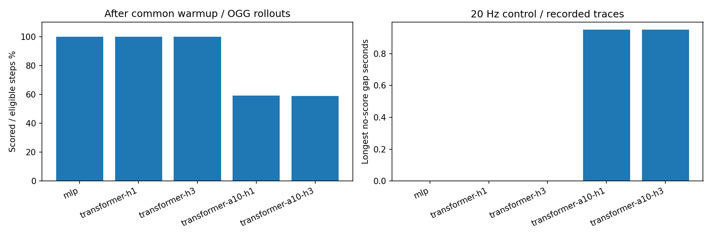

# SmolVLA相机扰动、执行窗口与视觉偏离监控研究报告

更新：2026-11-11。持续维护的研究证据与项目材料，尚不是简历或完整论文复现报告。行动安排统一见[工作日志](work_log.md)。

## 项目摘要与当前状态

研究问题：相机视角变化后，冻结的SmolVLA可能抓空、夹持不稳或掉落，随后继续执行未完成任务的动作。
先建立控制输入与计算成本的对照，再研究能否根据视觉变化预测误差，提前截断无效动作并恢复任务。

### 最新审计结果：2026-11-11（15组训练、1200回合原始记录已取回）

以只读SSH导出两目录的真实指标/逐步trace，本地核验并复算15/15训练、五组paired各240回合，程序错误0；15个forced_check排除。best实际SHA、重载结果、保存划分索引、共同锚点、计划/逐回合计数和引导次数一致。基础策略/库版本见下方与[来源证明](results/20261111/provenance.json)。[完整审计](results/20261111/RESULTS.md)、[数值摘要](results/20261111/summary.json)、[训练运行CSV](results/20261111/training_runs.csv)。

| 配置 | 3种子验证MSE均值±样本SD | cosine均值±样本SD | 每组已完成epoch计算均值 |
| --- | ---: | ---: | ---: |
| MLP H1+A1 | 4.0316 ± 0.0149 | 0.8020 ± 0.0012 | 44.18分钟 |
| Transformer H1+A1 | 3.8817 ± 0.0186 | 0.8112 ± 0.0016 | 251.07分钟 |
| Transformer H3+A1 | 3.9051 ± 0.0263 | 0.8100 ± 0.0010 | 266.34分钟 |
| Transformer H1+A10 | 3.6315 ± 0.0134 | 0.8224 ± 0.0013 | 47.02分钟 |
| Transformer H3+A10 | 3.6627 ± 0.0197 | 0.8214 ± 0.0015 | 97.26分钟 |

上述验证参与best选优，3个种子共享同一364/90轨迹划分与49447/12089样本。参数量MLP38,052,800、Transformer37,316,544、A10为37,324,224；全组BF16预测器、有效batch512，单动作Transformer micro8、A10 micro64，训练速度差异不能只归于架构。

| 配置 | LVM成功 | 完整OGG成功 | OGG打分覆盖率 | OGG块调用/回合 | OGG墙钟秒/回合 |
| --- | ---: | ---: | ---: | ---: | ---: |
| MLP H1+A1 | 55/60 | 55/60（91.67%） | 100.00% | 4.600 | 11.729 |
| Transformer H1+A1 | 55/60 | 55/60（91.67%） | 100.00% | 4.867 | 12.075 |
| Transformer H3+A1 | 56/60 | 56/60（93.33%） | 100.00% | 5.300 | 12.257 |
| Transformer H1+A10 | 50/60 | 50/60（83.33%） | 59.02% | 4.083 | 12.328 |
| Transformer H3+A10 | 51/60 | 51/60（85.00%） | 58.87% | 4.033 | 11.556 |

共同H50=44/60、H20=51/60；每模型只评训练seed42。H50/H20跨五组逐场景成败相同但不合并独立样本。各组LVM/OGG逐场景成败也相同，因此当前收益主要由检测/事件重规划支持，没有观察到OGG的额外终点成功收益；有实际引导调用与部分轨迹步数变化，不能说OGG没运行。单动作H3比其余单动作多1次成功，不构成稳定结构优势。

**已确认的机制瓶颈是监测覆盖。** 排除共同预热后，A10-H1为4873/8256=59.02%，A10-H3为4787/8131=58.87%；单动作三配置100%。两组A10的每个回合都出现最长19控制步（0.95秒）的无评分段。完整计划长度要求、块尾跳过和换计划撤销解释了空窗的形成；这不是将skip/cancel百分比相加推算。四个coverage告警（A10×LVM/OGG）是机制发现，数值/协议一致性错误为0。见[覆盖率CSV](results/20261111/monitor_coverage.csv)、[跨模型退化案例/失败视频路径](results/20261111/cross_model_regression_reviews.json)。视频本体仍在远端，未据此编造抓取失败标签。

**训练—部署动作分布偏移是独立待验证假设。** 离线A10条件含后续实际示范控制指令，可能带有后续反馈信息；部署用当前候选计划，后续可能被替换。单动作也有示范→VLA行为差异，A10进一步增加未来条件/有效性问题。已有的有效评分窗口中，A10在线cos并不更低；它们又只覆盖选择后的约59%时刻。norm/cos重建的在线MSE、残差幅度和状态分布也不同，不能单凭离线更低/闭环更差证明动作分布导致预测退化。需要共同轨迹/共同窗口的计划与实际动作条件比较。

**下一项实验设计（尚未实现）。** 先固定A10-H1 seed42，将LVM改为到期时使用origin=s−20的视觉及已执行动作origin+[0,2,…,18]补全条件，目标仍为1秒残差；当前观测只用于计算误差，不进入origin预测输入。验证评分覆盖是否恢复，再对相同60场景跑被动monitor/LVM与原planned模式配对；被动monitor应保持H50行为。该方案是回顾一致性监测的调度改动，不宣称提前预测，也不自动解决专家/策略动作分布偏移。之后增加OGG梯度/动作扰动量、eta0等价检查；必要时采集确实执行过策略动作的仿真特征训练，保留独立评测初始化。未执行的VLA候选计划不能直接与专家未来图像配成真实动作后果标签。

本轮研究贡献是完整可复算流程、三种子对照和从实际trace定位覆盖瓶颈；覆盖修复与进一步性能提升仍为后续计划。具体时间线、数学索引、统计边界与操作统一见[工作日志](work_log.md)。本轮未清理远程数据、未启动新训练/仿真。

前期基础（截至11月8日）：30回合执行窗口实验、物理事件/关键帧诊断、真实T4 LoRA五步训练与保存重载、独立轨迹离线动作评分、CPU预测器训练实践，以及单任务44条示范/6867帧的38,052,800参数Corrector训练。该训练按episode划分35训练/9验证，早停于27epoch，best验证残差余弦0.778118、MSE8.02612（零预测11.43089）；不是独立测试成绩。
11月9日首轮Object10 MLP：AutoDL4090完成十任务454条示范/66984帧的数据准备与共享Corrector训练。364条轨迹参与梯度训练（50175时序对），90条仅验证（12269对），无episode交叉。训练50轮、4900次更新后早停，最佳权重来自第45轮；逐轮训练/验证计算合计2954.294秒（49.24分钟），平均59.09秒/轮，Torch分配显存峰值1.312GiB。数值报告验证残差cosine=0.804360、MSE=3.995916，对比零预测11.585702、训练均值基线11.375277，MSE分别降低约65.51%和64.87%。这些是参与选优的开发验证成绩，不是独立test或论文复现分数。

11月9日首轮best完整SHA为`ac82257d743645b745f85846ccea236c869dcc5440171f7d289f33b472bf1ba3`。补图解释器错误已恢复，10回合自然预检通过程序检查，正式Object10十任务配对评测已全部完成：300/300，错误0，用时51.06分钟；完整Corrector为55/60成功，H50为44/60，H20为51/60。旧单任务best的2394回合历史结果单独保留，不与新模型/新任务范围混合汇总。用户回传的短摘要已存为[预测器证据](results/20261109/object10_predictor_summary.json)，原始远端文件与图像仍待取回核验。

项目使用模拟器；没有真机部署、完整benchmark、论文发表或新算法成果。

### 当前主实验的策略与参数版本

以下固定ID/revision已与项目评测及特征提取入口源码核对；旧远端试验的原始plan.json、actual_protocol.json仍需取回归档，不能把本地新修改的源码哈希冒充昨夜执行版本。

| 项目                | 当前主实验设置与版本                                                                                                                                 |
| ------------------- | ---------------------------------------------------------------------------------------------------------------------------------------------------- |
| 冻结基础策略        | `lerobot/smolvla_libero`，revision `a24f1f380461b665158d52acd140152c79e8b36d`                                                                    |
| 策略实现            | LeRobot 0.6.1，Git `7e241bd630a3719a56157a497ce5d08f244784f1`                                                                                      |
| Corrector方法源码   | `ZJU-OmniAI/vla-corrector`，Git `927a06da8f00d7df483459e9039219e076c846de`                                                                       |
| 当前Corrector       | 四块2048宽MLP，38,052,800参数；Object10共享预测器，best第45轮；SHA256 `ac82257d743645b745f85846ccea236c869dcc5440171f7d289f33b472bf1ba3`           |
| 历史单任务Corrector | 44轨迹训练的best，SHA256 `19f73f07cc75a32500aaaeb6f059f30b11ce8cc5b3626eff84a33f4b8ca7492c`；旧闭环结果单独保留                                    |
| 特征与示范来源      | `HuggingFaceVLA/libero`，revision `86958911c0f959db2bbbdb107eb3e17c5f9c798e`；与基础策略一致的冻结SmolVLA视觉空间与checkpoint预处理器            |
| 原始仿真            | LIBERO Git `8f1084e3132a39270c3a13ebe37270a43ece2a01`；当前`libero_object`全部10任务；先前单任务为task_0，对应示范数据task24；两种ID不可直接混用 |
| 基础策略生成参数    | `chunk_size=50`、Flow Matching `num_steps=10`；7维有效动作、内部补齐至32维；先前实际配置记录为双相机、512×512填充缩放                           |
| 执行与预测跨度      | 20Hz环境；Corrector训练10FPS、k10=1秒，在线监控跨度20个控制步                                                                                        |
| 执行窗口            | H50=50；H20=20；monitor/LVM/OGG最大队列50，事件方法可提前截断                                                                                        |
| OGG/监测部署口径    | 同步监测；stride1、eta1、每3个去噪步引导，cooldown0；为本次适配配置，不与论文全部部署参数及异步执行机制画等号                                        |
| 参数更新边界        | 闭环中SmolVLA和Corrector均冻结；OGG对动作相关输入求梯度，不更新网络权重                                                                              |
| 精度与运行库证据    | 不用单个参数dtype代表全模型。本批runtime确认Torch2.11.0+cu128/CUDA构建12.8、Transformers5.5.4、MuJoCo3.7.0、robosuite1.4.1；逐模块dtype尚未独立审计，nvidia-smi支持上限不当作Torch CUDA版本                 |

之前的LoRA能力练习使用`smolvla_base`，单独记录，不将其权重或训练成绩混入本次`smolvla_libero`基线。以后更换Corrector的训练范围/权重时须使用新输出目录与相应权重SHA，基础策略保持固定，从而明确比较对象。

### Object10预测器初步训练协议与论文差异（2026-11-09，原30轮方案，尚未启动）

本轮是公开方法在冻结`smolvla_libero`和LIBERO Object十任务上的适配，不是论文全部benchmark或原始分数的等价复现。四块2048宽残差MLP、AdamW学习率3e-4/权重衰减1e-4、余弦调度最低学习率3e-6、最多30epoch/早停5，以及部署版本的cosine损失与论文附录C.2/C.3对齐。38,052,800参数位于论文说明的约38～42M范围内，未为CPU练习而缩小模型。[论文训练细节](https://arxiv.org/html/2607.01804v2)。

| 设置          | 本轮拟用协议                                                                                 | 差异与原因                                                                                                                 |
| ------------- | -------------------------------------------------------------------------------------------- | -------------------------------------------------------------------------------------------------------------------------- |
| 数据与基础VLA | Object十任务454轨迹/66984帧；一个共享Corrector；固定公开SmolVLA权重                          | 在50GiB数据盘内先完成完整套件；不对应论文以π0.5为主的全部任务与训练来源                                                   |
| 数据划分      | episode级364训练/90验证，k10产生50175/12269样本对                                            | 保留已冻结的80/20开发协议；论文数据比例研究为80/10/10，本轮没有独立预测器test，验证选优结果不能写成test成绩                |
| 批量          | 微批32×梯度累积16，名义有效批512                                                            | 对齐论文部署版本标注的512并适应24GB显存；不是一次前向512，浮点累加顺序不同；作者实际多卡启动细节不能从批量标注反推         |
| 训练历史      | 旧单任务T4模型微批8×累积4；新的Object10实验从头训练MLP                                      | 旧模型有效批32、数据范围不同，不将新训练描述为旧checkpoint的精确续训                                                       |
| 特征与动作    | 上游视觉提取/量化实现；视觉BF16，缓存int8及FP16尺度，MLP训练FP32；动作使用固定策略的预处理器 | 保持离线训练和在线输入空间一致；不是照搬其他backbone的动作归一化。论文未明确全部训练精度，不能声称精度完全相同或已证实不同 |
| 硬件与恢复    | 单4090 24GB、16vCPU、120GB RAM；每完整epoch保存latest、验证改善更新best、每5轮快照           | 论文报告8卡A100服务器；本项目增加断连恢复和归档，不据此承诺相同训练耗时或任意batch无损续训                                 |

本轮三轨迹测速来自用户回传`stream_report.json`：北京时间11:16:00启动，463.943秒完成；三个分片合计288114375字节、下载426.230秒（约占91.9%），平均0.645MiB/s。其余37.713秒包含编码器初始化、解码、提取、校验及归档，不能全计为视觉GPU耗时。每帧实际视觉输出为128×960。仅据此可判断本次准备主要受下载限制，不能推断4090训练速度；原始远端报告仍待取回归档。

### 首轮无人值守训练队列的配置（2026-11-09，训练与300回合评测均已结束）

为解决数据未到齐时用户需离开的问题，已准备完整特征门槛、可恢复训练、GPU批量预测报告和最终best的有限多任务配对评测队列。Object10训练、数值报告及300回合闭环指标已回传并归档；下方保留该轮启动配置。具体启动/暂停操作统一见工作日志。

队列默认采用固定上游`siglip_dynamics/train.py`基础CLI的150epoch、早停5和`both=MSE+cosine`；此前30epoch/cosine配置来自另一部署式方案，二者需要区分。模型结构、数据范围、k10、优化器不变，微批32/有效批512、episode 80/20开发划分仍为本项目适配。新配置独立输出，训练预算4h/后续仿真2h、总计算预算6h（完整epoch/回合边界暂停，数据等待另计），不承诺训练满150轮或达到原论文数值。只保存少量快照，默认每25轮；最终选择验证best进行评测。若训练预算先耗尽，报告会标记使用当前已验证best及实际训练轮数。

离线增加原指标的CUDA批量计算、各任务cosine/MSE及零预测/训练均值基线图。闭环计划为10回合自然事件预检后，十任务×3真实初始化×2seed×5方法=300正式回合；原始视频/触发/耗时与逐回合恢复保留。套件内配对结果与跨任务泛化、同步监控计时与论文异步等待延迟分别解释，不混为一个结论。

### Object10最终300回合结果（2026-11-09，用户回传已完成）

[最终证据](results/20261109/object10_paired_final.json)与[总体CSV](results/20261109/object10_paired_final_overall.csv)来自用户贴回的execution.json/overall.csv，原始逐回合文件和视频尚未取回。status=completed、planned=completed=300、errors=0、reason=all_planned_trials_completed，wall_seconds=3063.713（51.062分钟）。

| 条件 | 成功/回合 | 成功率 | 平均动作块调用 | 平均策略秒 | 平均监测秒 | 平均回合墙钟秒 |
| --- | --- | --- | --- | --- | --- | --- |
| H50 | 44/60 | 73.33% | 3.833 | 0.824 | 0 | 8.260 |
| H20 | 51/60 | 85.00% | 8.267 | 1.764 | 0 | 8.497 |
| monitor | 44/60 | 73.33% | 3.833 | 0.920 | 3.699 | 11.826 |
| lvm | 54/60 | 90.00% | 4.867 | 1.165 | 3.273 | 11.235 |
| ogg（完整功能组合） | 55/60 | 91.67% | 4.817 | 1.199 | 3.248 | 11.186 |

完整Corrector相对H50增加18.33个百分点（净11回合），相对H20增加6.67个百分点（净4回合），动作块调用比H20少41.73%；但回合墙钟耗时比H20高31.64%，不能宣称端到端加速。OGG相对仅LVM多1个成功回合（1.67个百分点），单这一净差不足以证明OGG独立贡献稳定。用户随后回传的60组配对审计显示：相对H50新增成功11、反向损失0；相对H20新增5、反向损失1；相对LVM新增1、反向损失0。当前OGG增量证据仍有限，后续先定位这1组及5组共同失败案例，不用总成功率差替代机制分析。上述为原始Object10套件内成绩，不是LIBERO-plus相机扰动改善或全论文复现。

#### 监测时间口径

3.247956秒是平均每回合累计监测时间，平均151.5667控制步、stride1，二者相除约21.429毫秒/控制步。这个是总时间/总步数口径，不是单次p95或纯GPU kernel事件计时。当前同步实现每次观察调用两相机视觉编码、MLP、误差/阈值，并在计时边界做CUDA同步；OGG损失/输入梯度主要计入触发策略调用时间。尚无分组件GPU profile，不能宣称视觉编码占某个实测比例。

论文D.5/D.6报告每次完整LVM计算26.96ms、p95 27.57ms，异步重叠后暴露给控制器的平均等待0.008ms；二者含义不同。我们累计回合计算时间与论文异步暴露等待不能直接比较。相同量级的单次计算不支持“4090本身慢到引入数秒单次延迟”的解释；不同backbone/任务/硬件也不支持直接宣称本实现更快。论文OGG计时每次恢复用2个引导步骤，本轮去噪10步、每3步引导（0/3/6/9，共4次），也需保留协议差异。[论文D.5/D.6](https://arxiv.org/html/2607.01804v2#A4.SS5)。

#### 时间基准核对与待核实项

1. 当前数据卡声明10FPS，本地3条缓存timestamp差约0.1秒，k10时间差约1秒。训练保存prediction_seconds=k_step/fps=1。
2. 原部署包online runtime与本地代码一致，使用round(prediction_seconds*fps)得到20步；到期队列以step+20登记。新增CPU检查明确验证前20次观测不产生偏离分数，step20才出现首个分数。没有发现“直接在线用k10只等0.5秒”的该项代码错误。
3. **原始采集物理时钟/格式转换是否降采样尚未核实**。数据卡不提供转换链路；时间戳可能由转换程序生成，不能仅以timestamp宣称原始物理跨度已被证明。若20Hz原数据每隔一帧保留为10FPS，1秒跨度成立；若未降采样只改元信息，则需要重新判断。当前不能断定发生后一种错误，也不能把这项不确定性略去。
4. 记录为“数据/控制频率不同、声明跨度换算已处理、原采集物理基准未完全核实”。五条件均在相同20Hz仿真运行，所以保留其当前协议下实测结果，但不冒充严格时钟匹配或原论文等价复现。不能为让数值一致就直接把仿真改成10Hz，实际控制周期会改变。
5. 用户已回传独立只读corrector_temporal_audit.py的真实结果：454/454条特征、300/300回合，错误0；存储帧间隔范围0.099999905～0.100000381秒，全部跨度记录为10FPS/k10/1秒/20Hz/20步，首次打分均为step20。它确认保存的时间基准与在线队列换算一致，不验证采集物理时钟或重跑物理。[审计结果](results/20261109/temporal_audit_returned.json)、[时间基准证据](results/20261109/dataset_timebase_evidence.json)。

### 五种评测条件与135回合中途快照（2026-11-09）

此前CSV使用实现键而没有解释组合，容易误以为只测试单模块。`ogg`实际是当前**完整Corrector功能组合**，含预测器、LVM偏离检测、清空动作队列/事件重规划和OGG恢复引导。当前适配采用同步监测，不能据此声称论文异步执行及所有参数细节已等价复现。主比较是H50/H20与完整Corrector，另外两组用于诊断模块与耗时来源；不修改正在运行的冻结计划或原CSV方法键。

| 冻结方法键 | 预测与LVM打分 | 事件中止/重规划      | OGG引导 | 含义                        |
| ---------- | ------------- | -------------------- | ------- | --------------------------- |
| H50        | 无            | 无，固定50步执行前缀 | 无      | 长窗口基础策略              |
| H20        | 无            | 无，固定20步执行前缀 | 无      | 更频繁更新观测的参照        |
| monitor    | 有            | 无                   | 无      | 只监测记录，保持H50动作机制 |
| lvm        | 有            | 有                   | 无      | 检测后普通重规划            |
| ogg        | 有            | 有                   | 有      | 完整Corrector适配版本       |

用户回传execution.json：running，started_utc=2026-11-09T11:20:58.852087+00:00（北京时间19:20:58），1418.735秒内完成135/300，错误0。paired.log的280/280与eval batch 1/1只表示其中一次单回合调用结束，不能表示整个300回合队列完成；该进度条的0%也不是全队列成功率。中途统计见[135回合证据](results/20261109/object10_paired_progress_135.json)。

| 方法        | 已完成/计划 | 成功数 | 中途成功率 | 平均动作块调用 | 平均策略秒 | 平均监测秒 | 平均回合墙钟秒 |
| ----------- | ----------- | ------ | ---------- | -------------- | ---------- | ---------- | -------------- |
| H50         | 27/60       | 18     | 66.67%     | 4.000          | 0.868      | 0          | 8.963          |
| H20         | 27/60       | 24     | 88.89%     | 7.667          | 1.636      | 0          | 8.213          |
| monitor     | 27/60       | 18     | 66.67%     | 4.000          | 0.960      | 3.844      | 12.304         |
| lvm         | 27/60       | 23     | 85.19%     | 5.259          | 1.264      | 3.353      | 11.635         |
| ogg（完整） | 27/60       | 24     | 88.89%     | 5.148          | 1.289      | 3.257      | 11.392         |

本快照完整Corrector与H20成功数相同，平均块调用减少32.85%，策略计时降低21.24%，但回合墙钟时间增加38.71%。OGG的策略加监测约4.546秒，不能仅以策略计时声称整体加速。H50与被动monitor聚合成功数和步数一致，与不改变动作的设计相符，但聚合相同不能代替逐回合核验。不同方法成功的具体回合是否相同、配对得失、按任务差异尚待完整记录。按当前平均吞吐外推剩余约28.9分钟只是粗估，后面任务难度与回合长度可能变化。

### Object10数据与结果解释边界（2026-11-09 19:22）

十任务共享“抓起指定物体并放入篮子”的动作结构，目标分别为橙汁、番茄酱、奶油奶酪、烧烤酱、字母汤、牛奶、沙拉酱、黄油、番茄沙司、巧克力布丁。按数据task20～29冻结，454条轨迹不是454种任务；详情见[任务范围](results/20261109/object10_task_scope.json)。训练学习一个共享预测器，不是每个物体单独训练一个。基础SmolVLA保持冻结。

闭环范围是同一个Object10套件，仿真task0～9、初始化0/1/2、种子1000/1001和5方法，共300回合（每方法60回合，每任务每方法6回合）。这是从当前观测生成动作的完整仿真执行，不是回放原示范，也不是全部40任务、LIBERO全benchmark或LIBERO-plus视角测试。程序预检通过不代表任务成功率100%；正式完成与成功率以execution.json和analysis/overall.csv为准。

新模型MSE与旧单任务模型MSE来自不同验证分布，不能直接把二者的差值归因于扩大数据；当前与零/训练均值基线的比较使用同一12269对验证样本。提高预测器cosine也不保证LVM触发更准确或OGG任务成功率更高，须以当前配对结果验证。

下一步先复用现有特征考察架构/历史输入，不为填满GPU时长立即扩大原始数据。固定上游已包含SiglipResidualTransformer及h_window数据支持，启用它们是对照/复现，不单独算新算法。当地新增训练入口、报告、在线历史队列都需要明确支持新模型，不能只改一个CLI参数。多帧历史在10FPS训练和20Hz仿真中保持物理间隔一致；多动作OGG则需要动作片段条件预测或一致的滚动目标，不能把单动作梯度直接复制到整块。

### 2026-11-09晚：Transformer与历史输入对照（实现完成，远端GPU尚未启动）

新增生产工厂`corrector_models.py`和可中断队列`corrector_night_sweep.py`；训练、离线报告、在线历史队列与OGG均按保存协议选择MLP或Transformer。正式Transformer直接复用固定上游`transformer.py`，不是将未完成练习作为正式算法，也不将启用已有架构表述为新方法。原MLP默认入口及旧模型仍保留；`temporal_practice.py`的学习TODO保持原样。

| 对照项 | 今晚冻结设置 | 目的/与已有实验的区别 |
| --- | --- | --- |
| MLP H1 | 4×2048残差块、38,052,800参数 | 生产默认仍可选MLP；本次另起输出，旧FP32实验不覆盖 |
| Transformer H1/H3 | token维960→模型维768、12头、5层、37,316,544参数 | 直接使用上游实现；上游默认4层，本次5层用于接近MLP参数预算，并非论文指定的唯一结构 |
| 输入/标签 | H1或H3视觉历史＋当前7D动作，输出当前到k10的视觉残差 | 复用454条量化缓存，不再下载或提取；不输入未来图像/动作 |
| 共同锚点 | 全组仅保留t≥2的锚点，train49,447对/val12,089对 | H1/H3使用相同当前/未来样本；按episode划分仍364/90，属于开发验证 |
| 历史时距 | 训练H3=t−2,t−1,t（间隔0.1秒）；在线H3=t−4,t−2,t | 控制20Hz下每隔2步取一帧；全组共同预热4步，最早score=24，预测跨度仍20步/1秒；旧实验最早score20不变 |
| 预测器精度 | CUDA BF16 autocast，权重/AdamW状态与输出loss仍FP32 | 充分使用4090矩阵算力；所有新对照同设置，基础VLA精度不改。不是旧实验仅换seed的严格重复 |
| 更新 | 有效batch512；MLP从micro32、Transformer从micro8做真实缓存探测，探测OOM才减小micro并补累积 | 不因探测修改模型结构或覆盖正式运行；DataLoader根据共享内存选择2/0 workers |
| 预算/选优 | 每组150轮上限、早停5、AdamW3e−4/wd1e−4、both、seed42/43/44 | 共9次训练；每完整epoch保存含优化器/调度/RNG的latest，验证改善更新best，默认不额外存快照，可显式配置 |
| 评估 | 每份best离线数值与图＋一次强制OGG调用检查；训练seed42的3种架构各240正式回合 | 正式为10任务×3初始化×2执行seed×H50/H20/LVM/完整OGG，共720回合计划；强制检查不算正式成功率 |

采用12小时单次队列预算，在完整epoch/回合边界保存暂停，同命令可继续；若有限任务提前完成则正常退出，不循环空耗或自动关机。全流程强制离线，使用现有venv/sim-venv与模型缓存；图由有matplotlib的sim环境生成。代码/参数/数据计划冻结，相同输出拒绝混用不同设置。CPU回归129项通过，包含Transformer训练/精确恢复、权重重载、历史对齐、报告和OGG输入梯度；部署包SHA/AST及独立CLI也校验。**这不是4090实测速度/精度或新成功率**，首批真实探测与首轮日志仍需用户启动后确认。

今晚固定LVM阈值和首动作OGG，先隔离预测器架构/历史输入的影响。后续若离线改善未传递到闭环，再研究阈值校准、异步执行或多动作引导；不预先保证Transformer更优。

### 2026-11-09后续：动作序列条件扩展与冻结队列交接（本地验证，远端新实验待启动）

用户回传当前Transformer H1真实4090训练进度：完成15轮/1455次更新，第14→15轮验证loss4.76079→4.69808、MSE4.53440→4.47512、cosine约0.77361→0.77704，每轮约263秒。真实micro8探测通过，峰值Torch显存0.731GiB并完成OGG输入梯度检查；这些是中途开发验证，不是最终最优或闭环成绩。[运行快照](results/20261109/transformer_h1_progress_15.json)。此前“尚未在GPU启动”的条目保留为部署当时状态。

新增可选`transformer-action`，与`mlp`、单动作`transformer`并存；H1只用当前帧，H3含最近两帧和当前帧。当前帧本来已包含在H3中，并不额外重复编码。视觉分支沿用5层/768维/12头上游Transformer；用10个带可学习动作时间位置的token替换单动作token，参数37,324,224（比原Transformer增加7,680）。标签仍是z[t+10]−z[t]，不重新提视觉特征。

训练条件取同一示范轨迹的标准化动作a[t:t+10]，不取t+10之后的动作，不输入未来图像，保持原共同锚点及episode划分。在线条件取当前策略已生成、尚未执行动作计划的控制偏移0/2/…/18，对齐声明10FPS与20Hz控制；原始采集物理时钟的不确定性仍然存在。10Hz动作子采样不包含所有20Hz中间动作，属于条件近似，不能声称严格动力学积分。更重要的是**示范已执行动作与策略候选动作存在分布差异**：离线使用后续已执行动作作为条件是合法的条件预测评估，但信息比单动作基线更多，较低离线loss不能直接证明在线鲁棒性提升，也不是部署时可获得的未来真值。

在线只在剩余规划足够时建立预测，不补零、重复动作或提前改VLA行为。动作队列被事件中止或新规划替换时，撤销仍依赖旧计划的待验证预测，避免把条件已失效当成模型偏离；跳过/撤销数量保存到trace、逐回合结果和汇总。序列版OGG对本次生成块上述10个动作位置的前7维求梯度，其他动作位置/维度保持不变，固定视觉历史和纠偏目标。它因此同时改变了预测条件与OGG可引导范围；不能将闭环差值全部归因于Transformer架构。保留LVM与完整OGG对照，后续可单独研究引导范围。

后续默认H1+10动作、H3+10动作各seed42/43/44，共6次；各best生成离线报告和强制OGG调用检查，seed42两模型各240正式回合，共480回合计划。新模型从micro64做真实GPU前/后向与OGG探测，OOM时下降32/16/…/1，有效batch保持512；用实际共享内存决定DataLoader worker，不改旧任务资源配置。所有新权重仍best/latest，完整epoch恢复，默认不额外快照。

用户明确选择先完成原9组全部任务。独立标准库`corrector_followup_queue.py`先等待原父/子进程退出，原队列因12h正常暂停时重建原`sweep_plan.json`的CLI，并校验原部署源码SHA，用原`night-code-1e80242789`继续余项；不使用新工厂加载旧checkpoint，不覆盖原冻结代码。程序错误或非本调度器创建的STOP会暂停保留现场。原9组逐任务完成标记和总状态确认后，才启动新动作序列队列。默认20h墙钟预算包含等待与原队列续跑，可能在新实验开始前耗尽，不能承诺15次训练在20h内全部完成；同命令可继续下一段预算。保存至少5GiB余量，容量不足则暂停，不删缓存或自动扩容/关机。

本地CPU完整回归140项通过（含原MLP/单动作Transformer、序列训练精确恢复/重载/报告、规划取样/取消/多动作OGG、冻结队列交接与预算），部署包源码SHA/AST/CLI校验通过。新动作序列版GPU及真实闭环尚未运行。练习文件不自动补答案，原运行中代码/模型和原部署ZIP均保持原样。

### 2026-11-09 23:18：36h可恢复计算与追加初始化验证（计划，尚无新增结果）

原9组与后续6组仍按冻结优先级执行。新增独立监督器延续已有队列，持久36h截止时间、双盘容量监测、只对已完成任务latest做SHA校验后的无损系统盘归档和原路径链接，保留完整续训状态；不新增数据、训练架构或计费资源。9项监督器本地检查及部署包校验通过，远端待启动。操作/恢复/备份要求统一在[工作日志](work_log.md)。

若15组与原有限闭环提前完成，固定MLP及两个预测器族各自按seed42开发MSE选一个模型，用原冻结代码评测Object10初始化3～9、seed1000/1001与H50/H20/LVM/完整OGG，共3×560=1680追加回合。开发集选优在新评测前冻结，追加回合独立保存并统计配对救回/损失及成本；McNemar仅探索性未校正统计，重复seed/初始化的相关性仍存在。这是同套件初始化覆盖扩展，不是未见任务或相机域外测试；不能将动作序列条件更多带来的效果只归因于架构。计划未执行，不能用于简历成绩或论文结论。

### 2026-11-10：描述符额度导致的数据加载中断（恢复待远端验证）

原队列在H1 seed43恢复加载454条轨迹的mmap时遭遇Errno24，前序环境检查遗漏RLIMIT_NOFILE；其后两层调度器停止，不能当作36h计划完成或训练损坏。新增标准库恢复入口提高并验证子进程NOFILE继承，先备份错误记录和校验冻结代码、完整latest，再恢复原监督链；不改变训练数学/数据/权重/总截止时间。7项本地恢复与继承测试通过，远端待执行。RAM读数约960GiB属于宿主可见口径，仍不能当容器120GB额度使用；详见工作日志。

## 1．问题、假设与动机

观察到的问题分为首次夹持失败、抓起后掉落、搬运中失去夹持，以及失败后仍反复抓放空气。
图像中夹爪与目标重叠不能证明三维接触；单次双侧接触不能证明稳定抓取。

| 假设                                     | 实验如何检验                                     | 当前结论                           |
| ---------------------------------------- | ------------------------------------------------ | ---------------------------------- |
| 长动作执行窗口可能延迟利用新观测纠错     | 固定策略，比较执行前缀H50/H10/H20                | 部分视角改善，同时模型调用成本增加 |
| 更短窗口能解决全部视角失败               | 固定H20后检查原保留视角view_5/view_10            | 不成立；仍有首次失败和掉落         |
| 动作条件的视觉变化预测可以提供偏离线索   | 按轨迹训练预测器，独立轨迹验证，再在线只监控     | 待验证                             |
| 事件重规划比固定窗口更好地平衡恢复与计算 | 同场景配对比较H50/H20/事件触发，记录成功与总成本 | 待实现、待验证                     |

以上不是已证明的内部因果解释。相机域外输入也可能使监控器误报，并使重新规划继续抓空。

## 2．实现与个人工作边界

| 部分            | 本项目工作                                           | 来源与实现归属                                                                                        |
| --------------- | ---------------------------------------------------- | ----------------------------------------------------------------------------------------------------- |
| 策略与仿真      | 加载、输入对齐、Trace、配对运行与记录                | SmolVLA/LeRobot/LIBERO/Plus来自上游；不是自研模型                                                     |
| 诊断与对照      | 语言、初始状态、首噪声核验；执行窗口、接触与抬升分析 | 项目实验；用户实际GPU执行和视频复核，助手辅助工程与分析                                               |
| 基础代码实践    | Tensor bool统计、事件/位姿诊断函数、参数统计         | 用户实现，结合代码审查完善                                                                            |
| 训练和评分      | train_one_batch、masked_action_mae                   | 用户亲写核心；助手提供环境、调用、边界检查和归档                                                      |
| Corrector重实现 | 配对→特征缓存→预测器→损失→监控→重规划→OGG      | 用户配对循环已完成并通过真实数据；助手补类型/连续性防护、可中断归档和源码导读；后续模型核心待用户实践 |

面试前需能脱离助手解释并修改自己认领的模块。不能把助手生成的整个训练平台描述为本人独立从零完成，
也不能把阅读上游源码描述为实现了上游算法。后续每项实现应记录实际作者、审查与运行证据。

## 3．数据、环境与复现协议

- 模型机制：条件Flow Matching动作生成，动作块与外部动作队列分开；prefix缓存与队列不混淆。
- 相机研究：冻结lerobot/smolvla_libero；任务为alphabet soup放篮子；20Hz、chunk_size=50、num_steps=10。
- 环境LeRobot 0.6.1；LIBERO-plus固定提交4976dc30028e805ff8094b55501d532c48fec182。
- 相机实验控制语言、物理初始化、seed，并审计第一份噪声；目标真值仅用于诊断，没有进入策略输入。
- 窗口选择/预算18回合，原保留视角12回合，共30个独立回合；不重复计算复用结果。
- LoRA能力练习单独使用smolvla_base，训练episode813/818，共319帧；验证825，共153帧。不替换原相机策略。
- 本地已核对三份真实Parquet：813/818/825实际位于file-213/214/215。元信息文件编号曾不匹配，已通过真实行核对修正。
- 原始视频、Tensor、私有运行日志在本地/私有归档；公开提供代码、脱敏结果、来源哈希，不发布访问凭据与私人云盘链接。

精确checkpoint revision、seed、成本定义和原始证据入口以[窗口报告](replanning_results.md)、
[训练结果](training_results_20261105.md)、[离线评分](offline_eval_results_20261105.md)为准。

## 4．已完成实验与结果

### E1：固定执行窗口对照

| 条件                  | H50成功回合 | H10成功回合 | H20成功回合 |
| --------------------- | ----------: | ----------: | ----------: |
| 默认视角              |         3/3 |         3/3 |         3/3 |
| view_15（选择条件）   |         1/3 |         3/3 |         3/3 |
| view_5（原保留条件）  |         0/3 |      未评测 |         1/3 |
| view_10（原保留条件） |         1/3 |      未评测 |         2/3 |

原保留两视角共六对，H50为1/6，H20为3/6；两对失败转成功，其余不变。
每视角仅三种子，同一任务与物理初始化，不能外推为普遍泛化或统计显著提升。
这些视角已被本项目分析，Corrector阶段应视作开发条件，不能再次称为未见最终测试。

view_15每回合动作块生成总耗时均值：H50约2.99s，H10约9.33s，H20约4.14s。
H20相对H10降低约55.6%，两者在本选择条件均3/3；这是回合总成本比较，受轨迹长度影响。
H10单块推理约0.6s，超过其20Hz下0.5s执行窗口；同步仿真等待不代表连续实时控制。

证据：[公开30回合CSV](results/20261031/execution_window_trials.csv)、[结果与计算成本](replanning_results.md)、
[失败案例复核](video_review_20261101.md)、[计时边界](timing_and_queue.md)。

### E2：真实训练、保存重载与离线评分

- 用户单步函数已实际调用；官方5步均有非零梯度、有限数值与参数变化。
- LoRA可训练371328 / 总450417504参数，约0.0824%；本次更新限于LoRA参数。
- checkpoint保存adapter、processor、统计量和训练状态；固定输入/噪声重载动作误差为0。
- 验证episode825的frame0/76/152，101个有效动作位置×7=707个有效标量。
- 标准化动作整体MAE：1.066619277→1.061330318，约下降0.496%；末帧误差略升。
- 不代表闭环成功率提升，不能混淆重载一致性误差0与专家动作误差0；真实resume尚未验证。

这是训练与评测能力验收，不是有效的相机域适应实验。不为获得展示视频盲目扩张训练规模。

### E3：闭环入口与环境故障

远程仿真依赖安装通过后，LIBERO导入失败，尚未产生本次训练checkpoint的执行成绩。
原因：原仓库namespace布局与旧find_packages发现包失败，安装元信息存在但导入路径缺失。
已修复独立sim环境源码路径注册，加入repair-sim与干净解释器回归检查。
本地CPU真实reset/step、初始状态配对和MP4检查通过；29项CPU检查通过。
无操作策略的短rollout只验证评测管线，不计为SmolVLA成绩；修复后的远程完整VLA闭环尚未验证。

## 5．Corrector重实现范围与验收

上游未附数据集或训练好的Corrector权重，所以需自行准备数据并训练。目标是按论文机制做可审计重实现，
不是保证复制论文数值；当前只计划先验证子机制，再决定完整OGG接入。

| 阶段              | 核心实现/输入输出                           | 完成标准                                       | 状态                                                                                         |
| ----------------- | ------------------------------------------- | ---------------------------------------------- | -------------------------------------------------------------------------------------------- |
| C0 时间配对       | 同episode、frame相差k的行号对               | 真实数据边界检查、可被数据集调用               | 用户循环已完成；真实472帧及连续缓存的上游一致性检查通过，尚未进入训练器                      |
| C1 特征与动作缓存 | 同一冻结策略的z_t、a_t、episode/frame与来源 | 预处理、相机顺序、动作尺度、时序对齐；完整归档 | 远程T4三轨迹472帧已提取，逐帧[128,960]，Drive文件SHA复查通过；尚未由助手另行下载全部数组验算 |
| C2 视觉变化预测   | f(z_t,a_t)→预测delta，监督z_(t+k)-z_t      | 独立episode验证；比较零变化、去动作条件基线    | 待实现/训练                                                                                  |
| C3 只监控         | 到期预测与真实变化对齐，误差→报警          | 人工/物理事件复核，误报、漏报、延迟与开销      | 待实现/验证                                                                                  |
| C4 事件重规划     | 持续偏离→清空旧动作→冻结策略重新预测      | 对照H50/H20，报告成功/恢复/调用数/总成本       | 待实现/验证                                                                                  |
| C5 OGG            | 冻结权重下对采样变量求梯度并引导            | 适配0.6.1积分和inference_mode作用域；独立消融  | 尚未接入                                                                                     |

数据不要求人工标注正确恢复动作，视觉预测监督由真实前后帧生成；报警评估仍需独立事件标注。
现有三轨迹共472帧，k=1应为训练317对、验证152对；它们用于接口验收，尚不足以声称监控器有效。
模拟器可在有完整状态与模型XML时重渲染新相机专家轨迹；现有8维机器人状态不等于完整场景状态。

下一轮GPU先采集完整、可重用的特征与动作缓存；训练/验证按episode分割。
控制数据来源、帧率、编码器权重和动作归一化，避免把离线10FPS与在线20Hz的k直接等同。
优先验证默认视角预测/报警链路，再加入相机扰动；不在最终测试上调阈值。
缓存与基线跑通后再决定模型大小、数据量和训练步数，不提前编造预算或性能目标。

## 6．不足、失败与待验证事项

1. 当前单任务、少种子、同初始化；没有跨任务、真机与连续实时部署证据。
2. 更短执行窗口仅部分缓解，失败后的视觉误判和恢复动作分布问题仍在。
3. 接触诊断早期只有首六秒；后续空值不能当作没有接触，部分事件仍依赖视频人工确认。
4. LoRA仅五步；离线同episode三时刻，不能推断训练泛化收益或任务成功率。
5. Corrector尚未训练，正常视角动力学预测是否适应新视角未知；对几乎零变化的余弦误差需专门检查。
6. 原MLP的k步预测仅显式条件于a_t，而不含后续k步动作；这是需要消融的建模假设，尚不是本项目发现的错误或创新。
7. 原方法基于不同LeRobot版本；适配策略采样、缓存、队列和输入梯度作用域仍需逐项验证。

## 7．简历素材与能力证据的维护规则

公开CV和岗位调研见[资料与组织建议](resume_research_sources.md)。从报告压缩为简历时，每条围绕一个问题，
保留个人实现、实验范围、定量结果与代码证据；不直接把所有日志堆上去。

| 能力              | 当前证据                                    | 后续需要补齐                              |
| ----------------- | ------------------------------------------- | ----------------------------------------- |
| 实验设计与诊断    | 30回合、配对审计、成功与成本及失败解释      | 新条件/多初始化与事件对照                 |
| PyTorch训练与评测 | 用户单batch、masked MAE、真实LoRA保存重载   | 独立实现预测器forward、loss与训练验证循环 |
| 数据工程          | 实际Parquet行验证，episode边界与padding     | 特征缓存、时序数据集、分割与泄漏检查      |
| 算法复现与适配    | 已审计Corrector源码，列出版本/动作/时间差异 | C1–C5的实测与消融                        |
| 工程排障          | 安装发现包问题定位、独立环境修复、回归检查  | 远程修复再验证与可重复的一键运行          |

当前可用的项目事实：搭建并执行SmolVLA相机扰动对照，核对30回合与计算成本；完成真实LoRA训练/重载与离线动作评测。
暂不能写：独立复现完整VLA-Corrector、显著提升泛化、实现真机实时恢复、自研VLA模型。
简历中的“负责/实现”必须进一步限定为自己能解释与修改的模块，而不是默认认领本仓库全部工程代码。

每完成一组实验，在本报告补：日期、问题/假设、代码与权重版本、数据分割、对照与控制变量、指标分母、结果、
失败/不足、个人实现、证据链接和下一项决策。旧结果保留，修订要说明原因；把未完成项留空，不填计划数值当成绩。

## 8．更新记录与下一步

- 2026-10-31至11-01：完成窗口选择/保留视角验证与离线失败复核。
- 2026-11-03至11-05：CPU LoRA机制实践，真实T4训练、保存重载、离线评分；仿真入口排错。
- 2026-11-05：建立本报告，收束LoRA练习，转入Corrector；核对上游配对实现，留出用户核心重实现。
- 2026-11-07：用户完成make_transition_pairs核心循环，真实k=1/2配对审查通过；助手补拒绝非法k和漏帧，保留用户循环。
  三条真实轨迹的472帧已在本地筛选和SHA归档，重跑跳过检查通过，约122MiB包含临时与归档副本；尚未上传Drive。
  9项Corrector专项CPU检查通过，含与固定上游数据集配对一致性及MLP广播接口检查；后两者使用明确的小构造张量，不是视觉推理成绩。
  与既有29项检查一起运行共38项通过；Notebook语法、内嵌脚本一致性和diff检查通过。
  新增[源码导读](corrector_source_walkthrough.md)、逐轨迹数据工作台与远程Notebook；GPU提取尚未实测，不计作特征缓存已完成。
- 2026-11-07补充：修正数据Notebook默认依赖GPU的问题，新增独立Colab CPU轻环境；已归档轨迹可在没有原下载缓存的会话中跳过下载（本地真实执行通过），全新Colab CPU安装仍待远程验证。
  [存储与运行说明](corrector_storage_and_evaluation.md)区分LeRobot原始Parquet/图片和Corrector量化数组缓存。
  [核心实践框架](corrector/practice.md)已连接Dataset初始化→用户配对函数，以及预测器/损失/取样/单batch更新的CPU调用入口；五处核心仍留给用户实现，未实现返回明确状态，不记为训练已完成。
  批量评测增加冻结计划、逐回合状态、重试、成功率CSV和失败视频索引，H50/H20适配调用旧真实执行入口；Corrector callback未接入，不能回退为基线冒充结果。
  实际CPU复核旧12回合，结果与原报告一致，索引出8个完整失败视频，并用ffprobe读取一段280帧/80FPS原片；这是旧证据再整理，不增加实验回合数。
  新批量GPU执行及训练续跑尚未验证，尚无Corrector成功率成绩。
  此次合计46项CPU基础/回归检查通过；用户尚未填写的五个核心方法在实践入口明确返回“待实现”，不包含在通过的算法功能声明中。
- 2026-11-07后续资源/基线审计：Notebook远程输出确认三条原始轨迹已写入Drive；T4在宿主Torch版本检查失败，未提视觉特征。
  保留失败输出，增加独立Torch2.11/cu128回退和CUDA算子检查，不改宿主或放宽LeRobot依赖；远程GPU新分支仍待重试。
  核实Plus已发布训练数据与混合微调模型；原始LIBERO全量32.528GiB、Plus全量14.745GiB，用户Drive剩余约14.3GB，不启动全库下载。
  当前准备范围先定完整单任务44条/6867帧，物理文件映射还需核对；Plus任务索引/视频格式/帧率需独立适配，未证明覆盖view_5/view_10参数。
  增加独立公开SmolVLA原始LIBERO基线入口，默认2回合冒烟，再50回合固定Object计划；逐回合状态/视频/输入/首噪声和真实初始状态编号持久化。
  CPU实际验证相同seed下init_state0/1不同，未运行完整VLA；论文SmolVLA主对照为MetaWorld、LIBERO表为π0.5，当前不是其数值复现。
  本轮52项CPU基础/回归通过；GPU兼容回退安装、特征提取与新基线完整执行仍需远程确认。原Notebook的CPU成功和T4失败输出已保留。
  详见[资源与基线审计](resources_and_baseline_20261107.md)。
- 2026-11-07真实特征完成与基线修复：新Notebook输出确认宿主Torch2.14.1+cu130，独立2.11.0+cu128回退成功；T4约14.56GiB。
  813/818/825共472帧完成视觉提取、动作处理和Drive归档，实测两相机合计128 token、宽度960、动作7维；三条缓存复查均COMPLETE。
  当前试运行缓存数组载荷约55.46MiB；6867帧完整单任务按同配置约0.788GiB，不含原图、备份、训练状态，未据此启动全量下载。
  基线仍未运行完整策略：仿真依赖安装与pip check成功，失败在隔离子进程继承Matplotlib inline后端。
  已改CLI使用Agg并自动repair-sim；在父环境显式设置inline时，本地真实场景与录像复查通过。T4基线仍需重试。
  [任务选择与下一阶段](task_selection_20261107.md)以失败可恢复性和独立评估为原则，不借用MetaWorld难度标签，不预设Corrector一定提高。
- 2026-11-07基线远程重试完成：Notebook execution 17/18/19显示repair-sim通过，公开冻结SmolVLA在libero_object/task_0、真实初始状态0/1、seed1000、H50下完成2回合，2/2成功，无error/pending。
  每回合平均生成3个动作块，块生成总墙钟耗时的回合均值2.290733秒；不包括全部环境步进、录像和加载耗时，不是单块耗时或实时部署指标。
  入口逐回合要求MP4验证通过才返回完成结果；助手依据用户保存的Notebook输出确认统计，尚未下载或观看这两段视频。
  结果根目录为Drive中的corrector_data_pilot_20261107/baseline/object_H50_smoke_001。此为原始LIBERO单任务冒烟，不是Plus视角实验或Corrector增益，也不是50回合正式基准。
  用户已填写Dataset.__getitem__的反量化、动作读取与差分返回；本地dataset阶段CPU数学/接口检查通过，return后的旧NotImplementedError不可达，尚未由助手修改其实现。
- 2026-11-07核心实现审查：用户完成Dataset、残差块、预测器forward、损失和单batch更新。助手保留其主体，实现修正MLP中zip截断导致漏末块，以及损失中batch被展平、相似度符号和三值返回接口错误；补充注释释义，未修改上游源码。
  五阶段CPU调用全部通过；小构造数据下，等宽(8,8)与变宽(8,6,4)模型加载相同上游权重后，前向输出与各参数梯度一致。共58项CPU检查通过，仍未进行真实视觉缓存上的预测器训练。
- 2026-11-07转入正式训练准备：用户明确核心重实现用于理解和语法练习，非正式实验默认依赖。新增corrector_train.py，直接调用固定上游Dataset/MLP及原纯损失函数，保留工程层的episode划分、缓存SHA、训练验证、零变化MSE对照和完整epoch续训。
  原Notebook增加inspect/显式fit/结果曲线入口，默认不启动训练，保留原GPU执行输出。当前D=960/A=7下上游四块2048宽模型为38,052,800参数，pilot为825,024；不是把pilot说成论文规模。
  62项CPU检查通过；构造缓存真实运行3epoch命令行更新和保存重载，同CPU环境的epoch边界续训权重与连续训练逐位一致。未下载云端特征到本地，尚未在472帧真实缓存上训练，尚无Corrector成功率结果。
- 2026-11-08教学边界调整：用户希望亲自实现训练组装，已将组件创建、DataLoader、前向损失和反向更新四步留在corrector_train.py的student_*方法中。默认student未完成即停止；已验证的reference只作显式对照，不能冒充用户已完成训练。正式模型/数据/损失仍调用固定上游。
  增加本地脚本到Notebook快照的同步工具与远程SHA打印，避免.py已改但远程仍执行旧版本。原始三轨迹已在本地，真实视觉features尚在Drive，未启动GB级模型下载或本机CPU完整视觉推理；CPU提取仅增加显式、默认不下载权重的入口。
  行动指南合并为按任务与日期组织的work_log.md，旧路径保留跳转。公开提交保留脱敏数据/基线摘要，原始权重、轨迹与私人Notebook日志不发布。
- 2026-11-08真实缓存本地训练：通过Google Drive插件取回三条轨迹27个文件（58,159,190字节），与原COMPLETE逐文件SHA一致。用户student_components已审查并验证；其后填写的student_loaders也在真实缓存检查通过，C/D仍在实现，不覆盖用户工作。
  新增upstream-random/episode显式划分：前者复用原基础train.py的random_split口径（k10时398/44样本，三条episode两侧共享）；后者保留独立episode的299/143对照。模式与索引哈希进入protocol，保存split_indices.npz。论文C.1的数据规模研究另有episode级划分，不能将基础源码方式概括为整篇论文协议。
  显式reference路径完成真实CPU pilot：825,024参数、3epoch、597次更新、batch2、cosine目标、lr3e-4、weight_decay1e-4。验证cosine loss由0.999588到0.479206，MSE由11.461806到10.025979（零变化基线11.063226）；最佳权重严格重载及指标复算通过。
  三轮训练+验证分别约3.88/3.60/3.46秒，不含全部启动/校验/保存开销。此为工程链路和样本随机验证结果，未证明独立轨迹泛化、论文规模或机器人任务收益；未将reference运行计作用户C/D已完成。
- 2026-11-08用户训练实现完成：保留用户A～D主体，修复前向的视觉/动作入参颠倒，并解释梯度累积与清零边界。真实student CPU三轮训练完成，597更新；最终权重与此前同配置reference运行逐位一致，最佳权重重载复算通过。
  GNU time测得完整命令12.68秒，训练+验证10.07秒，进程峰值RSS约398.68MiB，2线程/batch2。该资源数字仅适用于82.5万参数和当前缓存，不外推为38M或VLA本体资源开销。
  审计上游基础训练脚本的实际CLI默认及流程：模型/损失/AdamW/裁剪/调度相同；pilot容量、训练预算、默认loss、shuffle随机路径、累积选项、日志与checkpoint恢复存在明确差异，详见工作日志表格。不是完整执行上游train.py，也不是论文默认规模成绩。
- 2026-11-08论文宽度CPU实测与预测评估：上游38,052,800参数模型通过用户student训练步骤完成1epoch/299次更新，计划总30epoch、本次显式停止于1；训练813/818、验证825，batch1、2线程、cosine目标。训练验证140.75秒，完整命令164.91秒，峰值进程RSS1272.32MiB；可续训latest与最佳权重重载通过。
  独立验证轨迹143对上，模型残差余弦0.522144，训练集均值残差基线0.119931；模型MSE8.283773，零变化基线10.634333，训练均值基线10.468400。模型与目标范数均值分别332.15与1124.88，预测幅度明显偏小；cosine目标不直接监督幅度，尚不能据此归因或判定在线适用性。
  新增预测报告入口，校验冻结索引/源码/归档，基线均值仅由训练样本估计；绘制逐token残差幅度、固定特征坐标和逐帧验证分数。配套真实双相机前后帧是参照，不是生成的未来RGB。单条验证轨迹上的离线回归结果不等同于LVM检出率、跨视角泛化或任务成功率增益。
  新增LVM/OGG三个短核心练习接口，仍为待用户实现；到期比较、完整状态机及LeRobot0.6.1在线适配尚未接入。71项CPU检查通过，不将占位接口计作在线算法已验证。
- 2026-11-08在线核心审查：用户完成偏离分数、MAD阈值、可微速度引导；44项Corrector检查通过，含有限差分、冻结参数/输入不变、零时间、快照续训与单权重报告检查。真实38M预测器CPU输入梯度探测得到非零梯度，但输入速度候选为探测构造、目标为离线真实残差，不计作在线OGG或任务收益。
  固定真实示范不改变执行，完美1秒残差与0.5秒残差比较仍产生1-cos均值0.272011（143对），说明时域错位本身可混入监控误差。新增周期性轻量权重、哈希索引和单checkpoint评估入口；训练与闭环评测计划串行开展，避免争用T4。数据仍仅472帧、38M训练仍仅已实测1epoch，完整LVM状态机和0.6.1闭环未接入。
- 2026-11-08流式数据与闭环准备：从固定Hub元信息/实际Parquet页脚核对44条/6867帧清单（35训练/9验证）；实际待下载分片约3.296GiB，量化数组预计0.788GiB，尚未完成T4提取。新增原始数据临时保存、逐轨迹特征SHA归档、三阶段测速及预算估算，少量参照PNG随特征留存。
  完整LVM状态机复用上游，到期比较/缓存中止/OGG通过实例wrapper接入0.6.1评测入口；处理外层inference_mode与输入梯度冲突。支持单回合/批量、可选失败视频/输入/日志、按回合恢复；首版原始LIBERO，不含Plus视角。54项CPU检查通过，含构造策略端到端控制检查和真实38M权重CPU加载；尚无新T4闭环成绩或Corrector成功率增益。
- 下一项：T4先运行3轨迹测速和38M一轮，再按时间/空间预算扩大数据；单回合强制事件只验调用链，随后完整自然事件配对评测。保持阈值/权重选择与最终保留测试分开，详见[工作日志](work_log.md)。

核心方法来源：[VLA-Corrector官方源码](https://github.com/ZJU-OmniAI/vla-corrector/tree/927a06da8f00d7df483459e9039219e076c846de)。

### 2026-11-08补充：AutoDL迁移准备（非新增任务性能结果）

已完成44条同任务示范的38M预测器训练及9条独立episode/1343对验证，best余弦相似度0.778118、MSE8.02612（零预测11.43089）；这些是预测指标，尚不能等同完整Corrector任务收益。本轮将现有0.6.1适配包装为可在AutoDL独立Python3.12环境运行的准备、强制事件检查、自然事件成对评测与诊断归档入口。计划50个正式开发回合（H50/H20/monitor/LVM/OGG，各5初始化×2种子），默认原始LIBERO alphabet-soup任务；尚未在AutoDL取得成功率。CPU定向工程检查19项通过，不作为GPU闭环实验结果。代理与账号诊断未包含任何训练改动或新性能结论。

### 2026-11-09：首次大批次真实闭环中途结果（非最终报告）

后续将冻结计划扩大为同一原始LIBERO任务的50初始化×20seed×5方法=5000回合，使用既有38,052,800参数预测器与冻结SmolVLA，不新增训练。用户约08:24回传运行记录：正式批次已耗时19849.16秒，完成1757回合、程序错误0，另1回合执行中；进程及4090占用证实SSH断开后nohup评测仍继续。强制OGG接线检查独立保存，不计正式成绩；自然事件pilot共10回合全部成功。

| 方法    | 已成功/已完成 | 中途成功率 |
| ------- | ------------- | ---------- |
| H50     | 209/352       | 59.38%     |
| H20     | 300/352       | 85.23%     |
| monitor | 208/351       | 59.26%     |
| LVM     | 293/351       | 83.48%     |
| OGG     | 296/351       | 84.33%     |

现阶段事件方案优于H50，但尚未超过固定20步重规划；不能将相对H50约25个百分点的差异全部归因于视觉偏离预测或引导。需要核对相同初始化/seed的完整配对、自然事件和OGG调用次数、执行成本与失败视频。顺序执行导致当前只覆盖部分初始化，且各方法分母不同，不能作为最终统计、显著性或相机域外泛化结论。上表证据为用户粘贴的远端execution/summary输出；原始trials、协议和视频尚未取回本地复核。完整计划运行和各组机制审计完成后再更新最终结论及简历表述。

### 2026-11-09：效率口径修正与训练优先级调整

后续用户CSV快照（非最终配对统计）：H20=368/420，平均8.4048次动作块调用；OGG=360/419，6.1599次调用，调用数减少约26.71%，但当前OGG同步路径平均policy_s+monitor_s约5.0334秒，H20为1.7602秒。OGG自然事件约3.315次/回合、引导计算约13.260次/回合，说明引导实际参与。monitor与H50聚合成功数/回合数/动作块调用数此时一致，但仍需逐配对核验行为，不用聚合值证明逐步数值相同。

研究目标为性能与成本的折中，不要求完整Corrector始终超过最短固定窗口；调用次数节省、CUDA计算、机器人控制等待和仿真回合墙钟分别报告。当前同步OnlineCorrector不是论文D.5的并行监控路径，不能复述论文26.96ms总计算/0.008ms控制等待为本项目实测，也不能仅凭预测调用少而声称端到端加速。

用户要求主线回到充分的多任务预测器训练：暂缓继续扩大旧单任务best的5000回合评测，保留既有结果作接入验证。固定数据真实元信息为40任务/1693轨迹/273465帧；Object10已核验454轨迹/66984帧的98分片映射，原始总下载8.7564GiB、量化特征估算7.6855GiB。364训练/90验证、50175/12269时序对仍是开发划分，没有独立test集。完成更大训练后先离线选择best，再做少量完整配对闭环；不对每个快照都跑完整大规模评测。

本轮代码补充原始分片最后引用释放、磁盘/STOP保护、完整特征清单检查、epoch0与完整epoch恢复、验证改善即发布best、可选worker/pinned-memory。该阶段开始时454轨迹原图尚未下载；随后4090已完成三轨迹特征及完整分片并发测速，并启动十任务原始分片预下载，最新日志至少已有26/98个分片完成。十任务特征尚未完整、正式训练尚未启动，更未取得多任务性能改善。具体命令和资源测量计划统一见work_log.md。

### 2026-11-09：数据准备提速与公开复现入口

初次三轨迹准备耗时463.943秒，其中下载426.230秒；该瓶颈位于数据传输而非GPU训练。对本地下载、SSH上传、镜像及远端并发做限量对照后，远端三个完整新分片293152746字节于115.833秒完成，载荷吞吐约2.414MiB/s，较初次下载约0.645MiB/s提高3.74倍。该数字不是训练加速比；若存在SDK partial续传，则完整文件载荷会高估本轮实际线上传输量，后续速率也有波动。当前未改变视觉特征、模型、损失或训练超参数来取得这项工程改进。

公开清单为[Object10固定manifest](corrector/manifests/libero_object10_8695891.json)，SHA256=61c9f63f16553ae2f81d57478fdeeaccc8cb653223da9931705102c935d4acb9；含任务、episode、开发划分、分片路径与大小，不含原始图像、权重或私人运行信息。预下载和源码打包入口可据此重建同一数据范围。下载期间可用已完成三轨迹单独预检38M训练路径与显存，须独立输出且明确不是Object10正式训练；不得将其结果加入主实验训练曲线。
