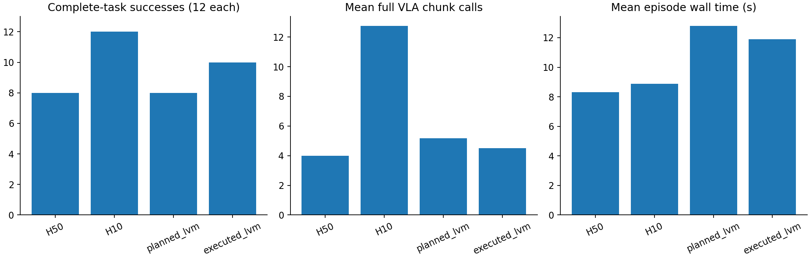

# 已执行动作一致性监测：48回合完整任务Pilot

2026-11-11。冻结A10-H1预测器，只改变监测条件与普通重规划时机，不训练、不使用OGG。**本次新监测成功10/12，比H50和规划监测的8/12多救回2回合；H10为12/12。收益目前集中在一个物理初始状态的两个噪声种子，尚不能认定总体性能提升。**

## 测试与固定协议

Object10任务1：把奶油奶酪放进篮子；任务9：把橙汁放进篮子。各初始化3/4/5、评测种子1002/1003，每种方法12回合，共48回合。每回合从观测控制机器人执行完整任务，最多280控制步。测试使用相同物理初始状态、首观测输入和首次采样噪声；12组配对SHA全部一致。

| 配置 | 动作生成与监测 |
| --- | --- |
| H50 | 每次生成50动作，执行50步后重新观测推理 |
| H10 | 每次仍生成50动作，只执行10步，清除余下缓存后重新推理 |
| planned_lvm | A10-H1用未来规划动作生成预测；到期评分，按本轮固定规则触发普通重规划 |
| executed_lvm | A10-H1用真实历史控制命令在到期时计算预测；同一规则触发普通重规划 |

基础策略`lerobot/smolvla_libero@a24f1f380461b665158d52acd140152c79e8b36d`，完整动作块50、去噪10次、控制20Hz。Corrector为`transformer-a10-h1_s42/best_model.pt`，SHA256 `c7185ff584d2ed224249fce506cb11c9069cc8446010010de78dcac284f5336f`，按原冻结工厂加载。模型/运行库/源代码SHA见[protocol.json](protocol.json)。

已执行条件在t步使用真实Z_(t−20)，采样真实提交控制器的动作t−20、t−18、…、t−2，预测delta并与Z_t−Z_(t−20)比较。数据10Hz、k10对应1秒，在线20控制步；该换算保留原协议，仍不构成对原数据采集物理时钟的证明。共同评分起点t24；回合重置清空历史，重规划保留已执行历史。触发时清除剩余未来动作、基于当前观测产生新完整块，不复用旧队列动作。

新规则在本轮测试前固定：此前被动诊断成功轨迹task9/init0/seed1000的64个共享有效窗口，线性Q95=0.3976114362478256；EWMA alpha0.35、连续5个有效相邻控制步超阈值、20步冷却后重新累计。缺分数打断连续计数，EWMA只在有分数时更新。测试初始化/种子未用于该阈值选取，且没有依据本轮成败再调参。成功轨迹只是工程参考，**没有独立逐窗正常/异常标签，不能解释为校准了5%事件误报率**。planned_lvm也用此新规则，与此前原LVM阈值实验分开比较。

## 结果与成本

全部48/48完成，程序错误0，执行状态耗时502.76秒（8.38分钟）。权重前后SHA一致，OGG调用0，没有自动扩大实验。

| 配置 | 成功 | 平均环境步 | 平均完整VLA块调用 | VLA计时/回合 | 监测计时/回合 | 回合总耗时 |
| --- | ---: | ---: | ---: | ---: | ---: | ---: |
| H50 | 8/12（66.67%） | 173.58 | 4.00 | 0.867秒 | 0 | 8.306秒 |
| H10 | 12/12（100%） | 123.25 | 12.75 | 2.695秒 | 0 | 8.889秒 |
| planned_lvm | 8/12（66.67%） | 173.58 | 5.17 | 1.219秒 | 3.937秒 | 12.796秒 |
| executed_lvm | 10/12（83.33%） | 153.67 | 4.50 | 1.058秒 | 3.709秒 | 11.890秒 |

新监测相对H50：多成功2回合、平均总耗时增加43.1%。相对H10：完整VLA块调用少64.7%，但少成功2回合、总耗时增加33.8%。监测仍同步执行，不能把减少VLA调用解释为整体加速。监测计时覆盖视觉编码与评分路径，真实命令归一化等其他成本由回合总耗时体现；各计时范围不简单相加。回合总耗时为评测callback墙钟，包含仿真及视频等，非真实机器人实时控制延迟。CUDA峰值为PyTorch已分配显存：四种配置均约1.32～1.34GiB，不是整卡显存占用。

| 评分指标（各自轨迹t24之后） | planned_lvm | executed_lvm |
| --- | ---: | ---: |
| 有评分步/可评分步 | 884/1795 | 1556/1556 |
| 覆盖率 | 49.25% | 100% |
| 最长无评分空窗 | 19步（0.95秒） | 0 |
| 总重规划事件 | 29 | 20 |
| 平均重规划事件/回合 | 2.42 | 1.67 |

两种闭环已经产生不同轨迹，覆盖率分母也不同，不能把二者当成同一批窗口上的配对检测召回。覆盖提高后事件数反而下降：事件数受轨迹、EWMA历史、持续性与冷却共同影响，不能据其大小单独判断检测优劣。29/20次触发都实际丢弃了非空动作队列，累计分别643/536条；逐步重放已核验实际VLA调用次数，没有只记录事件却不重推理的情况。

## 配对得失与定位

| 新监测相对 | 双方成功 | 仅新监测成功 | 仅对照成功 | 双方失败 |
| --- | ---: | ---: | ---: | ---: |
| H50 | 8 | 2 | 0 | 2 |
| planned_lvm | 8 | 2 | 0 | 2 |
| H10 | 10 | 0 | 2 | 0 |

两次救回均是**奶油奶酪task1/init3**：seed1002、1003。H50和planned_lvm各到280步失败；新监测分别在161、160步成功。两种监测在第68步前提交的动作完全相同，新方法第68步触发、丢弃32条动作并立即改变实际命令；规划方法当步没有评分，第75步才首次触发。差7个控制步，相当于0.35秒仿真时间，不能解释成墙钟响应优势。这支持“补齐原空窗可能让该案例更早干预并获益”的机制假设。

**橙汁task9/init3**：新方法第57步触发，规划方法第86步；新方法触发时规划评分同样缺失，且此前两者动作相同。但两个种子下二者最终仍失败，新监测各触发9次。H10均成功。更早发现偏离不保证普通重规划就能恢复，尚不能由未看过的视频推断抓取、碰撞等具体失败原因。

其余8个配对条件两种监测均没有触发，完整实际动作序列与对应H50逐值相同，全部保留成功。各条件详情见[cases.csv](cases.csv)，首次触发/动作分叉见[first_interventions.csv](first_interventions.csv)，完整触发记录见[triggers.csv](triggers.csv)。视频保留在远程各attempt目录，本次只取回轻量记录，尚未观看。

## 结论边界与后续

已验证：固定权重的已执行动作监测能够接入完整闭环，补齐可评分时段；在这批条件中有局部成功率收益，且不是靠提高全程VLA推理频率取得。尚未验证：Object10总体提升、独立异常检测能力、异步实时收益、与OGG结合后的表现。

本轮只有2个已见任务、6个物理初始状态及每状态2个噪声种子。两次救回来自同一状态，不能当作两个独立物理场景。探索性配对精确McNemar检验相对H50/规划方法均为p=0.5，不支持显著总体提升，且没有多重比较校正。也不能将已执行条件与规划条件的切换严格归因为“只有覆盖率变化”：条件内容及其EWMA历史一起改变，首次干预后轨迹进一步分叉。

本次有限计划到此结束，不自动扩大Object10、不改阈值、不训练、不启用OGG。后续如获授权，优先检查救回/未救回视频与触发附近分数，再固定方案到新的物理初始状态验证，避免围绕这一个救回状态反复调参。

## 可复核文件

- [overall.csv](overall.csv)：各方法成功率/成本；[paired.csv](paired.csv)：同条件成败得失。
- [audit.json](audit.json)：48回合、控制队列重放、规则逐步重放、配对签名等检查。
- [protocol.json](protocol.json)、[execution.json](execution.json)、[pipeline_status.json](pipeline_status.json)：冻结协议与结束状态。
- [离线审计脚本](../../../../../scripts/analyse_consistency_closed_loop.py)：重新生成表格与图。
- 结果原包：`outputs/consistency_closed_loop_20261111/results.zip`，1,464,656字节；SHA256 `e758018e5f19b7bd05f2844382824501bee2bd3c97d26db74a6a545d47e6b880`。
- 远程输出：`/root/autodl-tmp/corrector/object10/consistency_closed_loop_20261111_001`；源码`dev/consistency-control-49cb16490eab`，独立分支`experiment/executed-closed-loop-pilot-20261111`。
