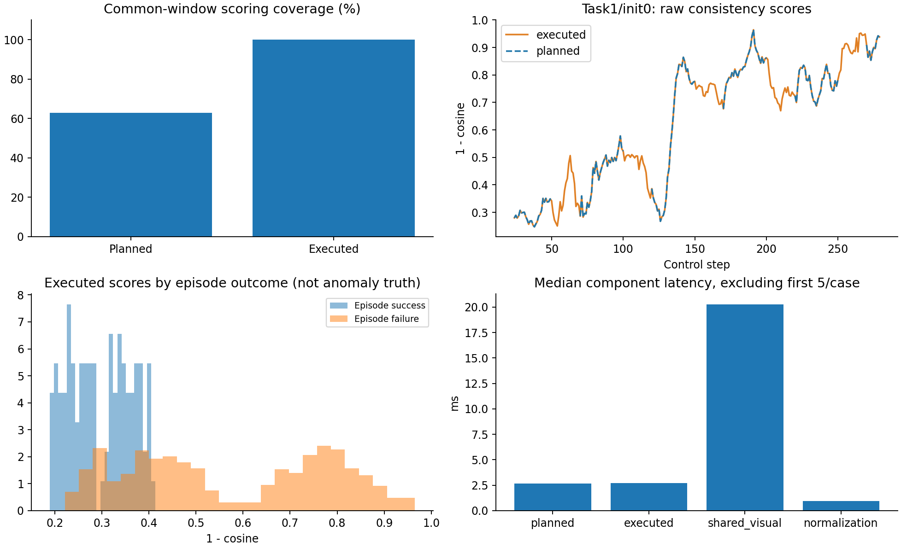

# A10已执行动作条件下的到期一致性监测：被动Pilot

2026-11-11，RTX4090；V2独立输出`object10/executed_consistency_pilot_20261111_002`，分支`experiment/executed-consistency-pilot-20261111-v2`。4/4完成、错误0、耗时71.107秒；21:49:27（Asia/Shanghai）开始，约21:50:39结束。无训练、无中断、无OGG；权重前后SHA相同。

## 方法和真实数据来源

固定A10-H1 seed42，checkpoint SHA `c7185ff584d2ed224249fce506cb11c9069cc8446010010de78dcac284f5336f`，使用原冻结action工厂。基础策略为`lerobot/smolvla_libero@a24f1f380461b665158d52acd140152c79e8b36d`，50动作块/H50执行/10次去噪不变；Object10奶油奶酪task1与橙汁task9，init0/2、评测seed1000。

原日志缺少连续视觉，因此本轮重新采集，未从规划队列伪造历史。保留966份真实视觉特征以及966条底层仿真step实际收到的7维命令；外层env.step与底层提交逐值对照。真实命令通过训练所用冻结policy preprocessor转换为归一化动作，并由冻结postprocessor往返还原校验；最大物理命令往返误差5.96e−8。

时钟定义：reset稳定后的首观测为Z_0；先取得Z_t，再提交u_t。第t步（t≥20）只用已成功提交并返回的u_(t−20)…u_(t−1)，按相对位置0/2/…/18取10个动作，配合真实Z_(t−20)，预测1秒残差，与Z_t−Z_(t−20)计算1−cosine。没有使用当前u_t或未来动作，也没有插值/补零。

数据10Hz、控制20Hz，采样跨度20步=1秒，与原协议保持一致；每两个控制步取一个动作不能完全表达夹在中间的控制作用，且声明时基一致不等于证明原示范物理采集时钟。两种模式都是同一冻结模型：新模式是到期时回顾一致性，不是在起点已知完整未来动作的前瞻预测。

第一次控制器对象在官方reset中延迟创建；V1在0回合时暴露初始化顺序错误，旧001现场保留。V2在同一次reset返回后、首条策略动作前挂钩，没有增加额外reset或更改RNG。初次reset内部settling动作不采集也不计控制时钟；其未观测计数没有伪造为真实0。每回合新建缓存，观测/动作次序、缺失拒绝、重置及延迟构造共189项CPU回归通过，真实运行也完成。

## 非干预验证

966条真实提交命令与此前纯H50同条件动作逐值完全相同；四回合首状态、首输入与首噪声SHA也相同，最终成败/环境步数/完整块调用与纯H50逐回合一致。成功仍为1/4，这是非干预的预期结果，不是纠错性能下降或提升。

| 场景 | 成败 | 环境步 | 原规划评分/共同窗口 | 已执行评分/共同窗口 | 原最长空窗 | 新最长空窗 |
| --- | --- | ---: | ---: | ---: | ---: | ---: |
| task_1/init_0 | 失败 | 280 | 161/256 | 256/256 | 19步 | 0步 |
| task_1/init_2 | 失败 | 280 | 161/256 | 256/256 | 19步 | 0步 |
| task_9/init_0 | 成功 | 126 | 64/102 | 102/102 | 19步 | 0步 |
| task_9/init_2 | 失败 | 280 | 161/256 | 256/256 | 19步 | 0步 |

## 覆盖率和公平配对

新模式最早t20有分数，原planned因共同anchor预热最早t24；主比较统一从t≥24开始，额外20～23的16个真实评分不算覆盖增益。

| 指标 | 原规划动作条件 | 已执行动作条件 |
| --- | ---: | ---: |
| 共同有效窗口 | 870 | 870 |
| 实际评分 | 547 | 870 |
| 评分覆盖率 | 62.87% | 100% |
| 最长连续无评分 | 19步/0.95秒 | 0 |
| 预测器forward总次数（含末尾未到期预测） | 644 | 886 |

新增323次评分已经逐步重放并定位：306个窗口来自原条件不足跳过，17个来自原换计划取消。本次有完整对应关系才报告这个分解；不能一般性把skip/cancel百分比直接相加当盲区。新模式不再依赖过去规划是否一直保持有效，实际历史完整就可以到期评分。

547个共同有评分窗口中，543个分数逐值相同；绝对差平均1.58e−6、最大0.000517。输入动作条件最大绝对差4.77e−7，来自真实命令经处理器往返与原规划float32动作的细小数值差异；这与BF16计算存在边界舍入差异相容，但未单独证明差异来源，也没有为强求相等而额外舍入或缩放。

在H50不干预时，原有效窗口的规划动作通常确实被执行，所以两种评分接近是合理现象。本轮收益证据是填补空窗，不能写成共享窗口的预测精度显著提高，也没有解决专家示范→VLA执行动作的分布偏移。

## 分数分布与检测能力边界

当前没有独立逐窗异常标签。以下只能按回合最终结局分层，失败回合中的正常阶段没有被标成异常；数据包含1个成功回合、3个失败回合，窗口强相关且有任务/初始状态混杂。

| 分组（不是正常/异常真值） | 窗口数 | 已执行分数均值 | 中位数 | P05 | P95 |
| --- | ---: | ---: | ---: | ---: | ---: |
| 成功回合 | 102 | 0.2965 | 0.2862 | 0.2009 | 0.3983 |
| 失败回合 | 768 | 0.5731 | 0.5285 | 0.2719 | 0.8838 |

失败回合分数整体更高，但分布有重叠，且不能把870个相关窗口当870个独立实验。新增窗口和旧可评分窗口对应不同阶段，不能比较其全量均值后直接宣称检测更强。

异常检测AUROC、召回率、误报率、提前量和可用阈值目前均不可识别，未直接沿用旧LVM阈值。已提供[人工窗口标注模板](anomaly_annotation_template.csv)，标签需来自独立视频审阅或明确仿真事件。分析工具可读取`--labels`，仅在同一已标注共享窗口上比较AUROC；完整已执行窗口另列，不借覆盖差异制造检测分数优势。当前模板为空，没有伪造标签或指标。

## 同步延迟

单位ms。每回合、每组件排除最初5次调用后统计中位数/P95；全部原始延迟保留在[latencies.csv](latencies.csv)。

| 组件 | 中位数 | P95 |
| --- | ---: | ---: |
| 原规划条件A10 forward | 2.655 | 2.775 |
| 到期已执行条件A10 forward | 2.691 | 2.822 |
| 两模式共享视觉编码 | 20.280 | 20.552 |
| 真实动作归一化及往返校验 | 0.929 | 1.078 |

到期新增的一次预测器forward约2.69ms，两模式共享视觉编码约20.28ms，没有重复编码两路相机。上述计时不含全部特征落盘/哈希/日志/物理步进；中位数不能直接相加当端到端P95，更不是异步控制额外等待。没有验证真实20Hz时限。Torch分配显存峰值约1.346GiB。

## 数据、复算与下一步

远端保存真实float32视觉474808320字节（约0.442GiB），布局[N,128,960]，逐回合路径与SHA见[feature_inventory.json](feature_inventory.json)。本地734082字节结果包仅包含轻量元数据/评分/实际动作，未取回完整视觉或视频，因此不声称在本地重算其字节SHA或已看过失败录像。

结果包SHA256：`f0552867a619165de9f4cf90e6cfeef5ca40a1bc226dcb1862bbb625db525b34`。部署14份源码与本地SHA一致；原checkpoint只读、运行前后SHA一致。

技术可用性与被动覆盖验证已完成；异常检测有效性尚未被证明。下一步优先独立标注少量窗口，校验正常/异常分数与阈值，再决定是否开展LVM/OGG闭环。当前不扩大评测、不训练、不自动沿用阈值。



```bash
MPLCONFIGDIR=/tmp/executed-consistency-matplotlib python3 scripts/analyse_executed_consistency.py --bundle outputs/executed_consistency_pilot_20261111_v2/results.zip --baseline-bundle outputs/smolvla_horizon_pilot_20261111/results.zip --output studies/policy_generalization/results/20261111/executed_consistency_pilot --plot
```

逐窗数据见[windows.csv](windows.csv)，控制非干预与空窗见[cases.csv](cases.csv)，完整数值及检测限制见[summary.json](summary.json)。
