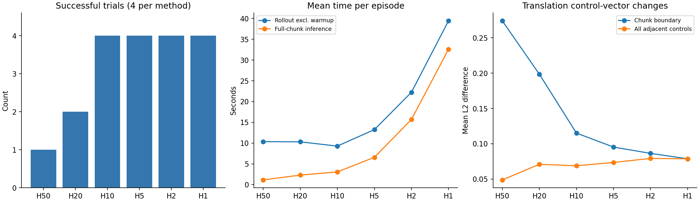

# 纯SmolVLA执行窗口Pilot：24回合结果

2026-11-11，RTX4090。24/24完成、错误0；18:13:56（Asia/Shanghai）开始，456.771秒（7.613分钟）结束。没有自动扩大Object10。

## 条件与核验

基础模型`lerobot/smolvla_libero@a24f1f380461b665158d52acd140152c79e8b36d`，权重SHA见[audit.json](audit.json)。原完整50动作块、10次去噪固定；仅执行前H步。两路256×256相机、relative控制、20Hz仿真时基、280步上限。无Corrector/LVM/OGG。

任务为Object10奶油奶酪task1、橙汁task9，初始状态0/2，seed1000，六种方法完全配对。前者历史H50失败但H20改善，后者H20仍有失败。任务来自历史结果选择，不是Object10随机代表性抽样。

独立重算4111个环境步的队列轨迹：仅在step%H=0时生成新块，旧队列为空，前H动作逐一消费；每回合调用数=ceil(steps/H)。正式完整块推理1132次、去噪前向11320次；各回合另有2次保留Torch RNG的热身，未计入正式调用/推理耗时。4组条件下，首物理状态、首预处理输入、首噪声SHA在六方法之间一致。此后不同窗口的随机采样时间不同，不能声称全程逐时刻噪声配对。

实际部署五份源码与本地SHA均一致；原15组训练completed、启动前GPU空闲及依赖版本检查通过。24回合queue_verified=true、录像记录各1份；视频字节仍在服务器，本地只收到JSON/CSV，不声称观看或重新验证视频内容。

## 成功率与成本

| 方法 | 成功 | 平均环境步 | 实际完整块调用 | 同步推理秒 | rollout秒 | 回合总秒 |
| ---- | ---: | ---------: | -------------: | ---------: | --------: | -------: |
| H50  |  1/4 |     241.50 |           5.25 |      1.136 |    10.347 |   15.959 |
| H20  |  2/4 |     205.75 |          10.50 |      2.296 |    10.303 |   11.018 |
| H10  |  4/4 |     135.25 |          14.00 |      3.055 |     9.276 |   10.002 |
| H5   |  4/4 |     150.00 |          30.50 |      6.574 |    13.249 |   13.990 |
| H2   |  4/4 |     145.00 |          72.50 |     15.699 |    22.239 |   22.968 |
| H1   |  4/4 |     150.25 |         150.25 |     32.586 |    39.452 |   40.233 |

实际完整块调用即sample_actions次数，不是select_action被调用次数；每个完整块含10次denoise_step。rollout扣除两次热身，包含预处理、同步审计、物理步进和渲染；回合总耗时含热身、环境创建/关闭、编码与落盘，首回合还含模型加载。H50首回合32.086秒，不能把平均回合总耗时当稳态纯策略延迟。

每次完整动作块推理约215.6～218.7ms，各H近似不变；缩短执行前缀没有缩短生成块。H1相对H10平均推理耗时10.67倍、rollout耗时4.25倍，而在本Pilot均4/4成功。H10平均环境步最少、rollout最短；这是本次观测到的折中，不能据此确定全套任务的最优H。4/4仍只有四个样本，不证明总体100%。

所有方法Torch allocated峰值1.17845GiB、reserved峰值1.22656GiB。Torch统计不含全部CUDA上下文/图形驱动资源，因此不应与nvidia-smi进程总显存直接等同。

20Hz是仿真控制的时间基准，不是墙钟实时保证：H1实际rollout约3.81步/秒；一次推理约217ms，超过20Hz的50ms单步预算。没有测试真实机械臂、异步部署或推理优化。

## 四组场景逐一对照

每格为成功/失败与实际环境步数。超时280步计任务失败，不是程序错误。

| 场景          | H50      | H20      | H10      | H5       | H2       | H1       |
| ------------- | -------- | -------- | -------- | -------- | -------- | -------- |
| task_1/init_0 | 失败/280 | 成功/118 | 成功/122 | 成功/132 | 成功/122 | 成功/128 |
| task_1/init_2 | 失败/280 | 成功/145 | 成功/119 | 成功/155 | 成功/172 | 成功/145 |
| task_9/init_0 | 成功/126 | 失败/280 | 成功/139 | 成功/166 | 成功/138 | 成功/139 |
| task_9/init_2 | 失败/280 | 失败/280 | 成功/161 | 成功/147 | 成功/148 | 成功/189 |

task9/init0从H50成功变成H20失败，再在H10及以下成功，说明窗口收益并非对每个场景单调；不能简单说H越小越好。更频繁观测与重规划是合理解释，但本次不提供抓取失败类型或新的视觉监测因果证据。

## 动作连续性

以实际传入环境的7维相对控制向量计算相邻变化。平移与旋转分别统计，不拼成无量纲单一“平滑度”，也不是物理jerk。不同H导致轨迹及边界数量不同，跨方法差值是描述性统计。

| 方法 | 平移相邻差均值 | 平移块边界差均值 | 旋转块边界差均值 | 夹爪符号切换/回合 |
| ---- | -------------: | ---------------: | ---------------: | ----------------: |
| H50  |        0.04876 |          0.27416 |          0.03394 |              2.50 |
| H20  |        0.07084 |          0.19854 |          0.01660 |              5.25 |
| H10  |        0.06880 |          0.11510 |          0.01211 |              2.25 |
| H5   |        0.07347 |          0.09530 |          0.01186 |              4.50 |
| H2   |        0.07918 |          0.08634 |          0.00960 |              5.50 |
| H1   |        0.07864 |          0.07864 |          0.00958 |              4.50 |

H50→H10平移块边界差均值下降约58.02%，但全程相邻差从0.04876增到0.06880，不能宣称所有意义上动作更平滑。H1每一步都是块边界，没有块内样本；夹爪切换也不单调。



## 证据与复算

结果包SHA256：`2eb0537ee0d42fad3569ebd28498b65a74e029987dfd0757ff4ae52c6838e1c9`（414916字节，原包不含视频）。

完整计划见[plan.json](plan.json)，逐回合成本和远端视频路径见[cases.csv](cases.csv)，独立重算见[audit.json](audit.json)，成本表见[cost_analysis.csv](cost_analysis.csv)。

```bash
MPLCONFIGDIR=/tmp/horizon-pilot-matplotlib python3 scripts/analyse_smolvla_horizon_pilot.py --bundle outputs/smolvla_horizon_pilot_20261111/results.zip --output studies/policy_generalization/results/20261111/horizon_pilot --plot
```

当前Pilot已结束；下一步是否扩大任务/状态或增加种子由用户决定，本次不启动任何新评测。
