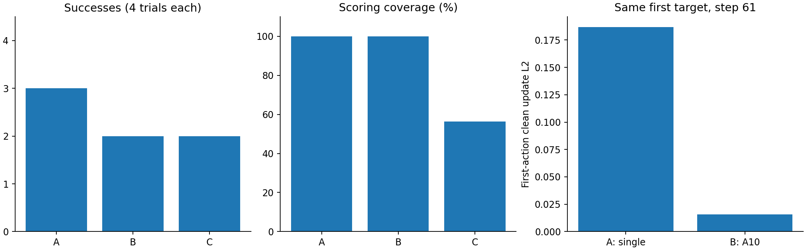

# 冻结单动作/A10混合Corrector Pilot结果

2026-11-11，独立分支`experiment/hybrid-corrector-pilot-20261111`。自然评测12/12、错误0、185.440秒（3.091分钟）；另3/3强制接口检查、错误0、23.738秒，强制成功率不计正式结果。远端前后权重/工厂SHA一致，未重训、未自动扩大。

## 对照定义与协议

| 配置 | LVM检测 | OGG引导 |
| --- | --- | --- |
| A | 单动作Transformer-H1 seed42 | 同一单动作模型 |
| B | 与A相同单动作模型 | A10-H1 seed42 |
| C | A10-H1 seed42 | 同一A10模型 |

单动作checkpoint SHA：`db5f037acb24a2f0954bd9f7e5debd6974a43117411ebf157ec23fe68a02c7b3`；A10 checkpoint SHA：`c7185ff584d2ed224249fce506cb11c9069cc8446010010de78dcac284f5336f`。分别使用原night/action冻结工厂，保持各自model_factory_sha校验，不更改权重、输入尺度或数据定义。

共用基础`lerobot/smolvla_libero@a24f1f380461b665158d52acd140152c79e8b36d`；50动作块与H50执行窗口、10次去噪、eta=1，每3次去噪引导一次（索引0/3/6/9）。Object10 task1奶油奶酪/task9橙汁，init0/2，评测seed1000，每法4回合、280步上限。两预测器同为H1/BF16、同454条特征、视觉128×960、归一化7维动作；10FPS/k10/1秒在20Hz部署对应20步。A10用候选块位置0/2/…/18。目标始终为检测器expected_delta−observed_delta，不借用引导器重新生成目标。原A10 skip/cancel规则保留。

兼容性与真实输入梯度检查通过。两模型在所有配置中均常驻以减少资源条件差异，不能把实验显存当作最终单模型部署需求。完整设置见[protocol.json](protocol.json)、[compatibility.json](compatibility.json)、[shape_gradient_probe.json](shape_gradient_probe.json)。

## 自然Pilot结果

下表事件/引导/耗时为回合均值，覆盖率为排除预热后的全部有效时刻合并统计。

| 配置 | 成功 | 覆盖率 | 环境步 | 触发事件 | 引导调用 | VLA块调用 | 回合总秒 |
| --- | ---: | ---: | ---: | ---: | ---: | ---: | ---: |
| A | 3/4 | 100.00% | 181.00 | 4.00 | 16.00 | 7.50 | 14.875 |
| B | 2/4 | 100.00% | 209.25 | 3.75 | 15.00 | 7.75 | 16.201 |
| C | 2/4 | 56.31% | 212.25 | 2.00 | 8.00 | 5.50 | 15.275 |

A=628/628、B=741/741有效时刻有评分；C=424/753=56.31%。C每回合平均skip49.75次、cancel38次，二者不相加当盲区。B使用单动作检测恢复全覆盖，但这次没有增加成功数：B与C均2/4。

| 场景 | A | B | C |
| --- | --- | --- | --- |
| task_1/init_0 | 成功/168步 | 失败/280步 | 失败/280步 |
| task_1/init_2 | 成功/154步 | 成功/155步 | 成功/163步 |
| task_9/init_0 | 成功/122步 | 成功/122步 | 成功/126步 |
| task_9/init_2 | 失败/280步 | 失败/280步 | 失败/280步 |

## A–B首次事件：更强的局部配对证据

四个场景均核验：A/B首次触发时刻、目标SHA相同，首次触发前的全部实际7维动作逐值相同，score/阈值到首次触发也逐值相同；实际动作从首次OGG触发那一步开始分叉。并非只匹配同一个init/seed名称。后续轨迹与事件会变化，不能继续把后续所有梯度当作同状态反事实对照。

奶油奶酪task1/init0的首次触发为step61（3.05秒仿真时间），目标norm1251.29785，目标SHA均为`b0f752de103d5956…`。首个引导调用：

| 指标 | A：单动作引导 | B：A10引导 |
| --- | ---: | ---: |
| OGG Loss（更新前） | 0.384628 | 0.349084 |
| 速度梯度L2 | 0.186895 | 0.044808 |
| 全部候选clean动作更新L2 | 0.186895 | 0.044808 |
| 首动作候选clean更新L2 | 0.186895 | 0.015721 |

A10的更新分散在10个动作位置，当前eta相同却不等于相同的有效纠偏强度。这个场景A成功/B失败，说明在当前固定设置下，更换引导器确实能改变该场景的结果；这次A/B的差别不能归于检测覆盖率。更新幅度较小/分散是可检查的机制线索，尚未验证是失败原因，未据此调整eta。

clean动作更新是归一化候选向量的局部变化，不等于最终执行位移；实际环境控制从step61分叉，两配置该步动作差L2约0.004727。没有保存相同x_t/v的无引导反事实，不能将此差值解释成各自独立OGG增益。不同学习预测器的loss更低也不保证真实恢复更好；跨去噪时刻的loss更不能直接当作同一个固定优化问题的单调下降曲线。

完整首次事件对照见[AB_first_event.csv](AB_first_event.csv)，逐次引导/位置更新见[guidance_calls.csv](guidance_calls.csv)，目标引用见[events.csv](events.csv)。

## 延迟与复现核验

| 配置 | VLA块生成秒/回合 | 监测秒/回合 | OGG更新秒/回合 | 每次引导平均毫秒 | Torch峰值GiB |
| --- | ---: | ---: | ---: | ---: | ---: |
| A | 2.148 | 4.375 | 0.280 | 17.51 | 1.540 |
| B | 2.169 | 5.054 | 0.254 | 16.91 | 1.541 |
| C | 1.455 | 4.920 | 0.120 | 14.97 | 1.514 |

OGG时间已经包含在VLA块生成时间内，不再相加。同步GPU计时与详细目标/梯度日志带来开销；本表是诊断实现的实际延迟，不是无日志吞吐/异步等待基准。

A/C对应原单动作/A10的冻结闭环实现。和此前证据包比较，同4场景、seed1000的success、env_steps、chunk_calls、event_replans、guidance_calls五项均逐回合完全相同（共8回合），支持解耦保留了原A/C行为；不要求两次墙钟时间一致。12回合共39次触发、156次OGG调用，逐调用核验4次/事件、0/3/6/9位置、梯度/更新有限及非指定动作位置零更新。

## 对原研究问题的回答与限制

1. A10监测覆盖不足有直接trace证据，本次C为56.31%。
2. 但“下降只是覆盖不足”不能解释全部现象：本Pilot中B覆盖100%仍比A多失败1回合，且该场景A/B第一次引导前动作、score和目标一致。当前A10引导设置也存在需要解释的局部退化。
3. 不足以断言“A10引导普遍更差”或量化覆盖/引导各占多少：每法仅4个历史失败驱动场景；A–B只多1个失败，B–C还同时改变检测分数和纠偏目标。B/C相同最终成败不等于覆盖无价值。
4. 本次没有发现采用双模型的收益。优先保留并分析task1/init0退化案例，后续若开展新工作，应先做相同事件快照下的引导敏感度/局部更新诊断，或专门控制目标的覆盖对照；当前不自动扩测、调eta或训练。



## 证据

结果包909682字节，SHA256：`1b90d6dab2277932173accbd3c55b8edd6289b94445af3bf24831128597ac3bf`。本地只取JSON/JSONL/CSV；视频及目标.pt本体留远程，SHA引用来自远端记录，未声称观看视频或本地重算张量字节。

核验见[audit.json](audit.json)、逐回合含视频路径见[cases.csv](cases.csv)。源代码SHA与本地12份部署源码一致。

```bash
MPLCONFIGDIR=/tmp/hybrid-pilot-matplotlib python3 scripts/analyse_corrector_hybrid.py --bundle outputs/hybrid_pilot_20261111/results.zip --reference-bundle outputs/corrector_audit_20261111/results_bundle.zip --output studies/policy_generalization/results/20261111/hybrid_pilot --plot
```
