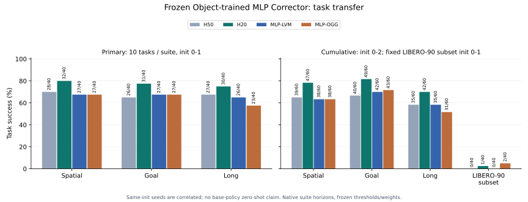

# Object训练MLP Corrector的跨任务泛化：880回合完成

**880/880正式回合全部完成，错误0，220组四方法严格配对，无缺失方法。** 北京时间2026-11-17 12:07:10至15:32:05，共3小时24分55秒，提前于四小时上限结束。正式回合阶段为3小时22分12秒；40次环境reset+一步及4次Object工程桥接另计。没有自动追加实验。

结论：**原MLP在Object上的纠错收益没有稳定迁移到这批新任务。H20在Spatial、Goal、Long均领先；余弦OGG在Long出现净损害。** 仍存在少数救回案例，不能概括为Corrector在所有新任务都无效，也不能外推至尚未测试的J模型或其他引导配置。

## 固定协议与完成核验

固定原MLP seed42、原动态LVM、余弦OGG（eta1、每3次去噪引导一次，仅首动作7维），不重训、不用新任务调参。SmolVLA仍为FP32、50步生成块、10次去噪、20Hz相对OSC控制。训练10Hz/k10对应部署20控制步，首评分24步。Spatial/Goal/Long/90分别采用实际原生280/300/520/400步上限。[完整协议](OPERATIONS.md)。

| 阶段         | 范围                            | init / eval seed         | 每套件每方法 | 合计 |
| ------------ | ------------------------------- | ------------------------ | -----------: | ---: |
| 主要比较     | Spatial、Goal、Long各全部10任务 | init0/1 × seed1000/1001 |           40 |  480 |
| 固定90子集   | ID 0/9/19/29/39/49/59/69/79/89  | init0/1 × seed1000/1001 |           40 |  160 |
| 补充初始状态 | 三个主要套件各全部10任务        | init2 × seed1000/1001   |           20 |  240 |

共40个不同任务名称、110个suite/task/init条件。LIBERO-90只测十任务子集，不称完整90任务基准。454条训练/验证记录均属Object10，新任务名称与规范化指令不重叠；这不保证物体、子技能、布局均未见。基础SmolVLA的任务级训练覆盖未确认，因此**不是基础策略零样本测试**。90与Long共同组成官方LIBERO-100，另外还有Spatial/Object/Goal各10；90不是官方定义的更难版本。[任务组成与出处](LIBERO_SUITES.md)。

CPU只读审计通过：正式880段视频和17,396个诊断文件SHA一致，桥接另4段视频/64文件。220组首状态、首输入、首噪声精确匹配；实际提交命令、H50/H20缓存和调用次数、视频帧映射及0.05秒控制间隔均通过检查。只复核原生PTS和录制证据，没有再次全量解码视频。远程已无本队列/评测进程；当前`nvidia-smi`无执行权限，不据此宣称独立确认GPU租用状态。[完成收据](completion_receipt.json)、[汇总](summary.json)。

## 预先固定的主要比较

每套件每方法40回合，保留原始init0/1主要比较，不以补充阶段替代：

| 套件    |          H50 |                    H20 |      MLP-LVM |      MLP-OGG |
| ------- | -----------: | ---------------------: | -----------: | -----------: |
| Spatial | 28/40，70.0% | **32/40，80.0%** | 27/40，67.5% | 27/40，67.5% |
| Goal    | 26/40，65.0% | **31/40，77.5%** | 27/40，67.5% | 27/40，67.5% |
| Long    | 27/40，67.5% | **30/40，75.0%** | 26/40，65.0% | 23/40，57.5% |

三套件主要比较合计H50 81/120、H20 93/120、LVM 80/120、OGG 77/120。各套件样本数相同，但解释仍以分套件配对为主，不混入90子集。

## 累计结果：包含补充init2

| 套件                       |          H50 |                    H20 |      MLP-LVM |              MLP-OGG |
| -------------------------- | -----------: | ---------------------: | -----------: | -------------------: |
| Spatial，60/方法           | 39/60，65.0% | **47/60，78.3%** | 38/60，63.3% |         38/60，63.3% |
| Goal，60/方法              | 40/60，66.7% | **49/60，81.7%** | 42/60，70.0% |         43/60，71.7% |
| Long，60/方法              | 35/60，58.3% | **42/60，70.0%** | 35/60，58.3% |         31/60，51.7% |
| LIBERO-90固定子集，40/方法 |     0/40，0% |             1/40，2.5% |     0/40，0% | **2/40，5.0%** |



三主要套件累计H50 114/180（63.3%）、H20 138/180（76.7%）、LVM 115/180（63.9%）、OGG 112/180（62.2%）。相对H50，LVM净多1次成功、OGG净少2次；与旧Object10两方法均55/60、超过H50的结果不同。这是收益任务依赖的证据，不能仅按跨套件绝对成功率下降推断原因。

90子集的两次OGG成功均来自**同一个task29/init1**的两个seed，H20仅在其中seed1000成功。这是一个值得复盘的恢复条件，不是两个不同任务的泛化证明。其余大量失败还可能涉及基础策略覆盖、任务难度或控制问题，不能单独归因于Corrector。

## 配对获失与OGG增量

“获/失”为候选独自成功/基线独自成功；总数相同也可能交换具体案例。

| 套件              | LVM相对H50 | OGG相对H50 |      OGG相对LVM |
| ----------------- | ---------: | ---------: | --------------: |
| Spatial（60配对） |      1 / 2 |      1 / 2 |           0 / 0 |
| Goal（60配对）    |      4 / 2 |      5 / 2 |           2 / 1 |
| Long（60配对）    |      5 / 5 |      4 / 8 | **1 / 5** |
| 90子集（40配对）  |      0 / 0 |      2 / 0 |           2 / 0 |

Long中OGG相对LVM获1例、失5例，是优先检查的风险线索。当前数据尚不能判定是梯度方向、引导幅度或纠偏目标哪一个造成退化。OGG改变轨迹后，后续评分、动态阈值数值和触发时间也会变化；此处是固定规则下的系统级增量对照。[全部配对](comparisons.csv)。

## 监测覆盖、真实引导与成本

两种MLP方法合计**106,501/106,501个可评分步有评分，覆盖100%，额外最长空窗0步**；首24步预热不计入分母。本轮没有A10式动作序列跳过/取消或清预测造成的额外空窗。

OGG有962个事件、3,848次实际更新，恰为每事件4次；**全部3,848次梯度非零**，原更新公式及仅首动作支持域通过核验。H50/H20/LVM没有OGG调用。因此不能以“没评分”或“OGG没运行”解释整体收益不足。没有逐步异常真值，不能把高分/触发/最终失败当作真实误报、漏报或报告异常AUROC。

| 累计套件 | H50回合秒 | H20回合秒 | LVM回合秒 | OGG回合秒 | OGG平均事件 |
| -------- | --------: | --------: | --------: | --------: | ----------: |
| Spatial  |      7.55 |      7.53 |     12.06 |     12.20 |        2.93 |
| Goal     |      6.27 |      6.45 |     10.81 |     10.74 |        3.20 |
| Long     |     12.32 |     13.45 |     22.15 |     23.09 |        5.73 |
| 90子集   |     12.20 |     14.71 |     22.72 |     22.44 |        6.25 |

监测路径约22–23毫秒/控制步，包含视觉编码等工作，不是仅MLP前向。H20虽查询更频繁，但一般用更少环境步完成；本批回合墙钟接近H50、低于Corrector。仿真0.05秒物理步长不等于墙钟实时20Hz；视频/记录也有开销。冻结loader额外加载未参与四方法控制的J/C0及视觉副本，显存不是最小纯VLA部署占用。[分方法成本](methods.csv)、[逐回合](trials.csv)、[引导](guidance.csv)。

## seed、状态指纹与元数据口径

110个命名task/init条件并非220个独立物理场景。已保存状态向量共有125个字节SHA：15个条件的两seed状态数值有差异、95个完全一致。用标准库读取已保存float64存储并核对SHA，没有执行pickle或仿真；状态向量混合多种单位，最大数值差不能当作末端位置误差。125个SHA也不能称125个独立场景。[逐条件检查](state_seed_audit.json)。

Long中，两seed成败不一致的条件为H20 4/30、LVM 13/30、OGG 11/30，显示Corrector结果较依赖轨迹/随机性。只有两个eval seed及一个Corrector训练seed，不作独立样本显著性或训练随机性结论。[种子稳定性](seed_stability.csv)。

发现初版新增`environment_config.json:init`写在reset后，实际记录了下一回合游标。冻结LeRobot先用指定init、随后递增1；884个正式/桥接回合均满足“日志游标＝计划init＋1”，`case.config.init`及`suite_assets.init`才是本回合索引。四方法首状态/输入/噪声配对与Object旧命令/队列桥接仍通过。**原数据未改写**，审计显式标记此记录错误。

本地后续接口已在reset前记录选中索引，并另存`init_cursor_after_reset`，CPU测试确认不增加reset次数、不改变返回对象。此修复**未部署到本次冻结队列，尚未做新的GPU验收**。

## 优先复盘案例与数据位置

四位为H50 / H20 / MLP-LVM / MLP-OGG，1成功。选例只用于诊断，不重新估计总体成功率。

| 条件                   | seed | 成败 | 价值                                    |
| ---------------------- | ---: | ---- | --------------------------------------- |
| Long task1/init1       | 1000 | 0100 | H20独自成功；另一seed同组合             |
| Spatial task3/init2    | 1000 | 0100 | 两seed同组合的另一任务类型              |
| Long task0/init0       | 1000 | 0011 | 两Corrector救回两baseline；另一seed不同 |
| Long task4/init1       | 1000 | 0010 | LVM成功、OGG失败，查看引导后分叉        |
| Long task4/init0       | 1000 | 1101 | OGG救回LVM失败，保留正例                |
| LIBERO-90 task29/init1 | 1001 | 0001 | OGG独自成功；另一seed为0101             |

220组中`0100`有26组，`0011`和`0001`各1组；另有6组OGG损害LVM成功、5组OGG救回LVM失败。[14组候选及原trial ID](replay_candidates.csv)、[全部结局](patterns.csv)。指标分析时只取回约6.35MiB轻量审计数据。随后按用户请求，**已追加导入90中task29/init1、seed1000/1001的四方法共8条完整回放**，新包约2.85MiB；其余视频未全量下载，没有新增运动采集。全部原件仍在远程`/root/corrector_crosssuite_20261117_001/transfer/`。[Replay打开步骤及任务组成](LIBERO_SUITES.md)、[导入与真实浏览器验收](replay_import_validation.json)。

本地原始快照在`outputs/autodl_setup/crosssuite_20261117/`；[summary.json](summary.json)记录源审计SHA、模型标识和范围。旧[12:15进度快照](status_snapshot.json)保留为历史，不代表当前仍运行。本次15项CPU测试通过：真实880矩阵、主要/补充汇总、配对计数恒等式、重复/缺失/签名反篡改、覆盖分母与游标修正；图表已实际查看。没有新增浏览器验收或重新跑GPU。

```bash
python3 scripts/corrector_crosssuite_analysis.py \
  --input outputs/autodl_setup/crosssuite_20261117/audited_20261117T074444Z.json \
  --output studies/policy_generalization/results/20261117/crosssuite
python3 -m unittest discover -s tests -p test_crosssuite.py -v
```

下一步优先复盘OGG正负翻转和H20稳定反例，分清预测条件、LVM触发、纠偏目标及引导幅度的影响。当前不建议用增加epoch或无目标扩测代替机制验证；J、多loss或校准方案应另立协议，先小规模验证。
