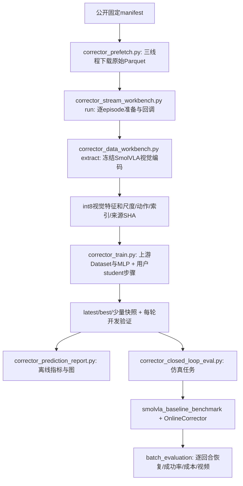

# 研究与工程工作日志：按任务、日期更新

更新：2026-11-11。以后行动安排、运行命令和进展统一在本文件更新，不再新增按天命名的指南。
研究问题、方法、正式实验结论与个人贡献另见[研究报告](research_report.md)；源码原理文档保留为技术参考，不作为另一份待办清单。

## 当前状态

| 主线     | 已完成                                                                | 当前阻塞或下一步                                  |
| -------- | --------------------------------------------------------------------- | ------------------------------------------------- |
| 数据     | Object10全部98原始分片下载完成；454条/66984帧特征已发布并通过训练前核验 | 保留原始缓存与量化特征，后续训练/评测无需依赖下载隧道 |
| 算法理解 | 用户完成配对、模型、损失和单步更新练习，审查通过                      | 练习用于理解；正式训练调用上游数学实现            |
| 训练工程 | Object10五种配置×三个seed共15组训练，best、重载与共同划分已核验 | Object10：50轮/4900更新，第45轮best；cosine0.80436、MSE3.99592；复用A10权重验证实际执行动作条件与等覆盖率方案（待实现） |
| 闭环评测 | 4090真实LVM/OGG已接通；旧模型长批次2394回合、程序错误0，已人工暂停 | 最新五组正式评测1200/1200；三种单动作OGG 55/55/56成功，A10为50/51，均每组60；精确覆盖率100%对约59%，下一步等覆盖率对照 |

### 2026-11-09晚：复用缓存，执行MLP/Transformer多种子队列

用户确认目标为训练预测器并观察系统收益，不再为占用GPU扩大下载。新增`corrector_models.py`生产工厂、`corrector_night_sweep.py`标准库调度入口，原`corrector_train.py`可用`--model-type mlp|transformer`切换；默认单独调用仍是MLP。Transformer复用固定上游实现，5层/768维/12头/37,316,544参数；4×2048 MLP仍38,052,800参数。练习`temporal_practice.py`不填答案、不参与生产调用。

**固定实验。** Transformer H1、MLP H1、Transformer H3各seed42/43/44，共9次。所有组共同anchor-history3，验证/训练时刻完全相同：49,447训练/12,089验证对，原364/90轨迹划分不变。复用全部454条缓存，不复制数据；H3取训练最近3帧、线上每2控制步取一帧，预热4步后预测20步未来，最早score24。旧300回合实验首次score20的审计结果仍有效，不修改旧记录。

**资源/运行。** 预测器采用CUDA BF16 autocast，参数/优化器FP32；基础SmolVLA冻结、精度不变。有效batch512，真实缓存探测MLP micro32 / Transformer micro8，探测OOM逐级减小并增大累积，正式运行配置冻结。检查训练反向、有限梯度以及冻结预测器对动作输入的OGG梯度。shared-memory不足时DataLoader由2workers回退0。AMP与共同锚点是相对旧FP32实验的适配差异，不能把新MLP仅称为换seed复验。150epoch上限、早停5、both、AdamW3e−4/wd1e−4；保存best/latest，默认额外快照0，可首启时指定`--snapshot-every 25`。

**自动评估。** 每份最终best生成GPU离线报告与sim-venv绘图；每份先强制一次OGG调用检查（结果不计成功率）。seed42三组各跑240正式回合，范围为10任务×3初始化×2执行seed×H50/H20/LVM/完整OGG，总计720回合计划；其余训练seed保留离线种子方差，先不做逐个大闭环。`comparison.csv/json`汇总相同锚点下的数值及种子均值/标准差；失败视频、trace和分任务成功率沿用原评测器。

**12小时与恢复。** `nohup`后台父进程，子进程独立会话；SSH断连无需重启。12h包含探测、训练和评估，在完整epoch/回合边界暂停，预算不是强制关机时间。latest保存优化器/调度/RNG，半epoch重做；已完成训练与报告跳过，已完成回合继续核验跳过。根STOP请求暂停；等状态paused且子进程退出后再删除STOP，原冻结包同命令续跑。发现程序错误停下保留现场，不能循环重复运行掩盖错误。有限计划提前完成则正常退出，不为凑12h重复计算；服务器继续计费，需用户后续管理。

**部署操作（生成包code_id=1e80242789）。** 本地生成`outputs/autodl_setup/corrector_transformer_night_20261109.zip`，上传至远程`/root/autodl-tmp/corrector/`。远程执行：

```bash
cd /root/autodl-tmp/corrector
unzip -n corrector_transformer_night_20261109.zip -d night-code-1e80242789
bash /root/autodl-tmp/corrector/night-code-1e80242789/launch_queue.sh --max-compute-hours 12
```

日志`/root/autodl-tmp/corrector/object10-night-launch.log`；状态：

```bash
/root/autodl-tmp/corrector/bootstrap/bin/python /root/autodl-tmp/corrector/night-code-1e80242789/corrector_night_sweep.py status
```

首个训练日志为`object10/night_20261109_001/logs/transformer-h1_s42_training.log`。先确认真实probe通过、首轮loss/验证值有限再离开；本地129项CPU回归、包内SHA/AST/CLI校验不能代替4090验证。旧`queue-code-fdca69dae6`及`queue_4090_001`不覆盖，旧checkpoints不重新训练。默认完全离线，不依赖本地代理隧道。首启添加`--no-eval`可以只跑训练/离线报告/强制调用检查；同输出计划冻结，不能运行中随意改该设置。

**时间审计回传。** 已保存`results/20261109/temporal_audit_returned.json`：454/454特征、300/300回合、error0，声明10FPS/k10/1秒与20Hz/20步一致；采集物理时钟仍无来源证据。配对OGG相对H50救回11/损失0，相对H20救回5/损失1，相对LVM救回1/损失0。约21.4ms/步监测与论文26.96ms计算量同一数量级；本项目同步执行不等价于论文异步暴露等待0.008ms。

### 2026-11-09后续：当前画面＋动作序列；原9组完成后自动接续

**进展。** 用户回传H1 Transformer已完成15轮/1455更新，验证loss4.69808、MSE4.47512、cosine约0.77704，约263秒/轮，真实GPU探测与OGG输入梯度通过。快照保存在`results/20261109/transformer_h1_progress_15.json`；当前训练继续，不更新其冻结包、不重启。

**新输入。** `corrector_train.py --model-type transformer-action --action-steps 10`启用序列条件；`mlp`和`transformer`仍可选。新H1为当前视觉＋10个动作，新H3为最近三帧（已含当前）＋10个动作。训练从既有`actions.npy`取同episode的[t,t+10)，未来帧只作标签；输入动作不越过预测终点。在线取规划块0/2/…/18控制步的动作，与10FPS示范的动作位置对齐。5层/768维/12头，37,324,224参数。离线真实已执行示范动作与在线候选规划动作不是同分布，这项变化与动作子采样近似明确记录，不能凭离线指标就承诺成功率提高。

**在线/OGG。** 规划不足时跳过预测，不填造动作；中止/替换旧规划后撤销未到期的旧条件预测，防止条件变化制造虚假报警。记录skips/cancelled计数。序列版OGG只对10个指定时间位置的前7动作维求梯度，保留其他位置和维度；当前LVM/阈值与纠偏目标算法不改。这是新增动作条件及多动作引导的组合实验，与原单动作结果的差异不可只归因于网络架构。

**工作量。** 新H1/H3各seed42/43/44，共6次训练，仍复用454条缓存、共同anchor3、49447/12089对。每份best离线数值/图和一次强制调用检查；seed42两种新模型各240正式闭环（H50/H20/LVM/完整OGG），共480正式回合计划。Micro64真实探测起步，OOM降到32/16/…/1，有效batch512；原9组仍按原micro配置训练。保存best/latest，额外快照默认0，可首启配置；预算和容量不足时保存暂停。

**用户已选择：先完成原9组，再开始新实验。** 独立`corrector_followup_queue.py`等待原`.sweep.lock`和真实父/子进程；原12h预算正常结束但未完成时，以原冻结CLI/源码SHA启动原版本继续余项。只有9组全部JOB_COMPLETE、总状态completed后才运行新实验。不重复并行占GPU。旧队列程序错误或外部STOP保留现场暂停。20h总预算包含等待原运行及原余项，新训练未必能在本段预算开始；每次同命令续接获得新预算，不无限自动加时。

部署包`outputs/autodl_setup/corrector_action_followup_20261109.zip`，code_id=9274415dd6；完整操作在同目录`START_ACTION_FOLLOWUP_20261109.txt`。上传到远程`/root/autodl-tmp/corrector/`，然后执行：

```bash
cd /root/autodl-tmp/corrector
unzip -n corrector_action_followup_20261109.zip -d action-code-9274415dd6
bash /root/autodl-tmp/corrector/action-code-9274415dd6/launch_queue.sh --max-compute-hours 20
```

现在就可以排队，父调度器只有标准库开销，旧任务仍运行不受影响。新日志`object10-action-followup-launch.log`；根输出`object10/action_followup_20261109_001`，状态`followup_status.json`，新任务输出在其`experiments/`。原代码、旧输出、旧ZIP不覆盖。nohup后台与独立会话，全部离线，不依赖代理隧道；服务器需保持开机，完成后不自动关机。

暂停新调度器可在其根输出创建STOP；不主动停止原先已在运行的外部父进程，若调度器自己续跑了原任务，会请求该进程边界暂停。再次续接时先确认无活动父/子进程、移除自己的根STOP，再运行原启动命令。只回收本调度器创建的前序STOP，不删除外部用户STOP。旧任务必须使用原`night-code-1e80242789`继续；不可拿新包直接覆盖原checkpoint协议。

CPU完整回归140项通过，新序列训练/恢复/报告/OGG与调度交接已测；新序列真实4090与闭环结果尚无，启动后先查看probe/首轮。磁盘起始仅17.82GiB余量，旧9组估算6.75GiB、新6组约4.5GiB另加视频；保留5GiB门槛，可能先受容量限制。不会自动删除原始数据/权重或购买扩容。

### 2026-11-09 23:18：额度重置前的36小时连续研究安排

用户回传后续调度器status=running、phase=waiting_original_queue、process_alive=true，原H1 s42仍在训练；属于正常等待，不重复占GPU。资源快照：16vCPU/120GB RAM/4090，系统盘4.9/30GB、数据盘33/50GB。用户希望至11-11中午前平台尽量持续执行有意义工作。

新增独立标准库`corrector_guardian.py`及可复现打包器`package_corrector_guardian.py`。监督器不替换训练代码，不新增数据、不自动扩容/关机；先等待既有20h后续调度器，退出后按其冻结SHA和CLI用剩余预算继续原9组＋动作序列6组。保留用户要求的优先级，禁止重复启动同一队列。首启持久化36h绝对截止时间，重复启动不自动重置；只有显式`--extend-hours N`才延长。SSH断连无影响；整机重启后需重执行启动命令，不能承诺硬件故障后自动开机。

若15组及原计划评估提前完成，按seed42开发验证MSE分别在单动作Transformer H1/H3、动作序列H1/H3内部选优，加固定MLP共3个模型，使用各自原冻结部署代码追加Object10初始化3～9、执行seed1000/1001、H50/H20/LVM/完整OGG，每模型560回合、共1680回合计划。与原初始化0～2分开保存，不混淆训练范围或声称新任务泛化。生成成功率/成本、失败视频、trace和同条件配对得失/探索性精确McNemar统计；不把重复seed/初始化当成完全独立样本，不跨多个模型重复累加同一baseline分母。动作序列有额外动作信息，仍保留条件差异。

资源监测每30秒记录RAM可用量、load、两个盘余量、GPU利用率/显存/温度到系统盘`resources.jsonl`。启动前保留数据盘5GiB/系统盘8GiB/RAM4GiB阈值；空间紧张时等待并尝试无损分层，不开新GPU任务。运行中的冻结队列沿用自身的磁盘、OOM和checkpoint边界保护，不擅改微批/模型。数据盘低于10GiB时，只对已有JOB_COMPLETE、训练completed、best重载验证且SHA匹配的任务，将完整latest复制至系统盘checkpoint_archive；源与目标SHA及源mtime均核验后，原子换成原路径符号链接。best、原始数据、特征、活动checkpoint都不搬动，不丢弃优化器/RNG状态。逐文件placements记录可追踪。迁移/备份必须同时带系统盘归档及placement清单，不能删除监督目录，否则latest链接会失效；best仍留数据盘。

正常预算暂停/陈旧进程状态自动接续；已存在latest的明确SIGKILL/SIGTERM中断，保存原错误后最多2次恢复尝试，不改协议和参数。监督器自身被137/139终止由外层watch脚本最多2次重启，沿用原截止时间且不重复extend。协议/形状/NaN/缺依赖等确定性错误、外部用户STOP均保留现场，不无限重启。提前完成则正常退出，不重复凑时长；36h结束保存暂停，不停止仍由用户单独启动的外部任务，不自动关闭计费实例。

部署包`outputs/autodl_setup/corrector_guardian_36h.zip`，code_id=2263c95a33（约9KB），操作见同目录`START_GUARDIAN_36H.txt`。上传至远程/root/autodl-tmp/corrector后执行：

```bash
cd /root/autodl-tmp/corrector
unzip -n corrector_guardian_36h.zip -d guardian-code-2263c95a33
bash /root/autodl-tmp/corrector/guardian-code-2263c95a33/launch_guardian.sh --hours 36
```

全部监督日志/状态/新评测/分层归档放在`/root/corrector_supervision_36h/`系统盘，不挤占原数据盘；旧9组/动作序列6组的输出位置不改。状态命令：bootstrap/bin/python guardian-code-2263c95a33/corrector_guardian.py status。首启应显示waiting_existing_pipeline，随后自动交接。具体实际截止UTC时间以guardian_status.json为准；若11-09 23:18启动，36h约至11-11 11:18。

9项新增本地测试通过，覆盖无损链接/活动文件保护/禁止覆盖不同归档/冻结CLI/配对统计/持久deadline/锁/有限中断恢复/watchdog有限重启且不重复延长预算，部署ZIP的SHA/AST/独立标准库入口和shell语法已校验；远端监督器尚未启动，不声称已跑满36小时。

### 2026-11-10：Errno24加载失败与保留冻结代码的恢复入口

用户回传约09:43原队列进入transformer-h1_s43的--resume时，在datasets()→上游np.load(z_scale.npy,mmap_mode='r')报OSError[Errno24]Too many open files，尚未加载模型/优化器；随后followup与guardian按程序错误策略退出。当时数据盘仍余约14.53GiB、36h还余25.88h，不能归因于磁盘或总预算。此前soft/hard NOFILE没有记录，不把“1024”补猜成实测；不同启动链继承的额度可能不同。454个Dataset各持有多份mmap，描述符需求可超过默认软额度。此前环境预检遗漏此项。

新增独立`scripts/corrector_recover_nofile.py`：先尝试将RLIMIT_NOFILE软上限提高到32768（硬上限受限时至少8192），真实子进程验证继承；硬上限不足则在改状态之前失败。确认无活动guardian/原/后续队列、无用户STOP，核对原代码SHA，仅在训练日志确有Errno24且已有协议能找到完整latest时，备份原始三级错误状态、记录latest SHA和限制值，再将这次已确认环境错误标成paused，exec原guardian_watch.sh。原训练代码/协议/权重/随机种子及11-11 11:36:44北京时间截止均不改。提高的额度沿watch→guardian→followup→训练/worker继承；原seed42三组的完成项继续跳过，seed43从最新完整epoch恢复。此前日志表明H3 paired已返回并进入seed43，正式完成数仍以远端JOB_COMPLETE/状态为准。

恢复包`outputs/autodl_setup/corrector_nofile_fix.zip`（code_id bf5f3b2127，约4KB），具体步骤见同目录`RECOVER_NOFILE_20261110.txt`。原所有进程已退出时上传到/root/autodl-tmp/corrector，远程执行：

```bash
cd /root/autodl-tmp/corrector
unzip -n corrector_nofile_fix.zip -d nofile-fix-bf5f3b2127
bash /root/autodl-tmp/corrector/nofile-fix-bf5f3b2127/launch_recovery.sh
```

错误备份在系统盘recovery_events/nofile_*，额度/恢复记录nofile_recovery.json，启动日志nofile-recovery-launch.log；不删除checkpoint/历史日志或重置deadline。以后中断后可通过同恢复入口重启继承额度，已有运行时拒绝重复启动。该入口限定本次确认错误，不通用清除其他异常。7项本地测试通过，包括真实子进程继承、低硬上限拒绝、错误备份/状态恢复、权重与计划字节不变、其他错误/无latest拒绝。ZIP SHA/AST/入口shell语法已校验，远端恢复仍待执行。

已知另项：现有guardian读/proc/meminfo得到约960GiB，属于宿主可见内存，不能视作120GB容器额度；本次不更改冻结监督器，保留此监测口径限制，后续需cgroup感知修复。此问题不是本次Errno24的证据来源。

### 2026-11-11：15组训练、1200正式回合与在线覆盖率诊断（原始结果已取回）

用户已在远端提前执行动作序列六组，15组训练及五组完整评测全部结束。本地通过用户交互SSH只读流式取回结果：压缩包约22MiB、原始载荷60.76MiB，包含训练协议/曲线/结果、报告、原始逐回合JSON、精简实际协议和逐步trace；不含权重、特征或视频内容。远端两个实验目录未清理、未重训。证据与复算脚本见[审计摘要](results/20261111/summary.json)、[来源与版本](results/20261111/provenance.json)、[完整统计报告](results/20261111/RESULTS.md)。

**核验结果。** 15/15训练completed且best重载验证通过，远端best实际SHA与JOB_COMPLETE、离线报告匹配；本地保存索引数组SHA与协议一致，train/validation无交叉，全部组使用相同49,447/12,089样本锚点及364/90轨迹划分。五组paired各240回合，共1200/1200，程序错误0；另15个forced_check单列，不计正式成功率。H50/H20跨五组在每个condition/seed上的成败完全一致，属于协议一致性支持，不替代初始状态/首噪声Tensor审计。元数据/数值一致性错误0，机制警告4项为两组A10的LVM/OGG覆盖率不足。五组闭环只评了训练seed42；seed43/44只有离线结果，不能宣称闭环三种子稳定性。

基础VLA仍为`lerobot/smolvla_libero@a24f1f380461b665158d52acd140152c79e8b36d`，LeRobot源码`7e241bd630a3719a56157a497ce5d08f244784f1`，Corrector上游`927a06da8f00d7df483459e9039219e076c846de`。五组实际运行库一致：Torch2.11.0+cu128/CUDA构建12.8、Transformers5.5.4、LeRobot0.6.1、MuJoCo3.7.0、robosuite1.4.1，4090；20Hz控制、声明10FPS/k10=1秒、共同预热4步/首score24，stride1/eta1/guidance_every3/cooldown0，正式回合没有强制事件。基础策略参数冻结。采集物理时钟仍未完全追溯。

**离线预测器。** 各配置训练seed42/43/44，均以开发验证总loss选best。这里SD只反映同一冻结划分上的训练随机性，不代表独立数据集不确定性。

| 配置 | 3种子验证MSE均值±样本SD | cosine均值±样本SD | 每组已完成epoch计算均值 |
| --- | ---: | ---: | ---: |
| MLP H1+A1 | 4.0316 ± 0.0149 | 0.8020 ± 0.0012 | 44.18分钟 |
| Transformer H1+A1 | 3.8817 ± 0.0186 | 0.8112 ± 0.0016 | 251.07分钟 |
| Transformer H3+A1 | 3.9051 ± 0.0263 | 0.8100 ± 0.0010 | 266.34分钟 |
| Transformer H1+A10 | 3.6315 ± 0.0134 | 0.8224 ± 0.0013 | 47.02分钟 |
| Transformer H3+A10 | 3.6627 ± 0.0197 | 0.8214 ± 0.0015 | 97.26分钟 |

H3历史输入没有显示一致的离线收益：单动作H3的三种子平均MSE略高于H1；A10的H3在三个seed中也均高于对应H1。加入10动作条件后数值误差一致下降，但输入信息更丰富，不能归因于网络架构。A10离线使用示范中实际执行控制指令，线上是VLA规划候选指令；“实际执行”也不等于事后测得的机器人位移。单动作同样存在示范策略→VLA行为差异，A10额外依赖未来动作/反馈信息及计划有效性。示范动作可能含后续观测反馈，当前元数据不证明每条示范的反馈生成方式。

**闭环主结果。** 每配置10任务×3初始化×2执行seed，每方法60回合。共同H50=44/60（73.33%）、H20=51/60（85%）。重复baseline不扩大成独立300样本。

| 配置 | LVM成功 | 完整OGG成功 | OGG打分覆盖率 | OGG块调用/回合 | OGG墙钟秒/回合 |
| --- | ---: | ---: | ---: | ---: | ---: |
| MLP H1+A1 | 55/60 | 55/60（91.67%） | 100.00% | 4.600 | 11.729 |
| Transformer H1+A1 | 55/60 | 55/60（91.67%） | 100.00% | 4.867 | 12.075 |
| Transformer H3+A1 | 56/60 | 56/60（93.33%） | 100.00% | 5.300 | 12.257 |
| Transformer H1+A10 | 50/60 | 50/60（83.33%） | 59.02% | 4.083 | 12.328 |
| Transformer H3+A10 | 51/60 | 51/60（85.00%） | 58.87% | 4.033 | 11.556 |

本批五组中LVM与OGG的成败逐场景完全相同（各组新增成功0、反向损失0），不能把收益归于OGG。OGG并未停止工作：每事件4次引导，逐步trace与结果计数一致；五组中分别有11/9/13/4/3个回合的env_steps发生变化，说明终点成功指标不变并不等于轨迹或控制完全相同。单动作H3比MLP/H1多1次成功，当前60场景/仅训练seed42不足以证明稳定优势。当前同步LVM仍增加墙钟耗时，不能宣称相对H20端到端加速。所有数据见逐模型/逐任务/配对CSV。

**精确覆盖率支持用户提出的条件可用性机制。** 分母为每回合预热后、理论应有到期评分的控制步数（本批从step24到结束，stride1），不是全部env_steps：A10-H1 OGG为4873/8256=59.0237%，A10-H3为4787/8131=58.8734%；三种单动作配置均100%。两A10配置的60回合中，最长连续无评分段都为19控制步=0.95秒。跳过/取消是建预测和作废事件，时间上不与缺失score一一对应，不能将26.6%与11.5%直接相加当覆盖损失。

A10-H1 OGG跳过2581次、取消1116次，A10-H3为2559/1107；每回合分别43.017/18.60与42.65/18.45。相对本批单动作H1的2.183事件/回合与H3的2.767，A10为1.217和1.283，明显减少。用户引用的2.283来自11-09首轮ac822旧模型（FP32/不同有效锚点），保留历史参照，主表使用本批共同锚点/AMP对照。

结构原因可从代码解释：10个动作需要当前计划至少覆盖偏移0/2/…/18；块尾剩余不足就跳过，换计划时又撤销未到期的旧条件预测。正常H50块换新后，新的1秒预测还需等待20步，形成重复空窗。当前覆盖率与计数是观测事实；“这些空窗导致了全部成功率差异”仍需保持权重/输入/其它条件一致的覆盖率对照。

用户进一步给出的seed43对照已核对：H1的MSE 3.8715→3.6327（下降6.17%），H3为3.9354→3.6637（下降6.90%）。这是增加示范后续动作条件后的开发验证数值下降，不能写成规划动作分布下已验证的显著优势。

**动作分布假设单独保留。** 离线目标是给定示范实际动作序列的条件残差回归，不等于在候选规划动作上评估的未来预测误差。当前trace保存norm/cos，可用`MSE=(||p||²+||y||²−2||p||||y||cos)/D`重建在线误差；D从per_pair的target_norm²/zero_mse核验为122880。已存活到期窗口的在线cos约0.626～0.678，A10子集cos甚至略高于单动作Transformer；在线MSE约12.1～12.3，而非离线3.6～3.9。不同状态/残差幅度/覆盖选择/缓存量化使这些值不能直接进行因果归因；尤其未评分约41%的窗口不可用已评分均值补推。当前记录未独立证明“规划动作输入一定使A10误差更大”，需要共同轨迹的planned/executed条件对照。

复算命令（本地CPU，无需Torch/GPU）：

```bash
python3 scripts/corrector_results_analysis.py --bundle outputs/corrector_audit_20261111/results_bundle.zip --output outputs/corrector_audit_20261111/analysis
```

**下一步优先级。** 先复用A10-H1 seed42，开发“基于实际执行动作的到期一致性监测”：在当前step s，取origin=s−20的视觉（H3则origin−4/−2/0）、已提交执行的动作origin+[0,2,…,18]，预测与当前观测的残差比较。不把当前图像或尚未执行动作送给origin预测器。这消除完整未来计划的可用性门槛，但不会自动消除示范与VLA行为分布差异；计算从提前预测变为到期条件补全，不能宣称提前预警。先做因果索引/覆盖率CPU测试和1回合接线，再用相同60场景做被动monitor与LVM对照，确认无干预monitor保持原H50行为、评分覆盖恢复。保留原模型/旧结果/1秒跨度与阈值超参，随后才比较OGG。

OGG下一项记录梯度范数、`||eta*g||/||v||`、动作扰动与dtype，并用eta0等价性检查区分“有调用”与“有效改变动作”。若仍需处理分布偏移，再用仿真采集冻结VLA真实执行的控制序列及对应未来视觉，按轨迹/初始化固定新训练与最终测试范围；不能把未执行的候选计划直接配上专家实际未来图像当作因果动作标签。变长mask或多horizon重训作为后续备选，当前不继续堆训练或下载。

当前仅完成分析与方案设计，尚未实现/验证覆盖率新方案，不能写成已提升的算法结果。代码审计/CSV/图和失败视频索引已保存；视频内容尚未下载/判读，不能只靠trace判定抓取失败类型。7项新本地结果审计测试通过，实际15组/1200回合复算通过。训练完整epoch计算累计约35.29小时，包含训练与逐轮验证，不包含全部启动、重载、重做半轮和闭环，不等于租机总耗时。

## 任务1：数据下载、特征提取与训练样本

### 2026-11-08：核对昨天结果与调用关系

这里是3条episode（示范轨迹），不是3个epoch；epoch是完整遍历一轮训练集。

| episode | 帧数 | 划分                | k=1样本对 | k=10样本对 |
| ------- | ---: | ------------------- | --------: | ---------: |
| 813     |  155 | train               |       154 |        145 |
| 818     |  164 | train               |       163 |        154 |
| 825     |  153 | validation          |       152 |        143 |
| 合计    |  472 | 训练319帧/验证153帧 |       469 |        442 |

每帧两相机256×256 RGB，共944张图像观测；原图字节、8维state、7维action、episode/frame/timestamp等保存在Parquet。原始三轨迹归档约61MiB；视觉缓存数组载荷约55.46MiB。它们不是整个LIBERO的数据。
数据Hub为HuggingFaceVLA/libero@8695891，三份物理分片file-213/214/215包含筛选所需轨迹；元信息下载不等于原始帧全量下载。

Notebook具体调用链：

```text
corrector-data-1：写出脚本快照、建立独立解释器与环境
corrector-data-3：subprocess启动 corrector_data_workbench.py prepare --download
  → snapshot_download：固定revision、allow_patterns限定meta和三份Parquet
  → episode_rows：按实际episode列筛选、按frame排序，核对长度/任务/动作
  → frames.parquet、第一帧PNG、provenance.json
  → publish：复制到.partial、核对SHA、最后发布COMPLETE
corrector-data-5：另起进程运行extract
  → 固定上游SmolVLAExtractor：双相机视觉编码
  → 上游_quantize_per_token：int8 z_q和float16 scale
  → checkpoint保存的preprocessor处理action
  → actions/raw_actions、索引、时间、metadata；逐轨迹归档
corrector_train.py
  → 校验features → 上游SiglipDynamicsDataset反量化并构造(t,t+k)
```

视觉特征实测每帧[128,960]。raw和features均位于Drive的`robot-lab/experiments/corrector_data_pilot_20261107`下；昨天保存的Notebook显示各三条COMPLETE。GPU训练新单元格尚无执行输出，不能据数据完成推断模型已训练。

### 2026-11-08：本地CPU的可行范围

本节以下为早期资源审计记录，不代表最新数据位置。2026-11-08后续T4输出已确认task24的44条、6867帧特征全部归档到Drive的corrector_stream_task24_001；本地也已完成38M预测器CPU训练。CPU完整视觉提取仍未实测。

- 准备原始轨迹、构造样本、训练pilot、验证和保存恢复：可以在本地.py进程中完成。
- 本地已有三轨迹raw，但没有云端真实features，也没有完整SmolVLA权重缓存。可用内存约4.5GiB、工作盘剩余约4.8GB是本次检查的瞬时值，不作为固定硬件容量。
- 优先把云端features整个目录下载/解压到`outputs/corrector_local/features`，保留每条metadata/COMPLETE和全部数组；约55MiB，不需要为体验命令行重复视觉提取。
- CPU视觉提取在理论和上游接口上可行，项目现增加`--device cpu --allow-cpu-extraction`显式分支。默认只找已有模型缓存，不自动下载GB级权重；缺失权重会停止。此分支尚未在本机完成真实模型验证，不保证速度、内存或与CUDA逐位一致。
- 如以后明确需要下载CPU提取权重，再加`--allow-model-download`；当前没有启动该下载或CPU全模型推理。CPU提取也要求完整SmolVLA依赖，不是已有轻量data-cpu-venv能直接完成。

当前10Hz数据k=10约1秒；20Hz仿真10步仅0.5秒。在线接入前核对时间跨度、相机顺序和动作尺度，不仅核对shape。

## 任务2：掌握训练脚本并进行真实Corrector训练

### 2026-11-08：用户负责四步，助手负责外围

在[scripts/corrector_train.py](../../scripts/corrector_train.py)文件开头填写：

| 顺序 | 用户方法           | 输出与核心操作                                                      |
| ---- | ------------------ | ------------------------------------------------------------------- |
| A    | student_components | 创建上游模型并放到device；AdamW；CosineAnnealingLR；返回三者        |
| B    | student_loaders    | 用已分好的groups创建训练/验证DataLoader；训练shuffle，验证不shuffle |
| C    | student_forward    | model(z_t,a_t)；调用原上游loss_fn；返回pred及三个标量Tensor         |
| D    | student_update     | backward；到累积边界才裁剪、step、zero_grad；返回grad_norm或None    |

每个方法已列出输入、返回、可用接口和限制。先写A，不要求从零写整个平台，也不要求一次补齐4处。写完一处请审查，再进入下一处。
上游MLP/Dataset/损失仍是正式数学实现；这次学习的是把它们组装成实际训练流程，不是再次重写算法。
默认`--implementation student`，任何占位未完成都会明确报错；不会自动运行reference冒充用户实现。inspect不受占位影响。
`--implementation reference`保留之前经过检查的显式对照，用于定位工程问题；若选择此路，结果协议会标明reference，不能称学生训练逻辑已完成。
日志、校验、按轨迹划分、累积组的样本权重、验证汇总、异常处理和checkpoint保存恢复由外围提供。C在训练和no_grad验证中都会被真实调用；D接收已缩放的loss，避免把梯度累积误写成每个micro-batch都更新。

拿到真实features后，本地终端先运行（无需Notebook、无需GPU）：

```bash
"$HOME/ws_lerobot/.venv/bin/python" scripts/corrector_train.py inspect \
  --features outputs/corrector_local/features \
  --source-root outputs/source_audit/vla-corrector \
  --output outputs/corrector_local/inspect_001 \
  --device cpu --profile pilot --implementation student --k-step 10
```

完成A～D并审查后，将inspect换为fit，使用新output，增加`--epochs 3 --batch-size 2`开始小规模真实训练。现在直接fit会报告未完成，不是环境坏了。
已有协议或代码变化都要求新实验目录；同协议断连才用`--resume`。续训从完整epoch恢复，半个epoch重做。

需要自己读懂的实际结果：train/validation episode与样本数、参数量、优化器更新次数、验证cosine与MSE、零变化MSE基线、重载验证。cosine目标改善不保证幅度误差改善；训练loss下降也不代表机器人成功率提高。

### 2026-11-08：与论文规模的关系

pilot约82.5万参数；paper-width在当前D=960/A=7下为38,052,800参数，采用4个2048宽block。先验证小规模完整链路，再实测T4显存与耗时，不能把pilot说成论文规模。
现有3条→完整单任务44条/6867帧→预算内约200–400条多任务是工程阶段目标，后两阶段未下载完成，不是论文已验证数据量。
全量特征估算约31.38GiB，超过15GB Drive，需分组或扩容。详细原论文核对和既有命令保留在下方11-07历史。

### 2026-11-08补充：真实特征取回、本地训练和划分口径

已通过Google Drive插件下载原27个文件，合计58,159,190字节，三条COMPLETE逐文件SHA全部通过。位置`outputs/corrector_local/features/episode_{813,818,825}`。不重新提取视觉，不下载模型权重；数据留在Git忽略的outputs。

用户已正确完成student_components；实际接收上游SiglipResidualMLP类和SiglipMLPConfig dataclass对象。已核对模型参数与优化器参数对应，学习率数值检查通过。随后用户也完成student_loaders；真实batch验证z_t=[2,128,960]、a_t=[2,7]、delta_z=[2,128,960]，训练/验证DataLoader可用。C/D仍在实现，不替用户补全。

划分现支持两个显式选项，不再强制只有episode模式：

| 参数                                 | 方式                                                 | 本次k=10样本数           | 结论边界                                                      |
| ------------------------------------ | ---------------------------------------------------- | ------------------------ | ------------------------------------------------------------- |
| --split-mode upstream-random（默认） | 汇总442对，再按seed42、val_ratio=0.1调用random_split | train398 / validation44  | 三条episode在两集合均出现；对齐基础源码口径，不是独立轨迹泛化 |
| --split-mode episode                 | 沿用metadata中的813/818训练、825验证                 | train299 / validation143 | 独立episode验证，作为后续对照                                 |

不是“论文只随机打乱、我们才按轨迹”。固定上游基础train.py按样本random_split；论文v2附录C.1的数据规模研究另说明按episode先固定训练/验证/测试。两者应分别标注，不能笼统声称同一协议。
模式、实际样本数、共享episode、索引哈希写入protocol，split_indices.npz保存索引。原缓存metadata不改；random模式会将825的部分样本用于训练，之后不能再把该模型在825上的结果称为未见轨迹测试。

已经显式用reference路径在真实缓存上完成CPU pilot：825,024参数、3epoch、batch2、k10、cosine目标、lr3e-4、weight_decay1e-4，共597次更新。三个epoch约3.88/3.60/3.46秒（具体以history.json为准，不含全部启动/校验/保存时间）。
初始验证cosine loss=0.999588，最佳=0.479206；MSE由11.461806到10.025979，零变化MSE=11.063226。最佳权重严格重载和指标复算通过。
**这是样本随机划分下的真实训练链路验证，不是未见轨迹泛化、论文完整复现或机器人成功率提升；也不是用户尚未实现的B/C/D已完成。**

结果：`outputs/corrector_local/reference_upstream_cpu_001/`，含日志、配置、划分索引、CSV、history、latest、best_model、result和learning_curves.png；保存了与protocol哈希一致的training_entry_used.py供审计。该快照不是独立部署包。

新的本地参考运行（用002避免覆盖已完成001）：

```bash
"$HOME/ws_lerobot/.venv/bin/python" scripts/corrector_train.py fit \
  --features outputs/corrector_local/features \
  --source-root outputs/source_audit/vla-corrector \
  --output outputs/corrector_local/reference_upstream_cpu_002 \
  --device cpu --profile pilot --implementation reference \
  --split-mode upstream-random --val-ratio 0.1 \
  --k-step 10 --epochs 3 --batch-size 2 --cpu-threads 2
```

检查输入可把fit换成inspect。B/C/D完成后改成implementation student并换新output，才会真实调用用户四步；不会自动替换或补全。
调用顺序为main解析参数→上游接口与缓存校验→select_split→模型/优化器/调度器→DataLoader→训练前向/反向→验证→scheduler.step→保存/最佳重载。原算法结构和损失直接复用，外围并非逐行原训练器：有不同的缓存布局、可恢复随机数、SHA与日志等工程适配；不声称数值训练轨迹与上游完全逐位一致。

概念补充：model_cls是类对象，不是已创建模型；cfg为SiglipMLPConfig对象（如token_dim=960、action_dim=7、action_embed_dim=256、scale=CUSTOM、custom_widths=(256,256)），用cfg.token_dim访问。model_cls(cfg)调用构造函数得到模型。
AdamW的weight_decay单独按1-lr*weight_decay缩小参与更新的参数，不把该项加入动量；当前并未对bias/LayerNorm免衰减。scheduler只调整优化器lr，当前每epoch结束调用一次，所以T_max=epochs；eta_min=.01*lr=3e-6。
3epoch时实际使用lr依次为3e-4、2.2575e-4、7.725e-5；最后一次step得到3e-6，若训练结束则该值尚未用于下一轮更新。

### 2026-11-08补充：四步审查完成、上游差异与CPU预算

用户完成A～D。审查修复student_forward中视觉/动作输入颠倒，保留其更新顺序；DataLoader显式num_workers=0。注释中的疑惑已补说明：

- groups为已分好的Dataset字典，generator只控制采样随机状态；DataLoader负责取样并组成batch。
- backward向已有.grad相加，不覆盖；should_step=False故意保留本累积组梯度。
- 外围只在epoch开始清一次，更新后zero_grad负责隔开累积组，不是每次调用前都会清。
- clip_grad_norm_按全部参数梯度的总L2范数做上限裁剪，返回裁剪前范数；1.是1.0，1也可，末尾下划线代表原地修改梯度。

等权微批次两次反向各取一半loss，则累积得到(g1+g2)/2；组内不清，step后清。多次反向得到“新梯度”不等于旧梯度自动消失。
小构造检查覆盖未更新时梯度保留、更新时裁剪/step/清空，以及同配置student/reference最终权重一致。

已执行用户student路径真实训练，目录`outputs/corrector_local/student_upstream_cpu_001`，3epoch/597更新/825024参数，最终权重与之前reference_upstream_cpu_001逐位相同；best重载验证通过。不是拿测试替身冒充用户函数，运行协议明确implementation=student。

| 测量项                                       |               实际结果 |
| -------------------------------------------- | ---------------------: |
| 之前reference三轮训练+验证                   |                10.94秒 |
| 本次student三轮训练+验证                     |                10.07秒 |
| 本次student完整命令（含启动/校验/保存/重载） |                12.68秒 |
| 本次进程峰值RSS                              | 408244KiB，约398.68MiB |
| 线程/批次                                    |          2线程，batch2 |

resource_usage.txt为GNU time原记录，review_evidence.json记录解释；RSS是进程峰值，非整机新增占用或大模型容量保证。当前本机可用内存约3.5GiB是瞬时观察。训练不加载完整VLA。

对照的是固定上游927a06d的`src/siglip_dynamics/train.py`，核对其build_arg_parser→_build_config→train，而非仅看TrainConfig dataclass默认值：

| 项目                            | 上游基础CLI                              | 本项目当前CPU运行                                     | 影响                                                     |
| ------------------------------- | ---------------------------------------- | ----------------------------------------------------- | -------------------------------------------------------- |
| 模型、反量化/时序配对、损失公式 | SiglipResidualMLP/Dataset/_combined_loss | 直接加载相同上游代码                                  | 计算定义相同                                             |
| AdamW / LR / decay /裁剪/调度   | 3e-4 / 1e-4 / 1.0 /cosine到1%            | 相同                                                  | 规则相同                                                 |
| 默认结构                        | scale=20m，四块2048                      | pilot，两块256                                        | 模型容量有实质差异，不能称论文规模                       |
| epoch / batch / loss            | 150 / 8 / both                           | 3 / 2 / cosine                                        | 更新预算与目标有实质差异；是管线实践配置                 |
| 数据划分                        | 样本random_split，val_ratio=.1           | upstream-random复用相同索引规则；episode可选          | 同一数据顺序/seed时划分一致；不同模式须分开报告          |
| shuffle随机数                   | DataLoader用默认全局随机状态             | 独立Generator并保存恢复                               | 不保证与上游全脚本每个batch/权重逐位一致                 |
| 梯度更新                        | 每batch更新                              | accumulate=1时相同；大于1可累积                       | 开启累积会改变有效batch和更新次数                        |
| checkpoint                      | 按目标选best，额外best_mse/best_cosine   | 按所选目标导出best，加optimizer/scheduler/RNG完整续训 | 额外选模文件与恢复功能不同；当前cosine目标的best规则对齐 |
| 记录/并行                       | W&B，支持DDP/DP                          | 本地JSON/CSV/日志，单设备                             | 工程适配；不能说完整上游训练器已执行                     |

结论：同一输入、模型和超参数下，核心MLP监督训练没有另设算法；当前运行与上游默认/论文规模并不相同，不能说没有任何差异。原始图像提取与动作归一化的版本适配也保留在metadata，未声称完整论文数据协议已复现。

本地适合继续pilot、超参数/损失小对照和样本扩大后的少量epoch。扩大数据先保留小模型、num_workers=0，以1epoch实测时间和RSS；内存映射不会预先把全量特征反量化进RAM，但页缓存和batch Tensor仍占内存。约38M模型、长训练、视觉重提取与仿真评测优先Colab/T4；不把当前399MiB外推过去。

下一次自己启动student运行，使用新输出编号避免覆盖已完成001：

```bash
"$HOME/ws_lerobot/.venv/bin/python" scripts/corrector_train.py fit \
  --features outputs/corrector_local/features \
  --source-root outputs/source_audit/vla-corrector \
  --output outputs/corrector_local/student_upstream_cpu_002 \
  --device cpu --profile pilot --implementation student \
  --split-mode upstream-random --val-ratio 0.1 \
  --k-step 10 --epochs 3 --batch-size 2 --cpu-threads 2
```

### 2026-11-08补充：论文宽度训练、真实梯度与预测功能评估

已用上游四块2048宽模型（38,052,800参数）完成一个完整CPU epoch。配置总30epoch，本次--stop-after-epoch 1；保存可续训latest。不是把一个epoch称为完成论文训练预算。
运行：`outputs/corrector_local/paper_width_episode_cpu_001`，student路径，episode划分（813/818训练299对、825验证143对），batch1/2线程、k10、cosine目标。
训练+验证140.75秒，完整命令164.91秒（2分44.91秒），进程峰值RSS约1272.32MiB（1.24GiB），最佳权重重载通过。产物约0.73GiB，当前工作盘余量约3.9GB；不自动并行启动第二个大模型或跑完整30epoch。

单独梯度探测位于`paper_width_probe_20261108/gradient_trace.json`，用新初始化相同38M结构、真实episode813帧0→10、BOTH目标，未保存为训练模型：

- 32个Parameter Tensor合计38,052,800个标量参数。action_proj.weight和其grad均为[256,7]，bias均为[256]，out_proj.weight及其grad均为[960,2048]。
- 全局梯度范数/函数返回值均5.4603858，所有梯度统一乘约0.1831372，之后全局范数约0.9999974。浮点误差下接近上限1，并非每层各自归一化到1。
- grad_norm是0维标量Tensor，不是梯度矩阵副本；函数完成原地缩放后返回已算好的裁剪前范数。单个数学权重的梯度在矩阵相应坐标；只有一个scalar Parameter时也可裁剪，其L2范数为梯度绝对值。

预测报告入口`scripts/corrector_prediction_report.py`读取原冻结验证索引，校验数据/源码与checkpoint，只从训练样本计算均值残差基线。第一幅例子固定取首个验证样本，不挑最优。
报告目录为运行下的`prediction_report/`：summary.json、per_pair.csv、first_pair.npz、latent_prediction.png和real_observations.png。后者是记录的真实前后图像，不是解码生成的未来图。

| 指标                              | 143对独立episode验证样本均值 |
| --------------------------------- | ---------------------------: |
| 模型残差余弦相似度                |                     0.522144 |
| 训练集均值残差基线余弦            |                     0.119931 |
| 模型MSE                           |                     8.283773 |
| 零变化基线MSE                     |                    10.634333 |
| 训练集均值基线MSE                 |                    10.468400 |
| 模型预测范数 / 目标范数的各自均值 |             332.15 / 1124.88 |

图中有一定方向一致性，但预测幅度偏小；cosine目标不直接约束幅度，不由这些回归指标推断任务成功率或LVM检出率。仅一条验证轨迹，仍是同任务开发验证，不是正式盲测或相机偏移泛化结论。

参数追踪：命令行--source-root被argparse转换为args.source_root，run→reference_api→ensure_source及src/siglip_dynamics各模块。--val-ratio转换为args.val_ratio，run→select_split→int(n*val_ratio)；只有episode模式沿用metadata并忽略其比例。默认upstream-random/.1时442对变398/44，不能从原meta的三轨迹标签推断实际划分。
--profile paper-width将隐藏块改为[2048]*4，输入视觉D仍960、输出D仍960、动作7维；只对齐结构，不自动改变数据、batch、loss或训练预算。

继续CPU完整训练需保留同协议、加--resume并去掉--stop-after-epoch 1（或设0）；重新选择预算/协议则换目录。当前71项CPU基础/回归检查通过，新增报告检查验证索引与训练集均值基线，不把在线练习占位计为算法已通过。

### 2026-11-08补充：间歇T4训练、中间权重与分阶段评估

采用训练与闭环评测串行进行的方案：训练期间每个epoch已记录独立验证；额外按固定epoch保存评估快照，之后选少量快照运行完整VLA/环境。避免频繁反复加载VLA，或训练器和VLA并存占用显存。

corrector_train.py新增`--snapshot-every 5`：保存epoch0、5、10……和正常完成/早停的最后epoch；每份只含当前权重与配置、完整数据协议、epoch/step/验证指标，不含优化器。snapshots/index.json记录SHA。latest.pt继续每个完整epoch保存全训练状态，不把评估快照当作可完整续训状态。38M每份约145MiB；30epoch按5间隔约7份、约1GiB，另有latest/best。若只是stop-after-epoch主动暂停且未到间隔，则以latest续训，不承诺该epoch另有快照。

预测报告新增`--checkpoint <run>/snapshots/epoch_0005.pt`，不再只能评估最终best；验证来源必须与run的冻结协议一致。每个checkpoint使用独立output，同目录已有不同权重结果会拒绝覆盖。中间权重可在尚未产生result.json时单独评估；绘图仍为离线latent指标，不算成功率。

Notebook训练配置更新为T4 paper-width、episode划分、batch8×累积4（名义有效batch32）、30epoch、快照间隔5；CPU仍默认pilot。此batch不是论文512的数值复现。旧代码或协议已变，使用新的TRAIN_RUN；旧38M结果仍可离线分析，按旧快照代码续训才保持原协议，不强改哈希冒充续训。

数据规模仍只有三轨迹472帧。完整单任务44条/6867帧只是已知候选清单，现data-workbench的CLI只允许三条pilot；下一阶段先在CPU核对剩余Parquet映射、固定episode训练/验证/保留测试清单并扩展入口，核对容量，再按episode提取至Drive。未完成这一步，不启动大预算T4训练，也不把单纯增加epoch称为扩大数据。

比较预测能力时保留cosine、MSE、变化幅度与零/训练均值基线，所有快照复用相同独立验证轨迹。先选验证最佳与末期等最多两份作闭环开发对照，不对全部快照反复搜索成功率；最终保留任务/初始状态用于一次独立评测。

## 任务3：闭环基线、失败诊断与后续在线Corrector

### 2026-11-08：LVM与OGG开始学习和准备接入

不等待全量训练数据才开始在线机制学习。先用已保存的38M预测器学习误差计算与输入梯度，同时逐步扩展训练数据/预算。
三个核心空位在`corrector/online_practice.py`，不由助手代写答案：

1. visual_mismatch：当前到期真实变化与期望变化的逐样本1-cos；需在t+k观测到达才比较。
2. robust_limits：median/MAD高低阈值。只是阈值公式练习；正式状态机还要对齐上游EWMA、bootstrap、持续超限、冷却与重触发逻辑，不冒充整个LVM。
3. guided_velocity：使用冻结Torch预测器，候选动作从x_tau-tau*v得到，以目标纠偏变化为条件计算速度梯度。冻结参数仍允许输入动作梯度；不能用返回NumPy/no_grad的predict_delta_z路径替代。

调用检查：`python scripts/check_corrector_practice.py --stage mismatch`，或threshold/guidance；--stage online依次检查三个。未完成明确返回待用户实现/退出码2，不是环境错误。--stage all仍仅检查已完成的离线五项，不重复卡住旧练习。

实际源码入口：LVM在上游lerobot_eval_modified_detection.py的RobustThresholdState/robust_threshold_step及到期队列；OGG在smolvla_modified/modeling_smolvla_modified.py的sample_actions引导分支。guidance_injector.py不是当前SmolVLA分支的主要实际调用入口。
先理解输入输出和写短核心，再由助手补到期队列/状态机调用、日志和0.6.1适配。正式监控必须对齐10Hz训练k10=1秒与20Hz在线时间；保持动作标准化、相机顺序与视觉版本一致。

### 2026-11-08补充：物理预测跨度与在线步数

固定k训练的MLP只接收z_t和a_t，没有接收k、FPS或时间跨度。当前监督目标为z_(t+1秒)-z_t；将监控等待步数改为20Hz下的10步，不会自动把模型变成0.5秒预测器。较短跨度对重新训练的模型可能更容易，但不能据此直接复用1秒模型并声称其输出就是0.5秒变化。
最低改动方案：保留10Hz/k10模型，在线20Hz时将到期比较设在20个控制步之后；依据仿真控制步/观测时间戳，不依据GPU墙钟耗时。另一方案：复用已有逐帧特征，以10Hz/k5重新构造0.5秒目标、重新训练，再在20Hz下10步到期比较。不通过简单乘0.5或复制/插值帧声称完成时间语义适配。
对齐物理跨度是使预测与实际变化可比较的必要协议核对，不是充分保证：后续动作序列、相机、状态分布、控制器和动作尺度仍需检查。当前预测器只输入a_t，未显式输入未来全部动作，仍可能受控制策略和采样频率的分布变化影响。上述两条方案尚未进行闭环验证，未修改现有训练权重或在线控制设置。

在线对照按H50、H20、只监控、事件中止普通重规划、事件中止+OGG分开；冻结同一VLA/物理初始状态/seed，保存成功率分母、调用耗时、触发时间及视频。目前只有成功示范，不能报告失败检测召回率。GPU用于实际VLA+LIBERO运行，CPU先验证可微和状态接口。

### 2026-11-08补充：用户LVM/OGG三核心实现审查与实测

用户已完成visual_mismatch、robust_limits和guided_velocity，原三个CPU调用检查通过。保留其主体，补充history显式NumPy数组/有限值检查、标量float返回，以及OGG预测器eval/参数冻结前置检查、inference_mode拒绝和形状/生成进度/非有限梯度检查。不静默改变调用者模型模式。

冻结预测器参数不会切断其输入梯度；loss→预测残差→候选动作→v的计算图仍成立。enable_grad用于覆盖策略外层no_grad，不能用它覆盖inference_mode。detach切图但共享存储，clone另建数据副本；autograd.grad(loss,v)返回导数元组、不累加参数.grad，create_graph=False不建立高阶导数图。B=1时mean不改变值；OGG是候选动作预测与纠偏目标比较，不是LVM的到期观测比较。当前直接引导仅涉及第0个动作的有效维度。

共44项Corrector CPU回归检查通过，新增有限差分检查确认速度梯度数值、第一动作以外的速度不变、输入及冻结权重不变、零生成时间梯度为零、快照保存恢复/独立评估/错误来源拒绝。构造张量用于数学与接口验证，不计作真实闭环收益。

另用已训练38M真实权重与episode825第0帧执行输入梯度探测：v为[1,50,32]、tau=.5，监督目标仅为真实1秒变化（用于此离线探测，不在在线偷看未来）。eta=1时梯度范数0.00094882，损失0.36473912→0.36473823；预测器参数无.grad，后续动作未直接改变。eta=.01时变化低于float32稳定分辨率，未将其用作“引导有效”的在线证据；eta=1也不是已调定的闭环参数。

时间跨度不是仅为实验规范：以真实episode825的143对帧，假定预测器完美输出实际1秒特征变化，却拿0.5秒实际变化比较，1-cos均值0.272011、范围0.071537～0.684922，第0帧0.229597；时间戳0/5/10帧为0/.5/1秒。只改比较跨度就引入分数，可能导致误触发或抬高自适应阈值。方向恒定的特殊情况下cosine可能相同，不能据此保证抓取/抬起等阶段切换也成立。

原始证据：outputs/corrector_local/online_review_20261108/{time_horizon_mismatch,real_predictor_gradient_probe}.json。完整上游LVM状态机、到期队列、动作中止及0.6.1采样引导仍未接入；本轮没有完整VLA+LIBERO在线执行。

接下来按两条线推进：CPU先扩展44轨迹数据清单/持久化，再对齐上游完整LVM和OGG适配；T4先一回合端到端冒烟，再提取更大缓存并训练。正式闭环按冻结VLA、同一初始化与seed对比H50、H20、LVM中止普通重规划、LVM+OGG；保留分母、失败视频、触发时间、调用与耗时。两项主指标为独立轨迹预测质量与完整任务成功率，辅以正常执行误触发和计算成本解释收益/代价。更准的离线预测不自动保证更高成功率。

### 2026-11-08：已有证据与未完成项

默认原始LIBERO task0，真实初始状态0/1、seed1000、H50，两回合完成且成功，平均3次动作块生成。只是2/2冒烟，不是完整benchmark。
早期Plus窗口实验已完成30回合；view_5/view_10是开发条件，不应重复作为未见测试。尚未训练在线Corrector或得到Corrector任务收益。
先完成真实预测器训练和独立验证，再依次接入只监控、事件触发普通重规划、OGG；保留H50/H20对照及调用/耗时。视频由闭环评测产生，不是离线训练自动产生。

### 2026-11-08 15:21任务：流式数据、三段测速与完整闭环入口

用户剩约2.5–3小时，采用方案2的保守变体：原始物理Parquet只留Colab临时磁盘，按轨迹提取；完整训练特征每条立即写Drive、核对SHA并最后发布COMPLETE，之后清理本地原图。默认不将原始大分片复制到Drive；keep-raw显式可选。少量0/5/10帧双相机PNG随特征保存，原始文件清理后仍可解释首个预测例子，不能称生成的未来RGB。

已在本机读取固定Hub版本的元信息与实际Parquet页脚，定位task24的44条/6867帧；元信息中episode813的file_index=37与实际file213不符，不能照元信息直接下载。公开冻结清单在corrector/task24_manifest.json，含真实候选分片、字节数及固定split；下载后仍逐帧验证episode/帧序/长度/任务/动作维度，页脚定位本身不等于全部原始帧已验证。
35条训练5434帧（k10时5084对），9条验证1433帧（1343对）；此为开发集，没有另设预测器盲测集。所需物理分片总3,538,853,095字节（3.296GiB），估计量化数组846,000,666字节（0.788GiB），另有少量PNG/头部/来源信息；不是已完成全量下载或提取。

新脚本corrector_stream_workbench.py支持plan/run/status；默认单任务44，可改任务列表和limit但须换archive。4GiB特征预算上限先限制范围。plan可直接使用预核验模板，省去T4网络扫描；也可现场扫描，页脚缓存逐次落Drive。run先跳过经SHA校验的特征，模型在同一命令只加载一次，在每条开始前临时下载并筛选原始数据。按max-new-episodes和minutes在轨迹边界停止；断连后仅未完成轨迹需重做，当前正在写入/同步的记录不能保证零损失。临时盘、主机RAM、GPU显存是不同资源，不把T4显存当下载空间。

环境同步格若已在运行，完成后执行独立“仅同步最新代码”格，不重新安装环境；13份快照与来源清单统一由sync工具刷新。提取/训练子进程运行时不重写远程脚本。

新Notebook“今日主线”1～4先运行：计划→3轨迹提取→38M一个epoch→capacity_estimate。清单范围与先跑3条的批次限制分开，扩大时不改变轨迹split。stream_report逐条保存下载字节/墙钟/是否缓存命中、提取与Drive发布耗时、模型准备耗时及代码SHA。train_speed保存完整命令耗时、实际更新数/验证指标；若子进程已完成而父格摘要丢失，仅恢复能确认的字段，墙钟记None不捏造。
根据实测决定先完成44条，或另建多任务范围。时间估算仅作量级参考，另留30–40分钟闭环调试。完整提取与训练开关默认False；测速已确认后开启。训练结果留在stream scope下，与原pilot及speed_001独立；数据改变不能作为旧run续训。训练期间每完整epoch保存latest，快照间隔5；半个epoch可能重做。

闭环新入口corrector_closed_loop_eval.py复用原基线脚本，支持H50/H20/monitor/lvm/ogg、task×真实init_state_id×seed。首版原始LIBERO，未接Plus视角。完整RobustThresholdState/step直接从固定上游源码加载；到期队列按训练prediction_seconds换算控制步，默认1秒→20步。当前使用PyTorch余弦eps处理零变化，不添加上游随机微噪声，作为明确适配差异。
重要修复：0.6.1 eval_policy外层实际使用inference_mode；适配器在本实例select_action中临时退出inference_mode，VLA保持no_grad，必要输入克隆为正常Tensor，再由用户guided_velocity局部enable_grad。不会改安装包。已用构造策略检验外层inference_mode、到期清队列、强制OGG、梯度冻结和方法恢复；真实旧38M checkpoint也已通过CPU加载验证。

控制决策两短空位留在corrector_online_runtime.py：student_should_interrupt、student_correction_target。默认显式reference可先连通，选student时未完成会在加载GPU模型前停止，不暗中回退。已有用户score/threshold/guidance练习保留；正式状态机复用上游，阈值练习不替代完整状态机。

录像、审计输入与分数日志各自可选all/failures/none；事件特征Tensor显式开关。成功视频按规则删除前已验证，保留retention.json；失败视频索引、任务成功率/分母、pending/error、模型调用/耗时、监控耗时、事件次数与guidance_calls均落Drive。无视频模式需显式写入冻结计划，默认仍要求真实视频；中断/程序错误不算机器人失败。每回合独立原子状态和重试目录，已完成回合核对视频SHA后跳过。

首个T4闭环测试：ogg单初始化、60控制步、强制第24步事件，检查guidance_calls>0与20步监控跨度，仅证明调用链，不能当性能。随后关掉强制事件、恢复完整时限，按H50/H20/monitor/lvm/ogg对相同初始化和seed成对比较。先2个初始化共10回合，耗时足够再扩大；自然触发为0也是需要记录的结果，不能强制触发后宣称性能改善。
本轮54项Corrector CPU检查通过（含新增流式恢复、边界跨分片、无需网络模板、可选录像、完整适配构造调用检查）；没有在本机运行完整VLA+模拟器，也尚未远程验证新提取/闭环入口。

### 2026-11-08：报告图直接显示与闭环评测入口确认

用户无法直接看到云盘PNG；已在RUN_STREAM_REPORTS后增加stream-report-view，只用IPython显示已有latent_prediction.png与real_observations.png，不重跑预测/训练。后者明确为真实前后参考图，并非生成画面。末尾新增closed-video-view读取汇总与最多2个已保存视频，优先失败回合，默认debug并可显式切paired。

确认仿真准备、单回合OGG接线和5方法成对批次代码均已存在；没有伪称远程真实闭环已通过。Notebook RUN_CLOSED_SETUP/RUN_CLOSED_SMOKE/RUN_CLOSED_BATCH默认False，用户逐步开启。单回合新增实际断言：完成1回合、event_replans>0、guidance_calls>0，以及1秒跨度对应20控制步。它只验证调用链，不计正式收益；正式批次关闭强制事件，计划5方法×2初始状态=10回合，失败视频/审计和全量轻量trace归档Drive。保留已有Notebook输出及执行计数；本次不修改训练器或已冻结模型。

### 2026-11-08：44轨迹训练结束与独立轨迹预测报告

最新Notebook显示训练恢复自epoch17，继续到epoch27；epoch22验证余弦损失0.22188286，23–27连续5轮未改善，符合patience5早停。共44轨迹6867帧进入冻结清单，实际35条训练5084对、9条验证1343对；不是44条全部参与梯度更新，也没有独立测试集。目标为10FPS数据k10的一秒后视觉变化，动作/相机/编码器沿用冻结协议。

RUN_STREAM_REPORTS已完成predict与plot，Saved plots输出已保存。真实best_model SHA19f73f07cc75a32500aaaeb6f059f30b11ce8cc5b3626eff84a33f4b8ca7492c，38,052,800参数；1343验证对平均cosine0.7781184552、MSE8.0261217142、零预测MSE11.4308883251、训练均值基线MSE11.2480434784/cosine0.1240375492。MSE相对零预测下降约29.79%；预测变化平均范数265.522，目标1162.598，幅度明显偏小。cosine不等于任务成功率，平均范数比不等于每样本固定缩放因子。best导出未写epoch字段，报告checkpoint_epoch/optimizer_step为null，不能据此声称第0轮权重；来源SHA/模型/数据/划分校验均有检查。

该报告在CPU单样本推理，直接读取Drive全部特征完成SHA校验、遍历5084个训练样本估计均值基线，再评估1343个验证样本并绘图。用户观察约3分30秒，不是LIBERO闭环执行耗时；尚无本轮LVM/OGG真实任务成功率。输出在paper_width_001/prediction_reports/best_model，包括summary.json/per_pair.csv/latent_prediction.png/real_observations.png。后续先仿真环境准备与强制事件接线验证，再关闭强制事件开展H50/H20/monitor/lvm/ogg成对闭环。

### 2026-11-08：44条特征完成、训练断连与本地CPU提取方案

最新Notebook的stream-expand已打印“有效特征轨迹44/44”。完整训练paper_width_001保存的输出到epoch9、optimizer step1431，验证1343对、独立9轨迹；epoch1余弦损失0.363362，epoch9为0.231304，MSE由8.74107到7.93931（零预测MSE11.43089）。日志随后为远程Jupyter不可连接，不能据前端断连判断后台训练一定终止；实际最后进度以Drive latest.pt为准。脚本在每个epoch验证/调度器更新后原子保存完整latest，然后记录history及打印epoch；续训恢复模型、optimizer、scheduler、best/stale、随机数及DataLoader生成器，中断半轮重做。Notebook第6格自动检测latest并加--resume；不改变数据/训练脚本/配置/输出目录。若运行时重置，需要恢复环境与变量，已有44条缓存无需重提取。

用户考虑剩余50GB的外接U盘用于本地CPU下载/特征提取。普通CPU计算及正常文件读写属于硬件正常用途；U盘只扩展磁盘，不增加RAM，也不保证视觉推理速度。此次本机瞬时总内存13GiB、available约6.1GiB；外接U盘尚未在lsblk中识别，不尝试下载或写入未知设备。已有本地CPU predictor训练不等于完整视觉编码器已跑通。本地pilot extract已有显式CPU选项，但流式run_stream当前仍写死cuda，尚不能直接按原44条GPU命令改路径就做CPU提取。后续如需要扩展，先独立CPU缓存目录用少量真实帧测时间、峰值RAM及特征误差，再决定批量规模；不混入当前已冻结的44条特征目录。当前44条特征约0.8GiB量级，已经持久化Drive，优先复用，不重复提取。

### 2026-11-08：提取收到KeyboardInterrupt后的续跑确认

用户从Drive读得16个完成标记，最近attempt=interrupted_or_error，error=KeyboardInterrupt。可确认提取进程收到中断，尚不能据此判断是手动停止、前端操作还是其他来源；与程序45分钟预算触发的BudgetStop不同。已有16条将在续跑时逐文件验SHA后跳过，当前episode984从第0帧重新提取，不从第26帧续写。原始目录完整时复用，当前特征memmap以w+重建；不需要清空Drive或更换实验清单。

扩展流式恢复测试：第一条发布后删除本地原始数据，第二条在原始归档/临时特征创建后抛KeyboardInterrupt，检查错误落盘、旧特征保留、未发布特征不计完成，再用同命令成功续做。5项流式检查通过。当前远程内核可运行诊断格，优先直接重跑第5格；待44条完成后再运行训练和报告，不重复环境安装。

### 2026-11-08：T4测速通过与用户在线控制实现核对

用户报告环境准备重跑用时3分39秒通过。当前Notebook保存的三轨迹T4测速：472帧提取约0.21995秒/帧，冷下载约46.68MiB/s；38,052,800参数模型一个epoch训练及验证5.108秒，整个命令17.156秒，10次optimizer更新，143个独立验证样本余弦损失0.74507、MSE10.0482。仅为速度和工程验证，不与CPU299次更新实验直接比较。扩大格输出已有多条真实轨迹完成归档，仍在执行；未声称44条全部完成。下一格训练要求清单全部COMPLETE，且训练器再次验SHA；45分钟截止可留下部分数据，此时应续提取，不能跳过完整清单断言。

用户完成student_should_interrupt与student_correction_target，核心与reference一致。本次补未知模式报错及同形状[B,L,D]/同设备浮点检查，防止静默None或广播。新增测试确认全部模式/触发分支与reference一致、不修改输入，并让实际在线适配测试显式走student：monitor强制事件不清队列、LVM重规划不引导、OGG在外层inference_mode下确实引导且冻结参数不变。在线与OGG数学检查共9项通过；构造策略检查不等于真实LIBERO任务收益。

两处Notebook源码快照已更新并核对，全部代码格可解析、已有运行输出与执行计数保留。当前排队的完整训练和预测报告不调用在线控制方法；无需中断。它们完成后再运行独立代码同步格，随后准备仿真、单回合强制事件接线、无强制事件成对评测。闭环默认student实现，优先选择已完成完整训练的best_model。尚未在T4运行新在线闭环。

### 2026-11-08恢复格缺失后的再次核验

用户报告断连后看不到恢复格。重新读取磁盘中的Notebook，确认setup-recovery和stream-code-refresh均缺失，准备格仍写Drive逐行日志；不能以此前修改记录代替当前文件事实，也未确定缺失原因。本次补回可见启动说明、环境格前的可选恢复格、环境格后的独立代码同步格。同步工具增加旧模板迁移：后续同步会补齐缺失操作格并改为本地准备日志，保留已有输出与执行计数。恢复格默认只检查，本项目prepare残留进程需用户显式开启终止；不针对训练/提取。全新运行时跳过恢复格，执行环境格即可；重新连接本身不等于运行时一定重置。

新增两项定向检查覆盖操作格恢复/幂等迁移、脚本快照更新和输出保留；Notebook代码格语法检查及git diff空白检查通过。尚未声称新T4环境安装已成功，也未把Drive写入判断为卡住的已确认根因。

### 2026-11-08环境停顿与结构快速核对

用户报告环境格在host_torch输出后约10分钟无进展。Notebook输出证实独立Torch2.11/cu128已安装，CUDA张量及torchvision NMS通过；尚未出现明确报错。后续静默区间为工作venv建立/探测及日志IO，不把推测说成已确认根因。Drive连接日志检索未及时返回，当前定位依据是用户保存的Notebook输出及实际代码路径。
准备入口原来逐行反复打开Drive日志，并有多层子进程Tee；改为准备期间写workdir/setup_logs_local，结束后一次性压缩发布到Drive。给Python/pip启动探测30秒、独立CUDA探测60秒超时，增加准备阶段与子进程PID输出。新增setup-recovery格：停止旧格后，仅识别本项目prepare及其后代并终止；保留运行时、数据、模型、pip缓存和已装Torch，复测CUDA；工作venv若启动失败/超时只原样改名备份。再执行准备格复用缓存，不断开/删除T4。
结构核对使用固定上游类在meta设备创建：ModelScale.M20与本项目CUSTOM四块2048，token_dim960/action_dim7/action_embed_dim256/dropout0时均38,052,800参数，state_dict参数名称和形状逐项相同。上游README将论文主体称为约38–42M，40M是近似名，无需人为加参数。当前有效batch8×4=32与论文512不同；结构已对齐，不将数据量/批次/训练预算也说成完整复现。此次没有改变训练超参数或启动GPU训练。

## 任务4：本地开发、远程执行、提交与知识积累

### 2026-11-08：本地.py到底怎样送到Colab

原Notebook首格包含源码字符串快照，以write_text写到`/content/smolvla-training/*.py`，后续subprocess用指定Python执行这些文件。它并不是跨机器直接import本地Ubuntu上的.py。
因此只保存本地.py不足以更新远程。现在每次修改脚本后执行：

```bash
python3 scripts/sync_corrector_notebook.py
```

此命令刷新Notebook内嵌脚本并保留本地输出。保存Notebook后，在远程重跑环境同步格，核对打印的训练脚本SHA256；再运行inspect/fit。
Notebook只是启动器，实际训练仍是独立.py进程；以后租用服务器可直接运行同一命令，省去Notebook这一层。VSCode文件在本机不代表远程内核拥有同一路径。

### 2026-11-08：文档与公开提交约定

后续任务/日期/命令/当前阻塞仅追加或更新本文件；研究报告提炼已完成证据，不复制多份待办。
旧新指南合并到下方历史，并保留原路径跳转；已有原理导读和实验结果报告继续保留。
提交包含代码、学习占位、测试、统一日志和脱敏实验摘要。完整数据/权重/视频/私人路径日志留在被忽略的outputs；公开Notebook清除运行输出，保留本地完整副本与本地可读输出，避免推送账号和会话信息。

## 下一次工作的最短路径

1. 用户A～D已通过；下一步先实现visual_mismatch并读真实验证误差曲线，再推进状态机和OGG。
2. features已在本机；inspect中upstream-random为398/44，episode为299/143；不重提视觉特征。
3. reference与student真实CPU三轮都完成；小规模实验本地跑，大模型/数据与闭环评测安排T4。

以下为合并的11-07历史，保留当时已完成/待完成状态；与当前状态不同时以上方11-08为准。

<details>
<summary>2026-11-07｜任务1历史：数据与存储（历史原文）</summary>

# 数据在磁盘上是什么、在哪里运行、怎样保留评测

2026-11-07。当前只给出已验证的三轨迹数据链路，不把代码准备算作预测器已训练。

## 1．下载的LeRobot数据：先看具体revision，而不是只看仓库名

当前HuggingFaceVLA/libero固定8695891，meta/info.json中codebase_version=v3.0，图像feature的dtype=image。
这里的v3.0是数据格式版本，与LeRobot Python包0.6.1不是同一个版本号。

```text
dataset/
  meta/
    info.json                   字段、dtype、shape、FPS、路径模板
    stats.json                  状态/动作等统计量
    tasks.parquet               任务编号与语言
    episodes/chunk-000/file-000.parquet   episode边界、长度等元信息
  data/chunk-000/
    file-213.parquet            实际核对过包含episode813
    file-214.parquet            实际核对过包含episode818
    file-215.parquet            实际核对过包含episode825
```

Parquet是带类型的二进制表格，概念上像表，每行代表一个记录时刻；不是.py文件，也不需要用文本编辑器打开。
当前每行字段实际包括：

| 字段                              | 磁盘中的值/结构                                               |
| --------------------------------- | ------------------------------------------------------------- |
| observation.images.image / image2 | struct：bytes是PNG压缩字节，path是图片名字；解码后[256,256,3] |
| observation.state                 | 8个float的列表                                                |
| action                            | 7个float的列表，同一记录时刻的动作，不是已生成50步动作块      |
| episode_index / frame_index       | 轨迹编号、轨迹内部帧编号                                      |
| timestamp / index / task_index    | 时间戳、全局行编号、任务编号                                  |

同一Parquet可以包含多条episode，不应由文件名直接推断episode。这个revision还出现过元信息文件号与实际分片不符，已按行核对。
一般LeRobot v3数据也可能把视觉流放在videos/下的MP4，Parquet保存低维字段，靠元信息与时间索引关联。
但本份数据两路图像已在Parquet里；info.json存在video_path模板不代表这些image字段实际使用MP4。
一般格式说明见[官方文档](https://huggingface.co/docs/lerobot/en/lerobot-dataset-v3)，具体处理以实际feature与文件内容为准。

## 2．提取后的数据不是另一个LeRobot原始数据集

原extract输出一套数组和metadata；本项目外围将其按episode拆开，另保留帧编号、时间、原动作和完成清单：

```text
Drive/…/corrector_data_pilot_20261107/
  raw/episode_813/
    frames.parquet              筛选出的原始155帧，仍含两相机图片和动作
    image_frame0.png / image2_frame0.png
    provenance.json / COMPLETE.json
  features/episode_813/         GPU完成后才会出现有效目录
    z_q.npy
    z_scale.npy
    actions.npy
    raw_actions.npy
    episode_index.npy / frame_index.npy / timestamp.npy
    metadata.json / COMPLETE.json
```

| 数组                        | shape   | dtype         | 意义                                             |
| --------------------------- | ------- | ------------- | ------------------------------------------------ |
| z_q                         | [N,L,D] | int8          | N帧、两相机合计L个token、每token D个特征的量化值 |
| z_scale                     | [N,L]   | float16       | 每帧每token的量化尺度                            |
| actions                     | [N,7]   | float16       | 当前checkpoint保存的processor所定义尺度的动作    |
| raw_actions                 | [N,7]   | float32       | 原示范动作，供核对                               |
| episode_index / frame_index | [N]     | int32 / int64 | 确保监督不跨轨迹且时序正确                       |
| timestamp                   | [N]     | float64       | 保留实际记录时间                                 |

N=155是这条轨迹帧数，不是训练batch_size；L/D以实际视觉输出为准。当前GPU提取尚未执行，不能把预期形状说成实测。
反量化为float32特征：z≈z_q.float32*z_scale.float32[...,None]。
delta_z不是原始文件里人工标好的类别，而是Dataset取两帧后做z_future-z_current得到。
不需要为每个k重复保存所有特征，改变k只需重建行号对。
训练使用Corrector的缓存Dataset，不用再把这些.npy目录交给LeRobotDataset或重复视觉推理。

## 3．脚本与Notebook：不是本地/远程二选一

corrector_data_workbench.py是处理程序；corrector_data_prepare.ipynb负责选择路径、启动程序、显示日志/图片。
它们在Notebook所连接的Python内核所在机器执行，文件在本地VSCode中打开不代表计算在本机。
现有Notebook已内嵌处理脚本，执行首格会把它写到远程/content，因此不强制clone整个仓库。
也可以clone仓库后直接运行.py，但克隆只恢复代码，不恢复已安装依赖、数据或模型缓存。

| 机器/会话  | 做什么                                                 | 留什么                                                        |
| ---------- | ------------------------------------------------------ | ------------------------------------------------------------- |
| 本地Ubuntu | 阅读、写核心方法、小张量检查、少量CPU结果分析          | 代码、报告、小摘要；不再下载完整大数据                        |
| Colab CPU  | 下载选定原始数据、筛选/校验、后续CPU结果统计与视频查看 | 归档写Drive；/content副本可丢弃                               |
| Colab T4   | 冻结视觉模型提特征，之后训练/运行机器人实验            | 完成的特征、checkpoint、回合结果/视频写Drive                  |
| Drive      | 跨会话持久化                                           | 数据/特征/权重/日志/视频和来源SHA；不是已经安装好的Python环境 |

本地CPU当然可以跑prepare/verify，但无需为了执行它继续占用紧张的本地磁盘。
CPU↔GPU切换后，按新会话处理：挂载同一Drive、重建对应轻/重环境，读取已完成归档。
环境文件夹不能简单跨Python/Torch版本复制就当作已恢复环境。训练时将本轮特征缓存复制到临时盘，避免每个batch从Drive随机读大量小块。

## 4．现在Notebook怎样用

入口：[corrector_data_prepare.ipynb](../../scripts/corrector_data_prepare.ipynb)。

1. Colab界面选CPU，首格RUNTIME_MODE='cpu'。只安装独立的pyarrow/Pillow/Hub/NumPy，不加载VLA或模拟器。
2. 运行原始示范准备格：下载缺少的固定分片，选三条轨迹，验图像、帧编号和动作，逐条保存Drive。
3. 切换T4会话，首格改RUNTIME_MODE='gpu'，重新挂载同一Drive并准备模型依赖。这个变量不负责切硬件，硬件在Colab界面选。
4. 重跑原始准备格会先验Drive已有轨迹，全部完成则不用本会话保留下载缓存、不再次下载。
5. 显式打开RUN_GPU_EXTRACTION才提取。当前入口尚未远程实测，先一小批核对，再扩大规模。

缓存完成标记最后写入，重启时验SHA再复用；中断的当前episode重做，已完成的跳过。
这只是数据续跑；真正训练的optimizer/scheduler/RNG/step续训仍需后续训练入口实现，不能混为一谈。

## 5．核心方法框架和真实调用入口

见[五处实践接口](corrector/practice.md)。初始化已调用你的make_transition_pairs；你接着写getitem、MLP、loss和单batch更新。
CPU检查入口scripts/check_corrector_practice.py逐个真实调用它们；目前保留NotImplementedError，退出码2表示尚未完成。

## 6．批量评测：先沿用真实基线，不伪造Corrector结果

已有基础是30回合配对、初始状态/首噪声/语言审计、动作块耗时、视频和物理事件采集。
新增batch_evaluation.py负责冻结条件×seed×方法、逐回合状态、重试、统计及视频索引；不是并行训练mini-batch。
优先顺序执行，n_envs=1；小规模冒烟通过后再扩大条件和seed，避免一次在T4启动大量模型/环境。

[旧相机Notebook](../../scripts/libero_plus_camera_check.ipynb)新增第20节：

- 20a定义调度器。H50/H20 callback调用已有真实run_controlled_camera_pilot，RUN_BATCH默认False。
- Corrector callback尚未接入，训练checkpoint和对应SHA未固定前不能正式运行该组；不回退成基线冒充Corrector。
- 20b可以在CPU重新读旧实验统计；20c选择失败回合播放视频，无需加载模型。

每组保存计划数、完成数、成功数、错误数与pending。成功率=successes/completed，断连/程序错误不是任务失败。
环境success=False且正常执行完才算失败。完成覆盖率另看completed/planned，不能只报已完成子集的百分数。
每回合有独立attempt目录与状态JSON；中断重试保留旧日志，已完成且视频哈希正确的跳过，配置改变需换实验目录。
保存summary.csv/json、逐回合trials.csv、failure_videos.json和可点击HTML索引；模型调用数、policy/monitor耗时分别记录，缺少的指标不填0。
新baseline wrapper只修改当前实例的录像FPS为控制频率20，不修改物理控制规律；完整新批量GPU执行尚未实测。
同seed只是名义配对条件，还要沿用之前对实际状态、语言和首噪声的Tensor审计；不能据此声称全程随机性完全一致。

本地CPU已实际读取旧12回合：view_5 H50/H20=0/3与1/3，view_10=1/3与2/3；8个完整失败回合进入视频索引。
已用ffprobe读取一段真实失败视频：280帧、80FPS。旧片播放约3.5秒不等于20Hz控制下的14秒；复核事件按控制帧编号理解。
当前只是旧结果重新整理，不是新增12回合，更不是Corrector改善成绩。

CPU复核命令：

```bash
python scripts/corrector_evaluation_report.py \
  --legacy-root outputs/smolvla_heldout_camera_20261031_001 \
  --output outputs/corrector_eval_audit_20261107/legacy_report
```

后续方法比较至少报告H50、H20、只监控、事件截断普通重规划；OGG另作一组，避免把所有组件收益混在一起。
原view_5/view_10已经看过，用于开发；最终评测需提前固定新的条件/初始化与预算，不能看完再改阈值后称为未见测试。

</details>

<details>
<summary>2026-11-07｜任务2历史：正式训练准备（历史原文）</summary>

# 从核心练习转入真实Corrector训练

2026-11-07。练习实现用于主动理解与对照；正式训练默认调用固定上游927a06d，不把练习代码当作必须维护的算法分支。

## 已经拿到什么

数据来源是HuggingFaceVLA/libero@8695891。下载了元信息和file-213/214/215三个数据分片，从实际episode列筛选并归档以下轨迹；不等于下载了整个数据集。

| episode | 帧数 | 当前划分             | k=1时的时序对 | k=10时的时序对 |
| ------- | ---: | -------------------- | ------------: | -------------: |
| 813     |  155 | train                |           154 |            145 |
| 818     |  164 | train                |           163 |            154 |
| 825     |  153 | validation           |           152 |            143 |
| 合计    |  472 | 319帧训练、153帧验证 |           469 |            442 |

一个时间点包含两张256×256 RGB图像，因此共944张图像观测，图像字节存储在Parquet中，不是944个独立PNG文件。另含状态、7维动作、episode/frame/timestamp等字段。
原始选定轨迹在raw/episode_*中，本地同一归档约61MiB；每条还保存两相机的第一帧PNG便于核对。
features/episode_*保存int8 z_q、float16 scale和归一化动作、原始动作、帧/轨迹索引和时间戳。视觉特征实测每帧[128,960]，当前三轨迹数组载荷约55.46MiB，文件头/归档标记另计。

云盘根目录：`MyDrive/robot-lab/experiments/corrector_data_pilot_20261107`。
raw/features都逐轨迹SHA校验后写COMPLETE；临时环境的完整Parquet下载缓存、模型权重和Python环境不等于已备份到Drive的数据。
已经完成两个原始LIBERO/H50基线回合，2/2成功；尚未完成正式50回合基线或真实Corrector训练。

## CPU和GPU分别负责什么

图像→冻结视觉特征已经用T4完成。现在MLP训练读取特征，不再加载整个SmolVLA；因此小缓存、小模型的真实训练可以在CPU完成，不是必须有T4。
本地目前没有下载云端的真实特征，助手只运行了明确标注的小构造缓存验证。要在本地训练，先把已完成features目录完整取回，包括metadata/COMPLETE与数组，不能只拿PNG。
已有Colab CPU数据环境只有下载/解码依赖，并没有Torch；Notebook的CPU训练入口使用宿主解释器先核对Torch/NumPy，GPU训练沿用已有隔离venv。
论文宽度模型、批量视觉提取和闭环VLA评测优先T4或租用GPU。不能仅凭MLP参数量承诺T4一定能放下论文batch512；需实测峰值和单epoch时间。

## 正式入口怎样接到上游

`scripts/corrector_train.py`：

```text
校验逐episode归档 → 复制到临时本地盘
  → 上游SiglipDynamicsDataset，各轨迹独立配对
  →
  → 上游SiglipResidualMLP
  → 上游train.py中的_combined_loss
  → AdamW、梯度裁剪、cosine scheduler
  → 独立轨迹验证、最佳权重、完整epoch续训
```

损失加载器只从固定原文件加载两个纯函数，不执行原train()，避免额外导入W&B和默认随机拆分；函数正文未重写，上游文件未修改。模型/数据集/损失来源路径与文件SHA进入实验协议。
外围训练循环由项目提供，加入归档、逐轨迹划分和续训；这属于工程适配，不声称逐行照搬上游训练器。用户练习方法不在调用链上。

模式inspect只校验和打印，不更新参数；fit显式启动；resume从最近完整epoch恢复model/optimizer/scheduler、随机状态和DataLoader生成器。中断epoch重做，尚未支持任意batch位置恢复。
同目录改变数据、预测间隔或优化配置会拒绝续训；以新实验目录表示新配置。

## 下一次连接时怎么做

继续使用[原数据Notebook](../../scripts/corrector_data_prepare.ipynb)，不另起一套环境。

1. 运行首个环境同步格，写出新训练脚本。raw/features已完整时不重做提取，基线也不用重跑。
2. 新增“冻结特征上的真实Corrector训练”一节，保持TRAIN_PROFILE='pilot'，先将RUN_TRAIN_INSPECT=True。
3. 读报告确认train为813/818、validation为825，k=10时299/143对；然后打开RUN_CORRECTOR_TRAINING，跑3个epoch。
4. 看history/曲线、独立轨迹损失、预测幅度和零变化基线MSE，以及checkpoint_reload_verified。训练损失下降本身不代表成功率提升。
5. 中断后同环境配置重建，使用同一TRAIN_RUN，RESUME_TRAINING=True；已保存epoch可以复用。

输出在`predictor/<profile>_k10_<run>/`：train.log、protocol.json、config.json、initial_validation.json、metrics.csv、history.json、latest.pt、best_model.pt、result.json和Notebook生成的learning_curves.png。
latest含优化器/调度器/RNG/最佳状态，best只作推理导出；最后实际重载best并重算验证指标。每个epoch先写临时文件再替换，云盘突然断连仍须在恢复时检查完整性，文件损坏会明确报错。
离线特征训练不产生机器人执行视频；视频和任务success来自之后的闭环策略评测。
cosine目标不直接约束预测幅度，所以cosine改善而MSE未下降不一定是代码错误，也不能解释为数值预测整体更准；若要比较both目标，应另建实验编号并保留对照。

## 论文规模与资源预算

核对[论文v2附录C.1–C.4](https://arxiv.org/html/2607.01804v2#A3)：四个2048宽残差块，约38–42M参数；AdamW lr=3e-4、weight_decay=1e-4，cosine调度最低为初始lr的1%，30epoch、早停5。部署h1-k10配置使用cosine目标、batch512；ratio-sweep另用128/256。原始代码默认配置不等于论文所有实验配置。
本项目当前D=960、A=7时，上游结构实际参数量为38,052,800；pilot为825,024，不把pilot当成论文规模。
paper-width使用同四块宽度，初始micro-batch8、累积64次，有效batch上限512；尾组按实际样本数归一化。小batch累积是资源适配，不能声称与A100物理batch的浮点结果逐位一致，T4峰值尚待实测。

论文数据缩放按episode先固定80/10/10的训练池/验证/测试，多seed研究要求每个集合至少20条。当前2/1轨迹没有测试集，只是管线试运行。
目前核对的说明没有能直接对应我们SmolVLA/LIBERO组合的完整训练轨迹绝对数量，不能把任意N条宣传成复现了论文数据规模。

扩展路线按预算设定，不是论文成绩：

1. 现有3条：真实训练/验证/保存恢复跑通。
2. 完整单任务44条、6867帧：约0.788GiB特征，先检验同任务独立轨迹泛化；余下41条物理分片映射与下载提取尚未实现。
3. 约200–400条多任务示范：在实际总帧数预算内选择任务，正式冻结80/10/10 episode清单；该规模才有条件满足每个集合至少20条。继续保留按任务的统计，不只报总体均值。
4. 全库1693条/273465帧若按当前特征布局约31.38GiB，超过15GB Drive总容量；不能承诺当前云盘保存全量。可按任务分组训练和报告，或以后扩容再统一训练；分组训练不等同于全库单模型训练。

扩展时原始分片先存Colab临时盘，特征提取校验后保留特征与元信息，不长期双份保存全库图像。给checkpoint/日志/视频留至少约2GiB预算，不能把15GB全部拿来放特征。
训练数据10Hz，k=10预测约1秒后的变化；原在线仿真20Hz，10步仅0.5秒。上线前必须显式对齐时间和动作归一化；现缓存可重新构造不同k的时序对，不必为改k重复视觉提取。

## 这次需要掌握的工程能力

不要求背训练平台。先能操作并解释三件事：inspect怎样确认输入协议；一处配置怎样改变实际训练而非只改打印；checkpoint恢复了哪些训练状态。
运行后自己给出一次判断：验证方向误差是否改善、MSE与零变化预测的差别、是否出现训练下降而验证恶化。助手负责检查证据和定位异常，随后再接入在线监控，不用新语法练习拖延真实实验。

本轮验证：62项CPU检查通过；构造缓存下运行了真实CLI的3epoch更新、验证与最佳权重重载。相同CPU环境下，中断在完整epoch后恢复的模型权重与连续训练逐位一致；梯度累积的尾组权重、配置变更拒绝、缓存损坏拒绝及导入路径不污染均有检查。构造数据只是工程验证，472帧真实缓存训练和T4训练尚未运行。

</details>

<details>
<summary>2026-11-07｜任务3历史：资源与基线核对（历史原文）</summary>

# Colab资源、公开数据与SmolVLA基线核对

核对日期：2026-11-07。入口：[数据与独立基线Notebook](../../scripts/corrector_data_prepare.ipynb)。

最新执行状态：独立Torch回退和三轨迹GPU特征提取已在远程通过；实测472帧、每帧[128,960]、7维动作，Drive复查完整。
随后Matplotlib后端错误已修复，远程repair-sim与两个原始LIBERO/H50基线回合通过，2/2成功。正式上游Corrector训练入口已准备，但真实472帧训练仍待执行；见[训练运行说明](corrector_training_runbook.md)。下方保留此前排错过程。

## 当前T4错误与修复

Notebook原始输出确认CPU成功处理813/818/825并在Drive写入COMPLETE，合计472帧。
切换T4后失败在prepare的Torch版本约束检查，尚未提视觉特征。旧日志没有打印实际Torch版本，不能猜成某个具体版本。
硬件输出为Tesla T4、系统内存12.67GiB、可用约11.25GiB、临时磁盘112.54GiB。

修复：首格自动识别实际分配硬件，记录Torch版本/来源/CUDA；保留LeRobot的torch>=2.7,<2.12要求。
宿主不兼容时用独立torch-runtime-2.11-cu128安装官方Torch2.11.0、torchvision0.26.0、torchaudio2.11.0，
在新的解释器验证CUDA张量运算与torchvision算子，再准备项目venv。不在已经import Torch的宿主进程里降级，不改Colab全局安装。
兼容宿主仍走原来的复用路径；新分支首次需下载CUDA wheels，后续同会话复用。
安装命令来源：[PyTorch官方历史版本](https://pytorch.org/get-started/previous-versions/)。
CPU回归验证覆盖选择分支和隔离目标；本地没有执行CUDA wheel大下载，修复后远程GPU安装/推理仍待重试。

重新执行更新后的首格即可；CPU原始数据格可重跑，已归档数据会先验SHA再跳过，无需重做三轨迹。
旧Notebook报错和图片输出保留；完整修改前副本位于outputs/corrector_env_fix_20261107/before_torch_fallback.ipynb。

## Colab CPU是不是免费、是否影响GPU

官方FAQ说明Colab可免费使用，但资源不保证且不无限；会话寿命、空闲超时与总体限额动态变化，不公布固定数值。
所以免费标准CPU可用，不应称为“无额度限制”。官方也没有公布CPU/GPU配额的完整联动算法，不能保证账号限额完全独立。
官方明确建议不使用GPU时将硬件加速器设为None，以减少触及GPU使用限制。
仅把RUNTIME_MODE或device改成cpu并不会释放界面上分配的T4；需要在Colab界面切换运行时。
无需因此默认全程占用GPU：长时间下载/整理/分析可用CPU，实际视觉推理和评测用T4。
依据：[Colab官方FAQ的资源限制及GPU未使用说明](https://research.google.com/colaboratory/faq.html)。

## 实际公开数据清单（仅下载元信息）

通过Hub API固定SHA清单与info.json核对，不凭网页显示的“行数”推断训练帧数：

| 数据集                | 固定revision                             | 轨迹/帧数       | FPS |           全部文件字节数 | 视觉存储               |
| --------------------- | ---------------------------------------- | --------------- | --: | -----------------------: | ---------------------- |
| HuggingFaceVLA/libero | 86958911c0f959db2bbbdb107eb3e17c5f9c798e | 1693 / 273465   |  10 | 34926157548，约32.528GiB | PNG字节在Parquet中     |
| lerobot/libero_plus   | f3f49f426d75030177b18778374005bc12ccd588 | 14347 / 2238036 |  20 | 15832116939，约14.745GiB | front/wrist双路AV1 MP4 |

文件清单/元信息本地在outputs/corrector_env_fix_20261107/dataset_inventory，未下载全量训练分片/视频。
用户确认Drive总容量15GB、已用约660MB，剩余约14.3GB；不启动全库下载。已按实际episode元信息列出当前完整单任务44条/6867帧范围，
计划保存在single_task_scope_plan.json。除三个pilot外，物理分片映射仍需逐个核对，不能用曾出错的元信息文件号直接下载。
Notebook新增只读清单入口，可用scripts/inspect_robot_datasets.py重新获得固定版本清单。
完整原始数据体积不等于特征缓存体积；以首次pilot的实际L/D估算int8特征+scale+动作/索引等开销，再决定规模。
以用户当前总容量15GB、已用约660MB计算，剩余空间不足以保留Plus全库及所需特征/checkpoint；容量单位与实际配额应以Drive界面为准。
本地Ubuntu磁盘紧张，不在本地下载全库。Colab临时盘112GiB与Drive额度是两种资源。

LIBERO-plus官方已经公开RLDS/LeRobot训练集及OpenVLA-OFT+混合微调模型，并非只有修改评测环境。
依据：[官方仓库](https://github.com/sylvestf/LIBERO-plus)、[LeRobot官方数据说明](https://huggingface.co/docs/lerobot/en/libero_plus)、
[公开数据集](https://huggingface.co/datasets/lerobot/libero_plus)。

任务元信息实际有40条语言；alphabet soup放篮子为task_index=3，不是原LIBERO数据中的24。
没有view_5字符串；目前没有证明某条视频对应我们固定4976dc3环境的view_5/view_10参数。
Plus的20FPS、front/wrist视频和不同任务索引需要单独读取适配，不把它直接塞进当前PNG/10FPS/固定三轨迹处理器。
下一步先确保三条真实特征缓存正常，再扩展单任务完整示范或suite；全库下载须先满足Drive和缓存预算。

普通失败执行MP4可以辅助标注/评估，但单路渲染视频缺少对齐动作和另一相机，不能直接成为当前双相机动作条件预测器的监督数据。
若重新采集仿真rollout，保存两路实际策略输入、执行动作、episode/frame/time及配置，并明确成功示范训练与失败检测评估的分工。
把目标域相机示范用于训练属于目标域适配；不能同时把同样回合/相机称为完全未见的最终测试。

## 基线与论文复现分开

核对论文v2：Table1的SmolVLA在MetaWorld（Baseline平均61.90%）；LIBERO的Table3为π0.5，
论文主要权重/完整数据未随代码提供，不能用当前smolvla_libero在LIBERO跑出一个数就声称复现Table1或Table3。
我们先做“冻结公开SmolVLA、协议明确的LIBERO/Plus基线”，后续比较Corrector时保持同一权重和初始化集合。
论文来源：[VLA-Corrector v2](https://arxiv.org/abs/2607.01804v2)，第4节与附录C.1。

新独立入口scripts/smolvla_baseline_benchmark.py不依赖用户的Corrector练习实现，也不依赖五步LoRAcheckpoint。
Notebook末尾先准备独立原始LIBERO仿真环境，再显式启动：

1. SMOKE=True：Object task0，真实初始状态0/1，seed1000，共2回合。
2. 通过输入/录像/返回指标检查后，SMOKE=False：Object 10任务×5个真实初始状态，共50回合。
3. 预算允许再扩大任务、真实初始状态和独立重复种子，预先冻结，避免只增加噪声seed却仍固定物理init_state0。

实现显式设置并核对init_state_id范围，拒绝取模回绕；每回合新环境，保存初始完整sim state、语言/图像/状态输入、首噪声和MP4。
动作块CUDA同步计时，回合success与模型调用数分开；success/已完成与完成/计划数分开，程序错误不计作机器人失败。
模型一次加载、顺序评测、每回合归档，完整回合可校验后跳过。视频20FPS、帧数须与实际控制步数一致。
统计/失败索引沿用batch_evaluation.py；Plus旧入口继续作为相机扰动开发对照，不与原始LIBERO的组混算。

本地CPU实际检查：相同seed1000、物理init_state0/1产生不同的110维settled sim states，证明选择的是物理状态而非只改seed。
该检查没有完整VLA推理，不计为基线成功率。新的完整策略T4入口尚未实测，两个smoke回合通过后才执行50回合计划。

本轮52项CPU基础/回归检查通过，包含独立Torch安装调度、初始状态边界和总体成功率加权。
Notebook内嵌脚本一致性、语法、旧输出保留和diff检查通过；这些不替代远程CUDA wheel安装与真实策略执行。

</details>

<details>
<summary>2026-11-07｜任务3历史：任务选择与规模（历史原文）</summary>

# SmolVLA阶段：先确认真实链路，再选可分析的恢复任务

2026-11-07。先完成SmolVLA上的数据→预测器→监控→重规划/OGG→任务评测；π0.5作为后续架构迁移，不在当前同时铺两套环境。

## 本次实际进展

依据用户保存的远程Notebook输出，宿主Torch为2.14.1+cu130，已成功走独立环境回退到2.11.0+cu128；T4约14.56GiB显存。
三轨迹813/818/825均提取并归档，原图10FPS，两相机合计128 token，每token960维；N分别155/164/153，总472帧。
action_dim=7，训练/验证标记保持813/818与825。脚本逐轨迹SHA复查均返回COMPLETE。
这些是Notebook运行证据，尚未由助手另行下载全部数组核验数值，也尚未训练Corrector。

按实际L/D与已记录dtype，三条缓存数组约55.46MiB；完整当前单任务44条/6867帧约0.788GiB，仅为特征/动作/索引载荷估算，未含原图、备份和checkpoint。
全库31.38GiB/256.79GiB特征估算无法适配当前15GB Drive。当前路线：先单任务完整示范，再视实际空间与效果逐任务扩展。
41条新增轨迹的物理分片映射尚待核对；不根据已知出错的meta文件号直接下载。此文没有把数据范围计划算作已下载。

## 当前错误：Notebook绘图配置泄漏到CLI

独立基线尚未加载VLA。仿真pip安装、libero导入、pip check均通过，首次check-sim在Matplotlib导入时报错：

```text
MPLBACKEND=module://matplotlib_inline.backend_inline
ValueError: Key backend: ... is not a valid value for backend
```

Colab宿主选择的inline模块不一定安装在隔离sim-venv，LIBERO导入matplotlib.cm时触发。
修复在runtime_env统一为CLI设置MPLBACKEND=Agg，不改Notebook内核的显示配置，不为后台进程加装整套Jupyter。
准备格发现已安装sim环境/源码/配置后使用repair-sim，只复查版本、路径和真实场景，不重复pip/apt。
本地在父环境明确设为inline的情况下运行真实repair-sim已通过reset/step、初始状态配对和MP4编码；新的完整T4基线仍待用户重试。

后续执行更新：用户保存的Notebook execution 17/18/19已确认远程repair-sim和完整策略冒烟通过。task0、init_state0/1、seed1000、H50共2回合，2/2成功，无错误或待完成回合；每回合平均3次块生成，块生成总耗时的回合均值约2.291秒。仅代表两个默认场景回合，未运行50回合计划，也未检验Corrector。

同次提取中只读NumPy/旧torch_dtype参数警告已在项目外围改为可写RGB数组及兼容参数名；不修改上游文件、不改变dtype，不要求重做已完成缓存。

## 不把LIBERO任务硬贴成论文Easy/Hard

论文v2的Easy/Medium/Hard/Very Hard是MetaWorld难度分组；其SmolVLA主表也在MetaWorld。
本项目的原始LIBERO套件按Object/Spatial/Goal/Long等组织，不能直接借用那套难度标签。
Plus还有相机/布局等扰动维度与配置强度，它们也不等于某个冻结策略上的成功率等级。
研究时标注“该checkpoint与协议下的基线表现”，保留权重SHA、H、初始化集合和成功分子/分母。

## 怎样选择任务，而不是预设必须提高

训练预测器与选择评测任务是两件事。当前监督目标是从示范中的视觉特征和动作预测未来视觉变化，不需要先给每条示范贴Easy/Hard或失败标签。先用成功示范建立这种预测关系，再用独立轨迹检查误差；在线偏离检测阈值和恢复效果还要另行验证。仅在默认视角训练，并不能保证预测器在偏移视角也准确；若它把视角差异当成执行偏离，可能出现误触发，因此需要保留正常执行误报率和扰动条件的评测。

1. 先默认场景冒烟：task0真实初始状态0/1，确认模型、动作尺度、图像朝向、录像、环境success都正常。
2. 再运行预先固定的小范围baseline筛选。已有Object 10任务×5初始化共50回合的入口，按时间预算执行并逐回合归档。
3. 开发优先看基线有失败且存在可恢复性的任务：偶发抓空、掉落后仍执行旧动作、H20能挽回部分H50失败。
4. 既有Plus开发线索保留，不再次花GPU重复旧12回合：view_15为H50 1/3→H20 3/3；view_5为0/3→1/3，view_10为1/3→2/3。
5. 这些只说明值得检验重规划/引导机制，不保证Corrector提高。H50为0/3但H20能成功的条件仍可有价值；所有方法均失败可能涉及基础策略能力不足。
6. 保留默认高成功条件检查是否退化，也保留难失败案例说明方法边界，不能只挑Corrector获胜视频。

五次或三次试验都不能稳定估计“固有难度”；暂不人为设官方Easy/Hard标签。
基线筛选和阈值调参只用开发条件，筛选过程与全部候选结果要记录；在看Corrector测试结果前冻结正式任务/初始化/seed和指标。
正式报告写清“在基线筛选出的恢复困难条件上”，不外推为全面泛化；报告成功率、完成覆盖率、调用数、监控/策略耗时和失败类型。

原view_5/view_10已被看过，属于开发条件；Plus任务名可能固定initstate_0，不能只改seed就称改变物理初始化。
后续Plus正式初始条件需按实际任务/初始化文件核对，不能依靠取模回绕得到“新样本”。

## π0.5迁移时保留与重做什么

可复用：时序配对原则、缓存/归档协议、训练循环、监控状态机思路、批量评测和结果分析。
需重新核对/生成：π0.5视觉空间的维度和token布局、预处理、动作表示与归一化、相同控制时间含义的数据配对，以及新Corrector训练和阈值。
SmolVLA预测器权重不能因为“VLA被冻结”就直接用于π0.5的另一视觉空间；冻结参数也不消除视觉提取、策略推理及OGG输入梯度的算力成本。
SmolVLA上至少完成一次独立验证的预测器和基线/监控/重规划对照后，再启动该迁移。

近期只做三件事：修复仿真检查并跑基线冒烟；用户完成已搭好的核心方法；用现有缓存验证训练接口后扩完整单任务数据。
来源：[论文v2](https://arxiv.org/abs/2607.01804v2)、[已完成窗口结果](replanning_results.md)、[资源与基线核对](resources_and_baseline_20261107.md)。

</details>


### 2026-11-08：AutoDL4090迁移与本地TUN的SSH分流定位

用户租用单4090/24GB显存，16vCPU/120GB内存；远程检查为Ubuntu22.04、Miniconda Python3.10.8、驱动595.71.05（nvidia-smi显示最高CUDA13.2）、系统盘30GB、数据盘50GB几乎空。当前固定准备器要求Python3.12/3.13；后续在数据盘建独立Python3.12环境并复用已验证Torch2.11/cu128，不更改系统Python或宿主驱动。当前目标复用已训练best权重完成新GPU上的闭环评测，不重复44条特征提取和训练。尚未在AutoDL执行环境安装或GPU算子检查。

用户反馈开启虚拟网卡无法SSH、关闭则可连。只读检查本机Mihomo Party：mode=global、TUN开启auto-route、DNS fake-ip、无AutoDL专属直连规则。该配置支持“SSH被全局代理接管”的推测；尚无目标连接内核日志，不能据此断定最终失败原因。路由查询受本地沙箱权限限制，未获得实际内核路由表。已生成outputs/autodl_setup/autodl_ssh_direct.yaml：前置两条AutoDL域名DIRECT，追加fake-ip排除，不覆盖9816条原订阅规则，不改代理服务器、凭据或系统网络。用户需在GUI选择规则模式并启用该覆写，再测试TUN下SSH；没有自动写入工作区外代理配置或重启代理。文档来源Mihomo Party官方YAML覆写说明与Mihomo DNS说明。公开日志不记录SSH地址/端口、实例ID或代理订阅。


### 2026-11-08：远程VSCode解释器、Todo Tree与独立网络出口

用户确认已在TUN开启、Mihomo规则模式下成功通过VSCode SSH连接AutoDL，但此前未调整也曾恢复，因而不将先前失败单一归因为规则缺失。新问题：远程Python发现失败、Todo Tree缺rg、Codex OAuth令牌兑换返回403地区不支持。已有远程base Python3.10不等于没有Python；优先选择真实存在的Python3.12绝对路径，尚未创建时base可临时用于编辑器发现，不能据此声称训练环境已准备。Todo Tree本地安装manifest和官方README均确认设置键todo-tree.ripgrep.ripgrep；在远程安装系统ripgrep后指向/usr/bin/rg。

本地TUN/DIRECT只控制本机发起的网络流量，不会自动给服务器进程提供代理。后续可通过SSH -R把本地Mihomo mixed端口转发为远端127.0.0.1上的专用端口，验证普通HTTPS下载；只绑定回环，不公开代理、不修改全局TLS校验。仅export到当前远程终端不会自动影响已运行的VSCode扩展宿主。OpenAI官方错误码文档确认403地区不支持属于区域访问限制；浏览器Google授权可达不代表令牌兑换出口相同。未验证远程Codex实际出口或登录成功，不用设备登录/复制auth缓存冒充解决地区限制。网络与解释器操作仍需在用户远程环境执行，本地未连接远端或读取凭据。


### 2026-11-08：AutoDL便携部署与夜间成对评测入口

用户确认远端bootstrap为Python3.12.16，VSCode远程解释器/rg路径已配置；经SSH反向代理访问GitHub得到CONNECT200及HTTP200，设置代理变量后git ls-remote成功。该HEAD只是连通性测试，不改变实验固定LeRobot SHA。远端Codex地区403尚未解决，终端网络变量不会自动影响已运行IDE扩展；优先在已继承代理变量的远端CLI检查认证，设备码只处理无浏览器回调，不保证解决地区支持问题。不要求在AutoDL容器再开TUN或公开代理。

新增scripts/corrector_autodl.py，标准库入口：prepare/check/smoke/batch/night/summary/diagnostics。prepare从Python-only bootstrap复用现有独立Torch2.11/cu128准备器、固定LeRobot与独立sim-venv；真实GPU算子与EGL/编码检查仍须在远程执行。night先验证当前best_model SHA19f73f...，加载带44条轨迹协议的38,052,800参数模型，强制单回合必须实际中止队列、执行OGG且监测跨度20步，才进入5方法×5初始化×2seed=50个自然事件回合。任务默认原始LIBERO object/task0，与数据task24的alphabet-soup任务对应；不是Plus扰动评测，也不是论文表格复现。默认只留失败视频/审计、全部轻量监测日志，按完成回合恢复。

smoke通过后批次默认HF_HUB_OFFLINE=1，避免在模型已缓存情况下因本机休眠/代理断开而再次请求Hub；此为代码设计，尚未远程实测。--proxy-url只影响启动器和子进程，不改系统网络。diagnostics收集脱敏日志/JSON/CSV，不含权重、视频或账号目录，64MiB预算，便于取回本地定位。新增打包器package_corrector_autodl.py只按白名单收集当前13份源码/清单、启动器及说明；平铺路径+逐文件SHA，不包含Git凭据或个人配置；无需等待push。部署包outputs/autodl_setup/corrector_autodl.zip约84KB。

19项CPU定向检查通过，覆盖独立部署包CLI可启动/哈希拒绝、强制事件与正式计划分离、50回合组合、接线必须有实际引导/正确时间/同模型/同在线核心、离线批次前置检查、诊断包排除与脱敏，以及现有在线适配/批次恢复。未执行远程安装/完整仿真。助手尝试现有SSH配置的BatchMode只读访问，默认沙箱DNS失败，获准网络检查后连接超时；未输入密码、未登录远端、未改远端文件。用户需通过已正常连接的VSCode/终端上传包并启动。今晚优先prepare，再迁移Drive的约152MB best_model.pt，tmux运行night；44条特征无需重新传入评测机器。


### 2026-11-08：AutoDL安装因代理断连暂停与阶段提交

用户已上传便携部署代码和checkpoints/best_model.pt；仅确认文件位置，SHA需入口实际验。prepare在首次补齐独立venv的pip时失败：远端127.0.0.1:17890 Connection refused。明确是代理端口当时未监听/不可达，不能从末尾from versions:none推断pip25.0.1不存在；没有改变版本、重装Conda或删除半成品venv。tmux维持远端进程，不会维持另一条已断开的SSH -R隧道。先在本机重建并保留反向SSH，远端curl经代理返回200后，原prepare命令可修复半成品并续做。night尚未执行，不声称真实闭环已通过。

新增prepare安装前代理TCP检查，5秒内失败给出定位与重建隧道提示，不自动回退另一出口。TCP检查通过不等于全部HTTPS域名可达。更新部署包说明，建议先显式选择2初始化×1seed×5方法=10个自然事件开发回合，用独立pilot输出；先环境/CUDA/EGL→真实预测器→强制事件单回合→10回合对照，检查延时/触发/失败视频后才扩50回合/更多任务/更多数据。仍以预测器独立轨迹质量和完整Corrector闭环成功率为两个主指标，不把硬件升级当性能收益。

阶段提交前86项Corrector/准备入口CPU检查通过。包内新增代理拒绝时不进入安装的检查；已有输出/远程地址/会话信息只留本地Notebook，公开提交清空输出、执行次数、元数据，不提交weights/logs/账号目录。当前未在AutoDL完成环境部署，未取得新机器人任务成功率。远端用户使用IDE Codex，当前优先修复prepare，不强制另装CLI或更换账号处理403。


### 2026-11-08：下载持续增长与10小时可暂停评测队列

用户确认GitHub经代理HTTP200后，NVIDIA cuDNN657.9MB下载约10分钟无可见进度。未据此终止安装；请求用户在另一终端只读检查临时wheel大小，实测188219392→202113024→237240320字节持续增长，证实仍在下载，最后约36%。没有精确采样时间，未捏造剩余下载时长；GitHub可达不代表每个CDN吞吐相同。pip输出被管道包装且进度条为auto时可缺少动态刷新，不把静默输出当死锁。本轮不改正在运行的安装环境、不删除partial或重装CUDA。

明确区分Colab已完成的27epoch预测器训练与night：后者固定相同best权重执行机器人闭环评测，不更新模型；OGG只对动作相关输入求梯度。新增评测预算--max-wall-hours、磁盘下限--min-free-gib和STOP文件控制，在完整回合边界暂停，执行原因/进度写execution.json，未完成回合不计机器人失败；同代码/同冻结计划续跑会校验并跳过完整回合。预算不参与科研计划hash，允许续跑时调整本次墙钟预算；改变方法/条件/seed/代码仍需新output。记录每方法回合墙钟、策略/监控耗时、实际控制步数、Torch分配显存峰值均值（不冒充整卡显存占用）。

固定原始LIBERO alphabet-soup初始化文件已在本地核对有50份。新增--initial-state-count和--seed-count/--seed-start，方便预先冻结大而有限的队列；示例50初始化×20seed×5方法=5000正式回合，10小时是每次启动正式批次的墙钟上限，在回合结束时检查，可能略超；准备/等待/小批次不计入这10小时，不自动关机，计划提前完成不循环凑时长。此仍是一项任务内重复初始化/噪声种子的开发评测，不等于多任务或视角泛化结论。

night自动先强制事件检查，再最多10回合小批次，完成后进入长批次；小批次因磁盘/STOP暂停则不会启动长批次。--wait-ready-minutes只等待另一prepare的environment/simulation/解释器与最新成功status，不同时启动第二安装器；发现最新prepare失败即停止。新版代码应解压到独立longrun-code目录，通过--workdir指向旧runtime共享环境/权重，避免覆盖正在运行的旧代码。首次模型下载与调用检查仍依赖当前本地反向代理；只有缓存与小批次通过后的正式批次默认HF离线，tmux本身不会维持本机网络。

本轮91项CPU回归检查通过，涵盖时间/磁盘/人工STOP正常暂停与同计划恢复、等待prepare完成但不并行安装、首次小批次先于长批次、预算只作用正式批次。尚未在AutoDL执行新闭环。新包corrector_autodl_longrun.zip约88KB，不覆盖正在运行的旧安装代码。


### 2026-11-09：cuDNN下载完成、tmux缺失与等待队列启动方式

用户已解压longrun-code但tmux命令不存在，故不能据解压成功认为后台等待任务已启动。cuDNN文件达到657906812字节，pip已转向287.2MB的cuSPARSELt；此前find只匹配cudnn，看到的是旧完整文件，不代表新包停滞。继续只读检查*cusparselt*增长，不中断现有pip，不并行安装同一Python环境。

当前night带--wait-ready-minutes时可在依赖下载期间启动：只检查最新prepare成功状态和完整环境/仿真标记，不重复运行prepare；完成后检查权重、单回合、小批次、长批次。tmux可在独立终端通过apt补装；今晚也可用系统nohup单次启动同一等待命令，stdin重定向/dev/null，stdout/stderr重定向持久日志，避免为了终端工具再阻塞队列。nohup与tmux均不维持另一条SSH反向代理隧道；本机仍需在下载/首次模型加载阶段保持联网不休眠。没有从本地启动远程任务，实际启动与运行状态待用户反馈。

### 2026-11-09 07:58：准备完成，长批次进度待只读核验

用户提供实际远端日志：独立LIBERO安装成功、pip check无冲突，真实reset/step、初始状态配对、两路图像/状态及MP4编码检查全部通过；prepare返回shell后SSH才出现Broken pipe。因此环境准备已完成，不能将随后客户端断连判为安装失败。Gym维护提示不抵消这次实际检查，也不为消除提示而改动已验证仿真版本。

用户此前ps确认nohup进程的完整参数：50初始化×20seed×5方法，正式批次每次启动预算10小时；不是新的Corrector训练。目录中已有debug_ogg_001、pilot_001、paired_001。正常night调用顺序只有在强制OGG检查和小批次完成后才进入paired，但仅有目录不能证明正式回合数量、成功率或当前存活。核验顺序为相关进程及命令行→三个阶段execution.json→trials回合记录和analysis/summary.json→启动日志错误；running标记也可能因进程被强杀而陈旧。检查前不重复启动同一输出目录。

nohup针对SSH挂断信号，screen/tmux保存远程会话；它们不保证SSH网络本身不掉线，也不保持独立反向代理。pilot和正式batch代码在强制检查通过后默认启用HF离线缓存，不能仅因本机代理断连就判当前批次必停。对现有nohup任务先检查，不为切换screen而终止。后续长任务可用screen并重定向日志；SSH ServerAliveInterval只发送保活/检测失联，不负责断线重连。来源：[AutoDL后台运行说明](https://api.autodl.com/docs/daemon/)、[GNU nohup](https://www.gnu.org/s/coreutils/manual/html_node/nohup-invocation.html)、[OpenSSH配置](https://man.openbsd.org/ssh_config)。

助手本次只读SSH连接已到达认证阶段，但BatchMode返回Permission denied(publickey,password)，未获得远程执行权限、未输入或请求密码、未改远程进程或文件。实际完成数、失败原因及GPU占用仍须用户已登录终端回传；不将权限失败误报为实例网络故障。当前保留原Notebook及输出，未覆盖运行中的便携包。

### 2026-11-09约08:24：AutoDL真实闭环已运行1757回合（中途快照）

用户回传真实ps/nvidia-smi与JSON输出：nohup启动器及paired子进程仍在，4090当时GPU利用率43%、显存2405MiB；证明昨夜SSH断连后评测继续进行。强制OGG接线检查1回合completed、无程序错误、任务未成功；该检查设置max_steps=60并强制事件，不纳入正式成功率。pilot自然事件10回合全部成功、无程序错误，但每方法仅2次，不据此推断稳定性能。

正式批次started_utc为2026-11-08T18:54:37Z，即北京时间11-09 02:54:37；快照wall_seconds=19849.16（约5.51小时），1757/5000完成、另1回合running、程序错误0。H20=300/352（85.23%），H50=209/352（59.38%），LVM=293/351（83.48%），monitor=208/351（59.26%），OGG=296/351（84.33%）。原始LIBERO alphabet-soup单任务、固定现有best权重；不是新训练或Plus相机泛化结果。数字来自用户粘贴，原始JSON/视频仍在远端，尚未取回本地核验。

阶段解读：事件方案高于H50，但OGG暂低于固定H20约0.90个百分点，LVM低于H20约1.75个百分点，OGG较LVM高约0.85个百分点；方法各完成数略异，需以同condition+seed的完整配对重新计算。计划按初始化→seed→五方法顺序运行，中途覆盖并非随机抽样，不能当作50个初始化全覆盖的最终成绩，也不作统计显著性结论。下一步优先核验自然事件触发数、实际引导调用及耗时，再从OGG独有成功/失败和LVM对照中抽视频；不在当前冻结计划中途调参。

现有平均约11.30秒/正式回合（含本阶段启动等开销）；若吞吐近似不变，10小时预算约完成3200回合而非5000，预计北京时间约12:54后在回合边界暂停。此为粗估，后续初始化难度、视频和OGG调用可能改变速度；10小时到期不自动关闭计费实例。当前不重启活跃进程；screen只需在远端安装并用于后续新任务，无需本地同装或迁移现有nohup任务。

### 2026-11-09：纠正主线——先扩大预测器训练，再选择少量权重闭环验证

用户明确：不能把已用单任务44条示范训练的best直接扩为长时间主评测；期望先扩大数据覆盖、充分训练预测器，离线验证/可视化持续开展，最终主要用best做闭环，少量中间权重留作后续分析。助手此前将接线检查扩大为5000回合，偏离了此优先级。昨晚的真实贡献是环境部署、断连后持续运行和LVM/OGG接通；AutoDL没有新增预测器训练，也不能把该单任务结果称为充分训练或论文完整复现。建议在远端touch runtime/results/overnight_001/STOP，等待完整回合结束和评测进程退出；未从本地擅自终止远端任务或删除其结果。

用户随后回传CSV快照：H20=368/420、平均8.4048次预测、policy_s=1.7602；H50=271/420、4.0643次；monitor=271/420、4.0643次，监测约4.0065秒；LVM=357/419、6.1862次预测、3.3174次事件；OGG=360/419、6.1599次预测、3.3150次事件、13.2601次引导计算。OGG相较H20减少约26.71%动作块调用，但policy_s+monitor_s约5.0334秒，高于H20的1.7602秒；两组平均回合墙钟12.4441秒与8.9140秒。不得将调用次数节省直接表述为整体计算或控制延迟节省。现有OnlineCorrector.select_action同步执行视觉/MLP，并显式CUDA同步，尚非论文D.5与执行并行的监控路径。今后分别报告同步CUDA计算总耗时、控制链路暴露等待、引导增量、p95、实际仿真吞吐；恢复率还须明确分母，不能从event数量推断。当前功能性接入仍有价值，不冒充论文异步开销复现。

重新查阅论文v2附录C.2/C.3、D.4/D.5：四块2048宽MLP、AdamW lr3e-4/wd1e-4、cosine调度eta_min=.01lr、30epoch/早停5、部署h1-k10用有效batch512和cosine损失。Table11为MetaWorld训练比例与系统成功率，不是LIBERO预测器余弦目标值；数据扩充不保证指标单调上升，也不能由此前早停27epoch直接断言训练不足。论文数据比例研究采用episode级80/10/10；本项目现有开发缓存为80/20，独立test协议尚待补齐，不宣称两者完全一致。[论文及附录](https://arxiv.org/html/2607.01804v2)。

**实际容量与本轮选择。** 固定数据SHA869589...的真实info/episodes/tasks及377个分片清单：全库40任务、1693轨迹、273465帧；原始分片32.5266GiB，同一双相机128×960量化特征估算31.3766GiB。Object任务为dataset task20～29，454轨迹、66984帧。已实际查询Parquet页脚核验Object所需98个分片映射，生成outputs/corrector_stream_audit_20261109/object10/manifest.json：原始下载总量9402105058字节（8.7564GiB），量化特征8252294832字节（7.6855GiB），364训练/90验证episode，k10对应50175训练/12269验证对。此轮仅下载元信息和页脚，没有下载这些原始图像、提取新特征或运行4090训练。

当前远端50GiB数据盘已用约15GiB，优先制作并训练Object完整10任务；全40任务需同时容纳约31.38GiB特征、当前环境、临时副本、checkpoint和5GiB余量，现有磁盘偏紧，可在用户确认容量/费用后扩至80～100GiB，或另行审计旧缓存，不能自动扩容/删除结果。现有120GB RAM可由系统页缓存复用量化数据；不将全部特征展开成float32常驻内存。不要训练完一小批就丢弃特征：后续epoch、验证、重训仍需它们。

**已完成的最小工程修正。**
- corrector_stream_workbench.py按未完成轨迹对物理分片计数，最后一个引用完成且特征已SHA发布后才删分片；跨运行仍要使用的共享分片保留。恢复时可清理“已发布、清理前断开”留下的已无引用文件，失败轨迹原始数据保留。只清单内data路径，拒绝越界/符号链接。新增STOP轨迹边界暂停与磁盘余量检查；首次STOP在加载编码器前就停止。
- corrector_train.py不改用户前向/反向/更新核心数学；新增可选loader-workers与pin-memory、非阻塞传输，默认CPU练习保持原样。首次训练前保存epoch0的完整latest；每完整epoch保存模型/AdamW/调度器/打乱与Torch随机状态。验证改善即发布带真实best epoch/step的best_model.pt，恢复时从latest修复best。STOP在epoch边界暂停；被硬中断的半轮重做，不声称支持任意batch无损接续。
- 新--manifest检查训练特征与冻结完整清单的episode/frames/split一致，拒绝把部分提取的454任务当全量训练。修改数据、源码、batch或精度后须新output；旧44轨迹训练输出不覆盖、不混作精确续训。增加每5轮的轻量快照已有实现，不逐快照触发全仿真。
- AutoDL权重检查去掉写死44条记录的限制，允许后续真实大数据模型；新权重进入闭环仍须显式选择checkpoint/SHA和新实验目录，避免默认旧best混淆。

**部署与下一步操作。** 新包outputs/autodl_setup/corrector_training_object10_20261109.zip包含当前代码、核验清单和START_TRAINING.txt，解压至远端新training-code目录，复用runtime/venv与runtime/hf；不覆盖运行中的longrun-code/旧输出，也不用重装环境。START_TRAINING逐节复制执行，不能整份当脚本一口气运行。
1. 旧评测STOP后确认paused和相关子进程退出，保留其trials/统计/失败视频；screen仅需远程安装，当前nohup已能抗SSH断开，不必为工具切换重启实验。
2. plan使用包内object10_manifest.json，不再重扫页脚；run --max-new-episodes 3先测下载/视觉提取/归档速度。初始3条含813/818/825，仅为资源测速，不代表10任务已覆盖。
3. 测速合理后同archive继续run --max-new-episodes 0 --minutes 0；逐轨迹发布，完成454条后训练。特征保留，原始数据在无后续引用后清理；原始来源/分片SHA和少量参照图保留。此版视觉提取仍按上游逐帧路径，尚未验证批处理提取吞吐。
4. 使用corrector_train.py inspect和--manifest核实完整数据，再用新predictor_001输出fit --profile paper-width --split-mode episode --batch-size 32 --accumulate 16 --loader-workers 2 --pin-memory --cpu-threads 4 --epochs 30 --snapshot-every 5 --stop-after-epoch 1，先真实测一轮。有效batch512不意味着把512份token激活同时装进24GB显存。若32仍OOM，以新output尝试16/累积32；性能用真实秒数、样本/秒及峰值显存核对，不预先承诺4090满载。
5. 保持其余协议参数不变，去掉stop-after-epoch、加--resume完成训练；每轮离线验证，best/last/少量中间权重落数据盘。部署前取回关键权重和清单备份；数据盘持久化不等于外部备份。
6. 先比较held-out预测的cosine/MSE、零/训练均值基线、幅值、分任务结果与固定样本图，再只选best进行10～30组完整配对的闭环初筛；有差异再扩大。最终研究模型数据量/训练时长影响时，最多选择少量代表快照，不给每份pt安排5000回合。独立test与异步控制成本是明确未完成项，不把开发验证结果冒充最终测试。

本轮验证：38项CPU检查通过（4.330秒），包括两个DataLoader工作进程下的连续/恢复最终权重逐项完全一致；初始epoch0暂停恢复；epoch2中断时epoch1的latest/best仍完整；原始共享分片跨次保留/最后引用释放；STOP与磁盘保护；完整清单拒绝半成品训练。另验证18文件部署包逐文件SHA、START_TRAINING的bash语法与解压后标准库CLI可启动。多进程测试需本地Unix套接字，默认沙箱限制导致通信失败，已停止该次测试并在允许本地进程通信的环境重跑通过；不更改训练算法规避测试。没有执行远端安装/原始数据下载/4090新训练。部署包SHA256=a3c383cacb345b208d401ac9823025b585bf327facc13d4bfccf3a32004155cf。操作预览另存outputs/autodl_setup/START_TRAINING_20261109.txt，公开文档仍统一维护本日志。

### 2026-11-09：训练范围澄清、旧评测暂停确认与基线版本固定

用户已在远端执行STOP并回传execution.json：status=paused、reason=operator_stop_file、completed=2394/5000、errors=0、wall_seconds=26116.881565（约7小时15分17秒）。这是完整回合边界的正常人工暂停；不重新运行night、不移除该旧STOP，不把未完成的2606回合计为任务失败。用户尚未上传新Object训练部署包，也未扩容、重启或启动新的多任务提取/训练；以上不能写作已完成。

**范围与项目目标。** 已训练的44条/6867帧仅含alphabet-soup单任务，现有结论限定该任务。可以用它测其他任务，但那属于额外的未见任务迁移实验，不是当前必做项。新包Object10不是一个任务，而是LIBERO Object套件的10个任务（dataset task20～29），454轨迹；推荐训练一个共享Corrector，在这10个任务各自的新初始化/episode上评估同一套H50/H20/LVM/OGG，再报告逐任务结果和任务宏平均。任务内训练与验证episode须分开，但不要求训练/评测任务类别不同；这不需要逐任务各训一个模型、也不需要10×10泛化矩阵。论文写的是benchmark示范训练与逐任务评测，不能从“逐任务评测”推断“每个任务单独训练一个Corrector”，公开说明也不足以承诺作者所用绝对轨迹清单与本库完全相同。

主交付为可复现的多任务数据→特征→训练与续训→离线预测评估→系统对照与成本→失败分析；先完成Object10这个明确边界，不强制完成四套件/所有backbone/所有泛化消融再形成求职项目。若扩充到全40任务仍只训练共享模型并在对应40任务评估，不自动扩展成多模型泛化研究。简历按已做内容写“基于公开源码复现并适配VLA-Corrector、实现数据与恢复/评测链路”等，不能把上游算法作为原创。论文/arXiv作为可选后续：须有明确新问题/改进和可复核对照，完整工程流程本身不等于新的论文贡献。

**基线版本。** 已在research_report.md前部补全当前主实验版本表：基础policy=lerobot/smolvla_libero@a24f1f380461b665158d52acd140152c79e8b36d；LeRobot0.6.1源码7e241bd...；Corrector方法源码927a06d...；旧单任务best权重SHA19f73f...；原始LIBERO8f1084e...；chunk50/去噪10步/环境20Hz、Corrector1秒跨度和H50/H20差异。LoRA练习的smolvla_base独立列明。固定revision是权重版本标识；远端plan.protocol和每回合actual_protocol中的真实审计仍须取回，dtype/实际库版本未获得原文件时不补猜。今后报告须同时注明基础VLA与Corrector权重及训练范围，而非只写SmolVLA。

**耗时差异。** 当前timed wrapper同步GPU后计_get_action_chunk整体时间，包含图像准备/条件编码/所有去噪步/OGG输入梯度等；monitor_s计额外的同步视觉编码、预测/比较/阈值，两段不是论文的暴露控制等待。例OGG每回合policy约1.498秒，是约6.16次动作块查询累计，不能与论文单次普通/引导调用232/243ms直接对比。monitor_s约3.536秒遍布约165.76个控制步，粗略平均约21.3ms/步（不是p95或严格逐步样本统计）。论文D.5将LVM与执行并行，用同步CUDA测全部计算、另测控制等待；本项目当前同步select_action没有该流水线。回合wall_s还包含仿真/渲染/录像与文件审计。A100与4090硬件不同，OGG引导频率也须核对（本次10个去噪步、每3步引导约4次/触发，图片计时协议每次2步引导）。因此差异既来自统计单位也来自真实运行结构，不能仅改统计标签宣称低延迟；后续选best后做普通/引导匹配调用、均值/p95和控制等待专项基准，再考虑异步监控改进。当前先推进预测器训练，不在本轮顺手改同步机制。

**扩容核查。** 查询AutoDL官方本地盘/计费/FAQ文档：按量实例关机后GPU不预留；包年包月才明确保证预留；系统盘和数据盘的文件/已装依赖在普通实例关机重启后保留。未查到针对“运行中扩容后的专用重启”保证不释放当前GPU库存的明确官方承诺，故不向用户保证一定保卡，也不把保留数据等同保留GPU。不执行平台重启、关机、扩容或容器内reboot。现有50GiB足以先开展完整Object10；若决定直接全40/扩至80～100GiB，先由平台控制台说明或官方客服确认该操作是否保留当前GPU占用，再选择扩容。无论screen/nohup都不跨实例重启保持进程，后续从保存的文件恢复。资料来源：[计费规则](https://api.autodl.com/docs/price/)、[依赖保留](https://www.autodl.com/docs/deps/)、[本地数据盘](https://api.autodl.com/docs/local_disk/)、[VLA-Corrector论文](https://arxiv.org/html/2607.01804v2)。

### 2026-11-09：Object测速卡在原始VLM联网重试，显式代理与完整检查点加载修复

用户实际运行的是三轨迹probe（PID仅作当时证据），日志为object10-probe.log，全量object10-extract.log尚不存在。经恢复SSH反向隧道，curl --proxy访问Hub返回CONNECT200/HTTP200；但probe仍在SmolVLM2-500M-Video-Instruct的adapter_config/model.safetensors等HEAD请求上报Errno99 Cannot assign requested address并反复重试。可定位为模型初始化阶段的连接错误，不是已确认权重缺失、CUDA OOM或特征提取吞吐慢。curl的显式代理不配置Python，日志不足以唯一确定Errno99底层原因；先停止旧重试进程、使用显式代理的新进程复核，不将恢复隧道等同已有Python自动更换路由。

检查发现上游SmolVLAExtractor默认先初始化并下载原始VLM权重，再加载完整policy；AutoDL此前使用load_vlm_weights=False已加载完整策略，未缓存原始约2GB VLM权重。这是本地数据适配器没有复用完整checkpoint加载方式导致的额外依赖。修复corrector_data_workbench.py：优先固定revision的完整策略snapshot本地缓存，设置load_vlm_weights=False并strict=True加载完整策略参数；VLM转回上游原提取路径的bfloat16，然后上游Extractor记录model_dtype。避免把改加载方式悄悄变成float32特征；严格参数匹配失败则直接停止，不以随机参数提取。局部适配AutoConfig/AutoProcessor优先local_files_only，允许联网时仅补齐缺失配置/分词器，不调用原始VLM权重加载。未全局设置HF_HUB_OFFLINE，后续真实示范分片仍需联网；参考仓库和安装包源码未修改。

流式入口新增--proxy-url：导入Hub/HTTPX前为本次进程设置HTTP(S)_PROXY及回环NO_PROXY，TCP不可达5秒内失败，日志不输出代理凭据；配置代理不自动创建SSH隧道。新增加载编码器/准备episode阶段日志与运行状态。修复包corrector_training_object10_netfix_20261109.zip解压到独立training-code-netfix，复用原object10归档、临时缓存和runtime/hf；不用重新发布清单或重装依赖。旧进程停止后用同三轨迹范围重试，nohup保护计算进程，追加日志保留旧错误；本地代理隧道仍须联网阶段维持。START_TRAINING预览已更新显式代理与日志追加，当前cwd由用户进入实际新解压目录，不切回旧代码。

29项CPU定向检查通过（1.464秒），包括完整checkpoint参数/严格加载调用合同、视觉权重bf16转换、上游Extractor局部适配与退出恢复、缓存策略不发Hub请求、代理环境/死端口检查和已有流式/部署合同；使用构造模型验证调用与精度，不计为完整VLA或GPU回归。新部署包逐文件SHA、命令bash语法通过，包SHA=a0ff6418f899301ccc378fa54f2848740f3dc4362bc19ad8b12a56e79c37f6dc。尚未在远端上传/验证这份修复包或确认三条特征完成；之后先核对严格加载、特征数值/shape与测速，再扩大454条。

用户随后补充旧probe最终异常：Transformers在原始SmolVLM的多个文件HEAD请求Errno99重试后，抛出OSError“does not appear to have ... pytorch_model.bin or model.safetensors”，旧进程已自行异常退出，故不再要求对该已退出进程Ctrl+C。Trace路径仍为training-code的旧compatible_loader，尚未部署netfix。该末尾信息不能单独证明Hub仓库确实缺文件；应结合先前网络失败判断为未成功解析远端权重。下一步先pgrep确认没有排队启动的其他run，再上传97,765字节netfix到新目录，复用固定manifest/缓存，以显式代理的三轨迹nohup重试；不重装依赖、不删缓存、不启动全量提取或训练。

用户随后以nohup启动得到PID，但日志出现unrecognized arguments: --proxy-url；提示符仍为旧training-code，usage也无新参数。此轮是旧脚本在参数解析阶段退出，日志中的前一OSError是追加保留，不是新修复模型加载失败。明确要求先以新目录绝对路径运行--help确认--proxy-url，再启动；PID本身不代表参数解析或提取成功。修复包代码保持不变，操作说明改用training-code-netfix绝对脚本/清单路径，并使用object10-probe-netfix.log隔离新旧日志；不依赖用户是否切换了cwd。当前仍无新三轨迹完成证据。

### 2026-11-09 11:24后：4090三轨迹测速完成，按下载瓶颈推进Object10

用户回传新一次真实运行报告：started_utc=2026-11-09T03:16:00.043173Z，即北京时间11:16:00；episode813/818/825共472帧，status=finished_selected_batch、phase=idle，wall_seconds=463.942967，约11:23:44结束。前一个attempt的1148.873805秒属于另一轮，不能混加为本次成功耗时。current_episode=825仅表示最后处理项，不表示仍在运行。本次三条在新Object10归档完成，不代表另外新增三个任务，也不与早先Colab的同三条重复计为新的独立示范。

| 本次实际量 | 数值与解释 |
| --- | --- |
| 原始分片 | file-213/214/215，合计288114375字节，约274.77MiB；均非缓存命中 |
| 下载时间 | 110.802+141.632+173.797=426.230秒，约7分6秒 |
| 总墙钟 | 463.943秒，约7分44秒；下载占91.87% |
| 平均下载吞吐 | 0.645MiB/s；包含这些请求的实际等待，非链路理论带宽 |
| 其他时间 | 37.713秒，含模型初始化、数据准备、解码、视觉提取、SHA和归档，不能称为纯GPU提取耗时 |
| 输出与源码 | 每帧128×960；stream SHA=96bb9002d214060a4c3f719b38f8bc225776ef61c2db9872fe045fe61d139616；data/extract适配脚本SHA=fd990da64e02814ab3f3710a0cf9fa4d6e948dec5f56b84398d1195c9085ae4b |

released_source_bytes=0符合共享引用策略：file-213还含814～817，file-214还含819～822，file-215还含823/824/826等未完成轨迹。不能为让统计显示释放而删除这三份文件。上游特征提取已在真实4090严格加载路径运行成功；不再把完整checkpoint修复写成仅通过构造模型检查。

**接下来按以下顺序推进，不启动旧5000回合队列。**

1. 用已验证的training-code-netfix绝对路径，确认没有同archive的run进程后，以nohup继续全量提取；max-new-episodes=0、minutes=0。451条待处理，已发布三条按SHA跳过；复用共享原始文件，最后引用完成再删除。日志object10-extract.log；停止文件为object10/STOP，保留特征供所有epoch复用。仅日志重定向不能保护前台进程，启动说明已改为nohup。无需为这次计划修改重新上传代码包或重新安装环境。
2. 完整集合只有98个物理分片，不能按454/3倍放大本次下载。已下载288114375字节，其余约9113990683字节；若维持这次速率，剩余下载约3.75小时。总制作暂按约4～6小时安排，含后续提取和归档；这不是保证，换线路/任务长度/服务波动后应重估。准确提取速度取stream_report.episodes各项extraction_seconds、publish_seconds，编码器setup只计一次，不能重复相加。
3. 优先改善下载出口，先不改已验证的逐帧提取数学路径。在独立终端可测试AutoDL官方学术加速source /etc/network_turbo，对固定revision的真实Parquet做限时传输测速；主页HTTP200不足以证明CDN吞吐。官方不保证稳定。确实更快才在下一次启动使用其环境代理，并省略本地隧道的--proxy-url；两种出口不要混用。保留原工作出口可直接继续，不为测试另起同archive写入者。若继续使用127.0.0.1:17890，本地电脑及隧道需在线；远端nohup不保持本地隧道。[AutoDL官方说明](https://api.autodl.com/docs/network_turbo/)。
4. 454条全部校验通过后，inspect核对364训练/90验证episode、50175/12269个k10样本对；再运行真实完整一轮，调度器仍设epochs=30，仅用stop-after-epoch=1暂停。记录train+val秒数、吞吐、Torch峰值显存与nvidia-smi。有效批512下每轮约98次更新，最多30轮约2940次，早停可能更少；不从特征提取时间猜训练时长。
5. 先测32×16。如果GPU尚有足够余量，可在独立测速output测64×8，再酌情128×4，同为有效批512；用一轮耗时/峰值显存选择配置，不能只看显存占比。批量、数据或源码改变须新实验；若沿用32×16，可直接resume原一轮输出。16vCPU先用2个loader worker和4条Torch CPU线程，120GB RAM让系统页缓存复用约7.69GiB量化特征，避免不必要的全量FP32展开和双份local-cache。此阶段不并行仿真与训练争GPU，不盲目设置16个worker。
6. 正式最多30轮/早停5：每轮开发验证，latest用于完整epoch恢复、best持续更新、每5轮少量快照。先离线检查逐任务cosine/MSE、幅值、零/均值基线及固定样本图；再仅选best做十任务小规模配对H50/H20/LVM/OGG，确认效果后扩大。没有单一的论文余弦分数可直接当跨数据集验收线；最终系统成功率和成本须另测。

**本轮训练与论文/源码的对照（拟用配置，未冒充已完成训练）。**

| 项目 | 论文或公开源码 | Object10本轮 | 原因与对结论的影响 |
| --- | --- | --- | --- |
| 架构/参数量 | 四块2048宽，约38～42M，随视觉/动作维度变化 | 上游MLP，2048×4，action embed256，D960/A7，38,052,800参数 | 结构对齐；不是为了CPU缩到256宽的pilot模型，不能为了凑整数40M任意加宽 |
| 优化器/调度 | AdamW，lr3e-4、wd1e-4，余弦最低.01lr；30轮、早停5 | 同上，最低lr3e-6；沿用源码clip1、dropout0 | 对齐核心训练设置；早停27轮等不自动表示训练不足 |
| 损失 | 主文公式含MSE+cosine；附录C.3部署h1-k10明确cosine-based | cosine，k10/h1 | 对齐部署版本，不与ratio-sweep或基础CLI默认both混为一谈；同时报告MSE/幅值 |
| 批量 | 部署版本标注512；ratio-sweep训练128/验证256；源码CLI batch为per-rank | 微批32×累积16，名义有效512；验证微批32 | 24GB显存适配；按真实样本数加权，浮点累加顺序不同。作者具体多卡启动/全局批量不能仅由服务器8卡反推；不声称运行级完全一致 |
| 训练来源/任务 | 多benchmark示范，主backboneπ0.5，并含SmolVLA等；不是本文库的精确清单 | 固定公开smolvla_libero，一个共享Corrector用Object十任务454轨迹 | 先在50GiB盘完成明确套件；不是只训单个任务，也不宣称复现MetaWorld或LIBERO全表分数 |
| 划分 | 论文数据比例研究episode级80/10/10；基础train.py另用样本random_split | 冻结episode级80/20，364/90，无独立predictor test | 延续已核验清单及开发协议，不是硬件要求；不让同episode两边泄漏，但不能把用于选best的验证称独立test。未来正式test须另定协议，不能回头挑验证子集冒充未使用测试 |
| 特征/精度 | 源码支持冻结视觉特征和int8量化；论文未明确所有训练精度 | 视觉BF16；int8缓存+FP16尺度；MLP输入/参数FP32，无新增AMP | 记录实际代码设置；不能把量化缓存说成int8训练，也不猜作者一定AMP或完全相同精度 |
| 动作空间/跨度 | 特征/动作随backbone变化，需与在线一致 | 固定policy预处理器动作空间；10FPS、k10=1秒；在线20Hz对应20步 | 避免照搬其他backbone归一化和0.5秒/1秒错配；相同步数不自动等于相同时长 |
| 资源 | 报告8×A100-SXM4-40GB服务器 | 1×4090 24GB、16vCPU、120GB RAM | 不预设作者每次训练用满8卡；比较任务质量需固定协议，耗时不能直接等同比较 |
| 工程入口 | 上游模型/Dataset/损失与训练文件 | 用户实现的四个student核心由本地wrapper调度，调用固定上游数学实现 | 不是直接原train.py CLI；新增清单审计、磁盘保护、日志、每完整epoch恢复和少量快照，不把工程扩展称为算法改进 |
| 在线阶段 | 论文异步LVM与执行重叠，OGG计时样本为每次两步引导 | 当前同步LVM，每3去噪步引导，cooldown0 | 属于明确待对齐的系统实现差异；不影响离线MLP训练入口，但会影响整体延迟/成功率解释 |

以上核对基于固定源码927a06d及[论文v2附录C/D](https://arxiv.org/html/2607.01804v2)。启动说明已显式写出implementation、k、学习率、损失、早停等选项，避免把脚本默认值当作已审核的实验协议。本次仅更新文档/启动说明，未远程启动451条提取、训练或改变网络配置。

### 2026-11-09：先比较下载出口与本地中转总耗时，暂不扩大任务

用户尚未启动Object10训练，希望先解决准备阶段约92%时间耗在下载的问题，并提出先下载到本地U盘再SSH上传。先做有上限的真实传输测速，不启动全量下载、提取或训练。当前数据流为远端HTTP请求→SSH反向隧道→本地Mihomo→Hub/CDN；数据返回也经过本机和SSH。它不是服务器独立出口，可能受代理节点/CDN、家庭下行/上行、SSH路径等任一环节限制。单凭原报告只能定位下载阶段，不能唯一归因为SSH、Hub限速或硬件性能。

已完成的本地限时测速（同一固定数据revision，不输出签名URL或凭据）：

| 路线/样本 | 实测 | 解释 |
| --- | --- | --- |
| 默认路由，file213前8MiB | 3.340秒，约2.40MiB/s | 默认路由可能受本机TUN规则影响，不称为“关闭代理直连” |
| 显式Mihomo HTTP代理，file213前8MiB | 2.520秒，约3.18MiB/s | 短请求受握手、CDN缓存、瞬时吞吐影响 |
| 显式Mihomo HTTP代理，完整file216尝试 | 90.041秒收到57702752字节，约0.611MiB/s；到测速上限退出 | 未下载完整，不能称为成功全分片测速；持续速率与原服务器0.645MiB/s接近 |
| 默认路由，file216前32MiB | 10.514秒，约3.04MiB/s | 比8MiB更长，但仍要复核完整文件后才外推 |
| 本地HF镜像，file216前8MiB | 20.595秒，约0.388MiB/s | 本次不比原路线快，不凭镜像名义认定加速 |
| 远端AutoDL官方加速，32MiB请求 | 用户回传TLS连接超时，8.001秒、HTTP000、0字节 | 此次不可用，不声称官方服务普遍故障；不切换现有进程 |

本地完整file216已通过默认路由续传完毕：99657643字节，SHA256=1f7fb0f8105fa81f40819d8216f03057d273e8b1ea03bb005943138a1c2e87ee，与Hub响应X-Linked-ETag匹配。仅保留这一个约95MiB分片在outputs/network_probe_20261109/source/data/chunk-000/，供真实上传测速/后续复用，不自动下载98份。续传后的哈希脚本误用了系统Python没有的hashlib.file_digest，文件已完成但首次校验程序报错；改为分块sha256后验证通过，未保留该次续传的精确计时，因此不补猜速度。第一轮90秒和后续32MiB测速均有独立JSON证据。

U盘`/media/<user>/UBUNTU 22_0`实际约52GiB空余，ntfs3挂载选项为ro，只读。空间足够Object原始分片，但当前不能写入；不自动重新挂载、格式化、修复文件系统或移动现有内容。本机根分区约2.4GiB、项目所在分区约3.5GiB可用，不把约8.76GiB全量原始数据写这些分区。读取已挂载U盘并不需要改它，但使用其作为下载目标前须先查明只读原因。

新增scripts/corrector_upload_probe.py，只在本地终端执行，通过已有SSH别名发送32MiB真实Parquet，远端cat到/dev/null，不创建数据文件、不启动GPU。READY后才计时以排除密码输入/握手，禁SSH压缩，认证最多90秒、传输默认60秒；结果可写JSON。不读取/保存密码，不自动修改SSH认证。CLI/语法及本地管道冒烟已通过，不把管道检查当成真实网络上传。助手只读SSH仍返回认证失败，真实上传速度待用户交互登录后测量。

选择标准：串行本地中转总时间约D/本地下行+D/SSH上传，不能只看本地下行；若逐文件流水可重叠两阶段，但吞吐仍受较慢一端限制。比如本地下行3MiB/s、上传3MiB/s，串行等效约1.5MiB/s；若本地下行仍0.61MiB/s，再增加上传不会比原0.645MiB/s更优。先对比完整文件吞吐与实测上传，再选本地中转或服务器独立出口，不仅为填满GPU而启动无关旧任务。

若最终选择本地预下载，按固定manifest去重下载98个分片，保留data/chunk-000/file-XXX.parquet相对路径，完整性校验后rsync分批上传到object10-work/source/，与原提取的local_dir一致；先上传一份并确认当前远端Hub库验证SHA后复用、不重新下载。已核对本地Hub库在缺local_dir元数据且ETag为SHA256时会核验已有文件并补元数据，但远端库行为仍须实测。不要盲目复制一堆文件到不同目录后误称已命中缓存，不在正在提取时覆盖同名文件；若后续开启并发下载，需另做磁盘预留和单写者协调。

**后续实测与本轮选择。** 用户在本地交互SSH后上传32MiB真实分片到远端/dev/null：20.654秒，1.5493MiB/s。再在远端以curl三并发Range请求不同分片各8MiB：各15.160/15.177/15.673秒，总墙钟15.704秒，24MiB/15.704=1.5283MiB/s，约原0.6446的2.37倍。程序均HTTP206、完整8MiB，没有GPU或文件写入。不能把每条请求的Bps相加再误乘并发数；实际总量除整体墙钟才是合计吞吐。单次上传不代表链路永久硬上限，但说明本地中转仍有第二段成本。

助手补做完整分片传输对照：默认路由不带Range的90秒请求仅收到17903490字节（0.189MiB/s，测速超时），与短Range请求的3.04MiB/s差异很大，不能用短测承诺本地全库下载时长。改为同文件8MiB分段、两个连接下载，99657643字节在56.467秒完成，1.6831MiB/s；最终SHA与原文件/Hub一致，临时片段全部清理。这说明调整传输并发/分段值得继续验证，但不同请求时段、CDN缓存及路径也会影响结果，不能唯一归因为某种服务端限速机制。按本地分段1.683与上传1.549粗算串行中转约0.807MiB/s，低于当前远端并发小测1.528；因此优先直接在服务器预下载，不先修U盘或下载整库到本地。

新增独立scripts/corrector_prefetch.py，调用现有Hub SDK、固定原manifest/revision与同一object10-work/source目录，默认3线程且只下载3个未完整缓存的分片；所有文件按清单去重与大小核对，SDK元数据/下载缓存继续复用。默认至少5GiB预留，并在提交前保守检查待下载总量及并发临时余量。SIGINT/SIGTERM或object10-work/PREFETCH_STOP停止提交新文件、等待在途文件结束；硬断后保留SDK的partial缓存。同一目录不同时运行原始清理/提取或另一预下载。这里没有另写分段下载器代替Hub验证，也不把curl Range小测当作新SDK入口的完整吞吐证据。

下一步只需上传这一个新增脚本，复用venv/hf，在远端nohup先测3个完整新分片；缓存检查也会计入completed_files，max-new-files仅限制新文件数。确认SDK完整文件实际提速后，将该参数改为0下载剩余98分片；然后再按原入口集中提取451条、核对454条完整数据、一轮训练测速及正式续训。若完整SDK吞吐仍约0.64MiB/s，则不直接扩大，而针对传输实现再核验；Range分段只是本地已验证的备选，尚未作为正式下载路径部署。按远端小测1.53MiB/s持续下载剩余约8.49GiB需要约1.6小时，仅为条件估算，不包含特征提取，不承诺达到该速度。

三份远端测速由用户回传终端证据，本地原始JSON保存在outputs/network_probe_20261109/；训练仍未启动。新增下载入口的缓存去重/限量、目录越界/符号链接防护、CLI实际创建数量、磁盘与STOP先于SDK导入等4项CPU检查通过；上传工具另通过CLI及本地管道检查，真实1.5493MiB/s结果来自用户SSH执行。没有修改SmolVLA、Corrector、特征数学路径或训练超参数。

### 2026-11-09：三个完整新分片并发下载成功，转入剩余分片预下载

用户回传corrector_prefetch.py真实日志：file212=94412007字节/31.2208秒，file216=99657643字节/100.8365秒，file211=99083096字节/115.6829秒；三份existed_before均为false。本轮status=completed、completed_files=6、errors=0，wall_seconds=115.833260。6份包括最初213/214/215三份缓存与本轮三个新分片，不代表6条episode、也不代表完成454条特征制作。

新完成载荷293152746字节（279.57MiB），按整体墙钟得到2.413574865MiB/s，约原单文件测速0.644645的3.74倍；并发耗时不能把三份seconds相加。此指标按完整新文件载荷计算，如果SDK续传了此前的隐藏partial，会高估本次真实线上接收吞吐；existed_before=false本身不能排除partial。它仍证实三份完整新文件已经可复用，且没有程序错误；不将这一次短批次当作全库持续速率保证。

按目前两轮记录累计6/98个物理分片，扣除原有288114375字节和本轮293152746字节后，剩余8820837937字节（约8.215GiB）。若维持这次载荷处理速率，约58分钟；临时安排约1～1.5小时下载窗口，随实际日志修正，不包含后续视觉特征提取。保持3个worker即可，暂不为追求并发继续加到8或增加本地中转。

操作预览START_TRAINING_20261109.txt新增明确2c命令：同prefetch参数仅改max-new-files=0，以nohup继续剩余全部分片，仍复用object10-work/source、固定revision和磁盘预留5GiB。先确认没有其他prefetch/run任务；下载阶段保持本地代理隧道在线。若中断，用同命令复用SDK缓存；PREFETCH_STOP在文件结束后暂停。等status=completed且进程退出，再执行第3节特征提取（已完成3条按SHA跳过），最后454条完整校验后才进入训练。当前不同时运行预下载与会清理原始分片的提取器；没有在助手端远程启动任何新任务。

### 2026-11-09：全量预下载持续完成分片，核对匿名warning及后续加速方案

用户回传进程646405，参数为prefetch --workers 3 --max-new-files 0，确认全量预下载在运行；shell另行显示的Done属于旧max-new-files=3测速任务，不表示全量结束。随后回传file217～229等持续file_completed，已贴日志没有HTTP429或下载失败；不能仅因匿名warning认定当前已被限流，也不能从各文件seconds之和推导并发总吞吐。此轮明确保持现有进程、网络和环境不动，不并行运行新的下载测速竞争带宽。

核对当前源码：prefetch和原stream均显式token=False，对公开数据使用匿名请求。即使另一个终端设置HF_TOKEN，已启动进程的环境不会自动更新，而且显式False也不会使用该凭据。Hub官方文档的rate limits主要是API/Resolver/页面的请求窗口配额，超限返回HTTP429；认证可提高配额、减少共享出口IP匿名配额风险，但不能由此承诺文件下载字节吞吐提升。现有日志不足以证明是否有其他网络或CDN层限速。[官方限额](https://huggingface.co/docs/hub/en/rate-limits)、[下载认证参数](https://huggingface.co/docs/huggingface_hub/en/package_reference/file_download)。

用户提供的CSDN聚合文章URL本次网页工具无法访问，未声称已读全文；根据用户摘要核对HF-Mirror官网四类方式：网页下载、hf CLI、hfd/aria2、HF_ENDPOINT。镜像是更换下载服务入口，CLI是调用入口，hfd增加分段/连接能力，它们不是同一层面的提速开关。我们已采用SDK三文件并发，本地镜像此前8MiB实测仅0.388MiB/s，不能代表远端镜像，但足以说明不能承诺镜像恒快。下次选择同一固定revision的新分片，在独立临时位置对照官方认证/远端镜像/必要时分段下载；不改现有归档或从main取不同数据。公开数据镜像保持匿名，不向镜像发送官方账号凭据。[镜像使用说明](https://hf-mirror.com/)。

官方当前将HF_HUB_ENABLE_HF_TRANSFER列为废弃，现代hf_xet提供分块传输；HF_XET_HIGH_PERFORMANCE尝试增加CPU/网络/磁盘并行，不是GPU加速，需先确认远端hf_xet版本、是否启用和代理兼容性，后续再单文件比较。当前文档还指出hf_xet>=1.3的并发自适应，一些旧Range参数已无效；不照抄旧教程在运行中的venv升级库或同时叠加多套加速器。HF_ENDPOINT/相关环境变量应在启动/导入库前设置，不会改变当前已运行的下载。[官方环境变量](https://huggingface.co/docs/huggingface_hub/en/package_reference/environment_variables)。

仅在本地prefetch增加后续可选--use-hf-token：默认匿名不变；显式启用后调用SDK的token=True，使用HF_TOKEN或已保存凭据，不接受明文token命令行参数、不输出token。缺少凭据则在下载前报错，不悄悄回退；此认证选项仅允许HTTPS官方huggingface.co，避免与公开镜像选项混用。原stream公开数据路径不改。当前远程下载无须更新脚本、重启或补登录；之后启动新任务才按需部署此选项。认证/无凭据/镜像拦截和原预下载检查在本地构造SDK下验证，不计为已测真实认证提速。

### 2026-11-09：下载等待期的并行预检、脚本导读与今日预算

**最新进度及时间口径。** 用户进一步贴出file217～236共20份完整新分片（1893251536字节），结合此前6份，可确认至少26/98份已经完成，剩余最多6927586401字节（约6.452GiB）；摘录可能省略其他完成项，所以不称为实时精确计数。最近数份分片约88～104MB需141～299秒，速率较首轮测速波动；固定三worker下，暂以约1～2小时的剩余下载窗口安排，而非继续保证早先58分钟。文件seconds是各线程墙钟，不能简单求和当总耗时。进程当前只做网络/CPU解密/写盘，未执行视觉编码或模型训练，4090基本闲置。

**可以与下载并行的工作。** 现有object10/features已发布813/818/825三条，共472帧；可以只读这些缓存，在新output probes/three_episode_gpu_001运行38M的一轮真实训练预检，验证CUDA、前向/反向、AdamW、显存、checkpoint保存重载。不调用完整VLA、不渲染、不联网，不与prefetch的source写入或清理冲突；用0个loader worker和2条CPU线程减小CPU竞争。source_root必须是已缓存固定仓库，启动设置HF_HUB_OFFLINE=1和TRANSFORMERS_OFFLINE=1；该环境变量不会影响另一个已运行的下载进程。具体命令已放在本地启动说明2d，不需要上传新代码或重装环境。助手尚未远程执行该任务。

此预检明确不传454条manifest，实际3条时为299训练/143验证样本对，32×累积16只产生约一次更新；它是独立资源/流程检查，不是十任务训练、不是“已充分训练”，也不从如此短的epoch耗时直接线性外推完整30轮。其protocol/result保留真实范围及显存。完成后即可退出，不循环凑GPU工作时长；后续GPU特征提取要等预检退出。旧44轨迹checkpoint的完整预测报告需要对应44份缓存，远端仅有3份新缓存时不能直接拿来冒充完整旧开发集评估。当前预测报告默认CPU逐样本计算，后续扩大报告时要另评估耗时，不把CPU报告当作GPU任务。

**本地代码与昨晚至今的调用关系。** Notebook主要写出脚本快照、准备环境、通过subprocess启动.py并显示输出；实际核心均在本地scripts/和studies/中。AutoDL使用其独立快照，与本地新提交不自动同步；正在执行的下载不必为提交而更换脚本。



| 文件/重点入口 | 核心输入→处理→输出 | 建议阅读点 |
| --- | --- | --- |
| scripts/corrector_autodl.py: prepare/night | prepare复用环境并做CUDA/EGL检查；night依次接线检查、小批次、正式闭环 | night不是训练器；昨天长队列固定旧best，没有优化网络参数 |
| scripts/corrector_prefetch.py: selected_files/main/download | manifest去重98分片；三线程SDK下载同revision到source；限量/磁盘/STOP | 下载与GPU训练是不同阶段，max-new-files与max-new-episodes单位不同 |
| scripts/corrector_stream_workbench.py: make_manifest/run_stream | 固定episode/split/实际物理文件映射；prepare_episode读Parquet对应行，completed发布后清理 | 共享分片必须等最后引用完成才删除；断开按轨迹恢复，不是重新下载全部 |
| scripts/corrector_data_workbench.py: cached_visual_extractor/extract | 严格加载完整冻结policy→双相机预处理/视觉推理→每帧128×960特征；上游量化→逐episode SHA归档 | 图像、动作和时间索引一起保存；缓存int8不等于MLP用int8训练；视觉BF16、MLP FP32 |
| scripts/corrector_train.py: reference_api/datasets/select_split/run | 校验缓存和完整manifest；上游Dataset配对；user student_components/loaders/forward/update执行训练 | 输入(z_t,a_t)，目标z_(t+k)-z_t；k10/10FPS为1秒；累积、裁剪、step和清梯度的位置 |
| 同文件checkpoint路径 | 每轮验证→改善即best；每完整epoch latest含优化器/调度器/随机状态；间隔快照 | latest用于续训，best用于评估；半轮中断重做；新数据或配置必须新output |
| scripts/corrector_prediction_report.py: predict/plot | 按冻结验证索引加载权重；cosine/MSE/幅值/零与训练均值基线；保存CSV、特征图和参照图 | 预测的是latent变化，不是生成未来RGB；验证集选best，不称独立test |
| scripts/corrector_closed_loop_eval.py | 小入口调用smolvla_baseline_benchmark.main，创建环境、policy和可选Corrector | H50/H20/monitor/lvm/ogg共享初始化和seed；1个或多个case由CLI参数选择 |
| scripts/corrector_online_runtime.py + studies/.../online_practice.py | load_predictor→视觉预测入队→1秒后观测比较→阈值状态机→清空动作队列→OGG纠偏查询 | guided_velocity只对动作相关输入求梯度，冻结模型；当前LVM同步执行，异步成本优化未做 |
| studies/policy_generalization/corrector/batch_evaluation.py | make_plan/run_plan/summarize冻结计划、每回合落盘、跳过完整回合 | 中断/程序错误与真实机器人任务失败分开，失败视频及各类成本按协议保留 |

上游参考仓库outputs/source_audit仅供审计，不提交整份复制源码；用户此前完成的transitions、online_practice与四个student步骤仍保留。练习的目的主要是理解和表达，正式模型/Dataset/损失尽量调用固定上游实现。最新Object10公开清单复制至corrector/manifests/libero_object10_8695891.json；数据内容与原临时生成清单逐字节相同，SHA61c9f63f...，不改变已启动远程实验。

**今天的时间安排（预算，不是已测完整GPU耗时）。**

| 阶段 | 当前安排 | 估计依据与限制 |
| --- | --- | --- |
| 剩余原始下载 | 约1～2小时 | 最新日志已完成至少26份，近期文件耗时增大；保持3线程及隧道 |
| 剩余视觉特征 | 先预留约1～2小时 | 初次472帧非下载开销37.7秒，按66984帧粗放大约89分钟；该数还含一次模型初始化/归档，不能当纯GPU基准，完整预下载后需实测更新 |
| 十任务正式训练 | 临时预留约1～3小时，待全量第一轮修正 | 4090尚无完整数据实测；T4旧5千训练对约65～133秒/轮，仅作历史参考，不按峰值算力比例保证速度。若全量2/5/10分钟一轮，30轮分别约1/2.5/5小时，加启动/保存并考虑早停 |
| 离线报告、可视化与闭环初筛 | 另留时段，不自动排5000回合 | 当前报告默认CPU；闭环可先10任务×3初始化×1seed×4方法=120回合，若仍约9～13秒/回合纯运行约18～26分钟，跨任务难度/时限/加载/失败视频还会改变耗时 |

因此先把数据→特征→正式训练作为今天余下半天的计算任务，初步预算约3～7小时，首轮真实训练后再决定今晚能否接上初筛；不把下载、GPU处理、评估全部承诺在固定时间内完成。离线每轮验证与少量快照保留；主闭环只选best，后续数据量/训练时长研究再选代表快照。

**等待期学习：求职导向，优先能解释和修改现有项目。**

1. 先30～45分钟依上表走一条真实样本：Parquet episode/frame→z/a→k10标签→一次forward/backward→best→一次LVM到期比较。交付是一页调用图和能独立讲清的训练/评测边界，不重复抄基础语法。
2. 接着60～90分钟读π0.5：优先本地已缓存LeRobot实现outputs/source_audit/vla-corrector/src/lerobot/policies/pi05/modeling_pi05.py，追forward/sample_actions/denoise_step、图像/语言/状态条件与动作专家、Flow Matching训练目标及去噪积分；再对照[官方OpenPI](https://github.com/Physical-Intelligence/openpi)。交付为SmolVLA/π0.5输入、backbone、动作生成和可接Corrector位置的对照表；不下载大权重，不给当前4090另装依赖。
3. 再45～60分钟读一个RL后训练闭环：[RLinf具身入口](https://rlinf.readthedocs.io/en/release-v0.2/rst_source/examples/embodied/)选择LIBERO/PPO或GRPO一条线，看rollout、reward、advantage、old/new log probability及policy update如何串起来；与当前监督学习直接给action/latent标签的区别是什么。先写调用/数据流，不同时启动第二个大型复现。Flow Matching策略如何定义可训练的策略概率也是具体要查清的接口，不把普通PPO公式直接套到速度场输出。

阅读和源码导读可以提升面试解释力，但不把“读过π0.5/RL”列为训练/算法改进成果。当前简历主项目优先完成十任务Corrector数据、训练、离线及系统对照的可核验证据，再选择一个有证据支持的小改进。88项Corrector CPU检查已通过；提交前打包/公开清单检查还会一起复核。

**本次提交范围。** 提交当前脚本、测试、公开清单、README/研究报告/本日志；三本Notebook代码单元与HEAD相同，差异仅运行输出/执行信息，保留本地而不上传会话日志。outputs/中的数据、模型、原始日志和部署zip继续忽略；本次沿用之前的GitHub noreply提交身份，不修改全局Git配置或现有历史。推送不会替换正在AutoDL运行的快照，也不自动启动实验。

提交前最终验证：13个Corrector测试模块、89项CPU检查通过（4.407秒），包含worker恢复一致性、完整清单拒绝半成品、预下载认证/磁盘/STOP、固定训练包内容与来源哈希。启动命令bash语法及git diff空白检查通过。没有为提交更改远端正在运行的下载进程。

### 2026-11-09：无需重复三轨迹训练，增加下载与GPU特征处理并行模式

用户确认日志已出现file263并提出边下载边自动处理。file编号不等于已完成数量/总98的百分比，跨文件完成顺序也不严格递增；不凭最大编号宣布数据完整。用户对重复预检的提醒正确：三轨迹已经在此前CPU/T4工作中验证训练闭环，今天早上的明确新证据是4090三轨迹提取/下载测速，不强制再重复训练；此前建议的4090资源预检为可选，现优先让GPU处理就绪原始数据。

**已有串行模式为何不能直接并行。** 默认run会自行调用Hub下载，并在最后引用处理完成后删除原始分片；与独立prefetch共享source时可能产生缓存重下或清理干扰。因此没有直接同时启动旧run，而是新增显式--watch-local消费者，保留默认行为供串行使用。

**新实现。**
- corrector_stream_workbench.py新增本地分片就绪检查：最终文件存在、大小等于清单、Hub local_dir的.metadata含同一固定commit及64位SHA，实际分片SHA一致后才读；忽略.incomplete和未发布元数据的文件。SHA结果按inode/size/mtime缓存，文件发生变化会重新核验。没有联网HEAD或下载回退。
- ready_episodes扫描本次未完成轨迹，要求每条所需的全部分片就绪；队首缺失时可以先处理后面的就绪轨迹。处理完后重新检查，有新下载就自动接上；缺数据每15秒检查，连续30分钟无新可处理轨迹以正常暂停状态退出，参数可调。实际模型推理时间不计入等待超时。
- corrector_data_workbench.extract允许受控episode_source迭代器。先等第一条完整原始数据再加载编码器，后续共享同一个已加载编码器/processor，避免每次扫描重新加载VLA。量化、动作归一化、特征维度和训练目标均不改；只改变输入调度顺序。
- watch模式设置HF_HUB_OFFLINE/TRANSFORMERS_OFFLINE，固定参考仓库必须已在本地缓存，模型/配置/processor同样只读现有缓存，缺失就报错，不使用当前代理或新增模型下载。当前运行的prefetch进程不受另一进程环境变量影响。
- watcher不删除source内任何原始分片，保留下载器缓存与共享引用。仅清理自己已经完成的每episode临时数据。启动额外核对待下载原始分片、剩余特征、临时副本与5GiB保留空间的组合预算；现有50GiB盘按Object10约8.76GiB原始+7.69GiB特征规模安排，不自动扩容。
- 对同一archive使用特征写入排他锁，防止同时开两个新版run/watch写同一报告或归档。正常run亦使用同一锁；旧版本并不识别该锁，因此部署前仍须确认没有旧特征提取/训练进程。已有已发布三轨迹按SHA跳过；硬中断后重做未发布轨迹，完整轨迹复用。

**部署范围。** 单独生成local-pipeline小包，只包含新的stream/data两个脚本、SHA清单与启动说明；解压到独立带代码ID的目录，不覆盖正在运行的下载器或旧bundle_manifest。继续复用runtime/venv、runtime/hf、同一Object10归档及workdir。需要用户上传该小包后从已登录远程终端启动一次消费者；助手没有远程认证，尚未在4090实际运行此新模式。旧2d三轨迹训练预检可跳过；watch全部完成454条后直接检查完整清单再训练，不再同时启动默认run。

并行后数据准备的墙钟更接近下载和视觉处理两阶段中较慢者，加启动/等待/资源竞争，不能继续将两者预算简单相加；实际节省程度须看新stream_report的extraction/publish与waiting记录。当前只是使GPU承担真实特征工作，不改变训练规模、主模型、论文对照或原始数据版本。

本轮最终验证：14个模块、96项CPU回归通过（4.552秒）。包括构造编码器连续处理多episode且仅初始化一次、CUDA选项下cache_only禁止模型下载；另验证元数据/大小/SHA、跨分片全就绪、跳过队首缺失、后续文件自动到达、等待超时、单写锁、恢复及保留source。构造测试不等于真实GPU提取。小包corrector_local_pipeline_20261109.zip为20437字节，SHA256=2234b42cf4898b620a8f6b076f97159460acfe5eeb3674cec7c7e46b0f075721；独立目录local-pipeline-49cb4998e2。包内逐文件SHA、解压后CLI及启动说明bash语法均通过；未替换远端运行中的任何文件。

### 2026-11-09：真实并行提取已接通，转发故障与定向下载恢复

用户回传真实GPU日志：episode1196共134帧、每帧128×960，已完成特征归档；随后watch状态waiting_episodes=59、verified_source_files=85。本次完整454条、无新增数量限制的消费者可据此推算约395条已完成；85是本消费者已核验原始分片数，不冒充原始全库的实时下载完成数。waiting_local_source表示等待完整新分片而非模型异常；原始296后来也完成了下载，但用时1606秒，网络明显退化，不能继续沿用早前2.41MiB/s估计剩余时间。

用户同时贴出HEAD超时、连接重置与Connection refused。只读检查显示两个远端计算进程仍在：全量prefetch与watch消费者。远端17890代理TCP连接约0.0002秒，但CONNECT/TLS均未完成；本地Mihomo7890监听正常，显式本地代理到GitHub及同一失败分片的HEAD均200。因此当前问题位于反向代理链路，不据此诊断模型、CUDA或HF匿名限额。读取本地配置仅输出模式/相关规则，未暴露节点、订阅或控制器密钥，未修改代理配置。

另建17891后，远端同一HF检查CONNECT/HTTP均200；重建17890仍超时，原因尚未唯一确认，选择用已验证的新端口恢复下载，不继续来回切换。用户后来关闭了17891窗口而继续测试17890；只读本地进程核对及时发现并明确端口，随后17891重新建立，远端再次HTTP200/CONNECT200（约1.48秒）。两个不同端口的转发可并存；两个同为17890的绑定会冲突。ssh -N成功后通常安静无输出，不能仅据有没有提示判断代理健康。

下载器已启动进程不会自动采用另一终端的新环境变量或新端口，因此准备scripts/corrector_recover_download.py定向恢复：先用17891对固定分片299做HEAD，失败则不触碰旧任务；只识别同一Object10清单、source路径和max-new-files=0的prefetch进程，拒绝多个下载器或PID命令变化。请求正常退出，15秒仍在才结束该已核对下载器；不对stream/GPU消费者发信号。复用原参数及SDK缓存，只换代理地址，后台独立会话续跑；原进程已退出时可重建同一全量命令。恢复前尊重已有PREFETCH_STOP，不自动删除人工暂停标记，也不清理原始或特征文件。

恢复工具使用标准库和已安装curl，不安装依赖、不读取/保存SSH密码。6项本地构造检查通过：GPU消费者不匹配、PID变化不发信号、正常退出、超时只结束同一下载器、代理失败不停止旧任务、续跑保留数据路径并更换代理。尚未据此宣称远端已经恢复；需要用户上传小脚本并执行后核对新PID/实际file_completed。消费者若连续等不到新数据30分钟会正常暂停，下载恢复后需先确认其进程是否仍在，再按原watch命令恢复，避免双消费者。

用户随后在17891恢复为HTTP200/CONNECT200后上传并执行定向恢复脚本：仅停止原Object10下载器646405，新prefetch PID666534，proxy_port=17891，cache_preserved=true，gpu_consumer_untouched=true。此为真实远端启动证据；仍须从新日志的existed_before=false分片完成及消费者进程确认恢复数据传输，而非只以PID宣布任务已正常结束。本地端口7890与远端17891的命名再次明确；关闭旧转发窗口不会让旧下载进程自动切换端口。

**后续真实传输确认与诊断修正。** 新下载器输出file298（81841452字节、657.84秒）及file297（101753530字节、811.89秒），existed_before=false；消费者随即归档episode1211（155帧、128×960）。因此缓存续跑和自动消费确实恢复，不再仅以新PID作为成功证据。两个耗时包含传输/等待/重试，不能拿它们推算当前稳定带宽。

负载下17891的10秒curl CONNECT探测也曾超时，不能据此认定整条链路已断；此前“旧隧道故障”的表述过强。只读本地连接检查显示外层AutoDL SSH匹配DIRECT，HF/CDN匹配代理，未发现误走代理的外层路由；看到SSH发送排队和HF连接，但不足以唯一确定退化根因。远端直连镜像4KiB测试返回HTTP429，未采用镜像或反复请求绕过限制。当前以真实新文件完成、特征归档和进程状态为主，保持17891与两个进程不动，不再因单次短探测失败循环重建隧道或停止下载。只在最终error/进程退出/整体持续无进展时再做定向恢复；消费者若等满30分钟暂停，可以原命令从已完成缓存继续。


### 2026-11-09：离开电脑期间的Object10自动训练与最终best闭环队列

用户要求先训练充分的多任务预测器，再以最终best评估预测和完整系统；允许较长后台任务，不希望等待数据完成后无人启动。新增`scripts/corrector_training_queue.py`和独立打包器`package_corrector_queue.py`，复用现有训练、上游模型/损失和闭环入口，不安装环境、不重启下载器、不删除任何原始分片或已完成特征。

- 数据门槛：冻结454轨迹/66984帧清单；轮询已发布COMPLETE并核对metadata，全部就绪且原GPU消费者退出后，调用训练器逐文件SHA与完整manifest校验。不能用395条或仅三个episode冒充Object10全量。
- 已有watch消费者持锁时只等待；若其因30分钟无数据正常退出，队列启动同协议的本地只读watch替补，idle-minutes=0，自动等待和处理新缓存。替补不联网；下载网络完全中断时仍需恢复原17891隧道，不能承诺无人干预修复所有网络问题。
- 新默认实验：38,052,800参数，4×2048；FP32，微批32×累积16（有效批512）；AdamW lr3e-4/wd1e-4，余弦最低3e-6；k10/10FPS。`epochs=150`、`patience=5`、`loss-type=both`对应固定上游**基础训练CLI**默认；与之前准备的30epoch/cosine部署式方案不同，不声称两者都与论文唯一配置完全一致。使用独立output，不更改旧协议。可在首次启动前选择`--epochs 30 --loss-type cosine --snapshot-every 5`沿用此前方案，开始后不能改协议冒充精确恢复。
- 资源：4条Torch/BLAS CPU线程，默认2个DataLoader worker及pin-memory；启动时核对/dev/shm，不足以容纳预取批次时首次自动选择0 worker，选择写入冻结队列/训练协议。后续恢复沿用同一选择，不静默改变batch或精度。尚无本次全量4090训练速度实测，不能保证150轮在4小时内完成或已验证32的GPU显存峰值。
- 保存：latest完整模型/AdamW/调度器/Torch及loader随机状态，每个完整epoch原子更新；验证改善发布best；默认每25epoch保留轻量权重快照（另存epoch0及结束），`--snapshot-every 0`关闭额外快照。突然中断只重做未完成的半轮；协议/代码变化必须新output。
- 预算：数据等待不计入计算预算；完整特征就绪后默认训练预算4h、后续仿真预算2h、总计算预算6h。完整epoch/回合结束才停，可能超出当前边界耗时。训练预算到达后，用已重载验证的当前best生成报告并评测；记录训练status仍可能paused，不标成已完成150轮。早停则提前进入后续阶段，不为了占时间额外训练。
- 预测报告改为可选CUDA批量推理，保留原展平cosine/MSE定义和训练集均值/零预测基线；新增任务级CSV、宏平均和按任务图，保留固定验证索引及权重SHA校验。不会把潜变量预测图当生成的未来RGB。
- 闭环：只有最终best，先task0×2初始化×1seed×5方法=10自然事件预检（保留全部视频），程序无错后进行Object10×3初始化×2seed×H50/H20/monitor/LVM/OGG=300回合；正式阶段保留失败视频/输入审计和所有触发记录，汇总成功率、调用次数、策略/监测/墙钟时间。当前仍为同步LVM和原OGG配置，非论文异步延迟复现。测试任务在本套件内，不能称为未见任务泛化。
- 断连：nohup进程独立于SSH；训练/报告/评测强制HF与Transformers离线使用已有缓存。新output内`.queue.lock`防重复队列，`queue_config.json`固定设置和代码摘要，`queue_status.json`记录阶段/PID/日志。整队列暂停用`touch <queue_output>/STOP`；删除本人创建的该标记后用同一包、同一启动命令恢复。训练预算边界标记TRAIN_STOP由队列管理。评测按逐回合记录恢复，报告按权重SHA分目录。

用户最新日志file301已完成。固定清单共98个文件，编号211～308；假设较早文件均完整，301之后仅剩7文件/664.7MiB。三并发下不能把每文件十几分钟直接相加；目前链路波动，估算约30～60分钟仍不保证。特征处理与下载共享CPU/磁盘，但已有证据不能证明视觉推理导致网络CONNECT超时。保持现有下载和消费者，不为了新队列覆盖它们的部署目录。

本地验证使用CPU构造缓存与模拟子进程，不能替代远端4090训练和十任务仿真验证；实际启动后以queue状态、首轮耗时/显存和真实任务记录为准。发布前检查包含：已有Corrector 111项回归通过（4.362s），新队列/批处理报告的12项专项检查通过，含真实CPU构造缓存训练→批1/批3报告一致→任务图导出。部署包校验SHA/AST、解压后独立plan、相关CLI及启动shell语法通过。未在远端自动执行。


### 2026-11-09：Object10完整训练已有证据，修复后处理解释器并接续评测

用户回传真实远端结果：prefetch最终completed_files=98/errors=0；本次恢复wall=4952.476s、新完成1165584526字节、0.22445MiB/s，包含之前缓存文件，不能把这些新增字节当全部8.76GiB数据。消费者归档到episode1260后正常导出逐轨迹统计；队列明确published=454/expected=454、writer已退出。inspect正常返回、fit正常返回、GPU prediction_report正常返回，最后在plots阶段失败。训练结果含checkpoint_reload_verified=true、shared_episodes=[]、Torch分配显存峰值1.312065GiB。报告目录为reports/ac82257d743645b7（仅已知checkpoint SHA前16位，不补造完整SHA）。

- 直接错误已由用户贴出的plots.log确认：ModuleNotFoundError: No module named matplotlib。依赖装在独立sim-venv，而队列用训练venv绘图，这是本地队列的解释器选择错误。不是训练没有启动，也不需要重装全部环境或重新训练。
- 纠正检查命令：训练指标是predictor/metrics.csv和history.json，没有history.csv。先前cat完整result导致几百条episode淹没关键指标；新增只读短摘要，输出完成轮数、更新数、best验证值、逐轮计算时间和绘图错误，省略轨迹/文件清单。
- 新队列源码绘图改用sim-venv，并在训练返回时直接打印训练证据摘要；当前远端queue-code-fdca69dae6保持原样，不能用新文件覆盖，否则冻结SHA检查会拒绝恢复。
- 新增独立scripts/corrector_finish_queue.py，上传到runtime。先检查原部署SHA、原manifest、非零训练更新/轮数、best重载证据及数值报告权重SHA；持有原队列锁后，仅用sim-venv补画图，再复用原部署的10回合自然预检与300回合配对评测入口。不调用fit/inspect/predict，不修改训练协议，不删除数据。默认后处理总预算2h，支持--plots-only，整队列STOP与原逐回合恢复规则不变。
- 断开SSH仍可nohup后台继续；旧queue_config保持不变，新辅助脚本放在原代码目录之外。既有数值报告/权重无需重新生成。若原始绘图另有错误或仿真报错，保留日志并停止，不把程序错误当任务失败。
- 本地11项恢复/队列检查通过（0.069s），包括拒绝零更新、拒绝修改源码/权重、只调用绘图/预检/配对、不调用训练，以及简短诊断不输出episode列表。实际远端绘图和新模型闭环结果仍待执行；尚未拿到具体训练轮数、验证数值、平均epoch时间，不能宣称充分训练或达到论文精度。


### 2026-11-09 19:22：完整训练结果回传，正式配对评测已启动

证据已记录到results/20261109/object10_predictor_summary.json和object10_task_scope.json，来源是用户粘贴的远端--inspect与恢复启动日志，未冒充本地执行或已取回原始远端日志。

- 全部454轨迹已用于构建训练/验证：364条训练、90条验证，不是454条都反传；50175/12269时序对。共享Object套件10物体的抓起放篮子任务，不是全部40任务。
- 38,052,800参数，50轮4900更新，早停原因early_stopping（不是4小时预算耗尽），best第45轮；本轮训练/验证计算49.238分钟，平均59.086秒/轮，Torch分配峰值1.312GiB。不能把这个峰值等同整GPU总占用。
- best验证loss4.191556=MSE3.995916+cosine_loss0.195640；独立数值报告cosine0.804360；零预测MSE11.585702、训练均值11.375277，分别下降65.51%/64.87%。报告宏平均cosine0.804626、MSE3.998642。数值报告58.839秒。没有独立预测器test，不能写成测试集成绩或原论文水平。
- checkpoint完整SHA：ac82257d743645b745f85846ccea236c869dcc5440171f7d289f33b472bf1ba3。重载验证通过，无训练/验证episode交叉。不能与旧44轨迹验证MSE直接比较来证明扩数据的因果收益。
- 恢复日志证明sim-venv补图正常返回、10回合smoke完成并通过程序错误检查；正式paired已启动，PID695680为当时采样。尚未收到完成状态/成功率，不说300回合全部完成或10回合全成功。正式范围：原始LIBERO Object10×3初始化×2seed×5方法，300回合。程序错误/未完成不计成任务失败；每任务每方法仅6回合，定位问题后再必要扩展。
- 当前没有新的阻塞；原始下载结束，后续离线缓存运行，不依赖本地代理隧道。用户可离开电脑；nohup保持远端进程，后处理入口约2h预算在完整回合边界暂停，是否全部完成看execution.json。

### 2026-11-09 19:22后：今晚工作顺序与第二项目准备

1. 当前GPU评测保持运行；先收execution.json、overall.csv、任务分组结果、失败视频索引、monitor/OGG触发与时间成本，并取回小JSON/CSV和预测图。不能只以更高cosine宣称系统已改进。
2. 本地复用8GiB左右已完成特征规划低成本对照：MLP H1基线→上游Transformer H1（架构）→同Transformer H3（历史）。冻结相同episode划分、未来跨度、seed/优化预算，比较共同有效时间锚点；参数量与吞吐单独报告。不同时改loss、任务范围和OGG，避免结果不可解释。不需要重新下载原图/再跑视觉编码器。当前本地训练入口仅MLP/H1，须先补接口，而不是直接改参数上线。
3. 优先看闭环瓶颈：若主要问题是监控耗时，则研究视觉特征复用/监控调度；若特定阶段误触发多，则研究按阶段或不确定度校准。源码已有MAD、自适应阈值、滞回和cooldown，不能把这些现成功能当新发明。异常标签可离线用于分析，环境真值不进入部署策略。
4. 多动作OGG列为后续研究：当前predictor条件为单个a_t，动作块损失直接取第0项。若扩展前K项，先定义片段条件模型/滚动目标与训练-部署匹配，再评估首抓/掉落恢复和额外耗时；不简单复制第一项梯度。
5. 第二能力方向选π0.5时，先读官方模型→预处理→归一化→Flow Matching→训练入口，再独立环境做预训练策略推理与相同任务基线；之后做明确数据/预算下的小规模适配。当前SmolVLA特征/Corrector权重不能直接迁移为π0.5视觉空间。官方OpenPI资源估计推理>8GB、LoRA>22.5GB、全量微调>70GB：4090可先做推理，LoRA实际单独测，不能承诺单24GB全量微调。源码：https://github.com/Physical-Intelligence/openpi 。
6. 求职没有统一必须两个项目的规则。当前项目需要完整证据、用户能解释并修改的核心实现、一个受控改进；若只更换backbone重复同一任务，仍是同一项目的扩展。第二项目宜形成不同的问题/方法/结果链，如π0.5任务适配与高效微调，而不是仅跑通仓库就当完整独立项目。今晚不并行占用GPU重新装环境或大规模下载；当前评测后可先用已有缓存开展对照，再依据真实需要扩数据。


### 2026-11-09：135回合进度、完整Corrector命名和今晚资源安排

- 最新用户快照running、135/300、错误0；每组27/60。paired.log的280/280和1/1仅为当前单回合调用结束，不说明整批完成。耗时23.646分钟；同吞吐外推剩余28.90分钟，不能保证后面任务相同难度/长度。保留原队列继续，不中途改变方法集合、标签或模型。
- 方法含义已据源代码核对：H50/H20不接Corrector；monitor运行预测/偏离监测但不清队列；lvm运行预测+LVM检测+中止并普通重规划；ogg包含前述预测/LVM/中止并在恢复查询加OGG，是完整功能组合。不是三组各只运行一个模块。此前没有说明这些实现键的含义是沟通问题；报告显示名补全，不修改冻结CSV键。
- 中途成功H20=24/27、ogg=24/27、lvm=23/27、H50=18/27、monitor=18/27。完整方法相对H20平均动作块调用减少32.85%，平均回合耗时增加38.71%；同步视觉监控约3.26秒/回合是已见瓶颈。当前结果不能写成最终/显著提升，逐回合配对得失还没取回。证据归档results/20261109/object10_paired_progress_135.json。
- 主比较始终是基础策略与完整Corrector，H20提供频率/计算参照；monitor/lvm是同时加入的诊断条件。当前约一半完成，继续原300回合即可。后续快速检查可先用H50/H20/完整Corrector三组，再针对假设补消融，避免每一份中间权重都自动五组大评测。
- GPU使用优先顺序：完成当前队列并保留原始结果→复用既有特征开展一个有假设的对照→按结果决定扩数据。当前Object10本身已经是完整套件；下载其余套件会增加覆盖，但不能预先保证成功率或“完整潜力”。学习收益低的重复扩规模不作默认夜间任务。
- 备用可复现性实验：如果Transformer接口尚未完成，可用现有固定训练入口在独立output跑seed43/44，数据、loss/batch/优化器/训练上限保持与42相同，记录早停轮数和验证变化。先只做离线结果，不自动每个seed重复300闭环；这种重复的目的在于给后续改进提供随机波动基线，不包装成新的方法。每轮当前实测约59秒，实际早停可能变化；最多150轮/seed，不能保证每个约49分钟。
- 主要学习/开发工作：复用上游Transformer完成H1/H3对照入口的本地接入，历史切片/forward作为用户核心练习；训练/评测工程由助手支持。无需重下载原图。另一个低网络成本诊断是实际/零/打乱动作条件下的离线评分，检验预测器是否利用动作，不能仅从cosine0.804断言动作因果建模已成立。两个方向均尚未启动远端新任务。
- 成本仅按用户提供2元/小时与1100元/月算术：包月等于550小时按量费，30天平均18.33小时/天；不据此推断AutoDL套餐是否保留指定GPU或其他条款。先记录未来一周实际需求/使用时长再判断，不因担心闲置而自动租用或升级任何服务。


### 2026-11-09：Object10评测完成、时间基准检查与Transformer练习框架

- 最终300/300、错误0，3063.713秒（51.062分钟）。H50=44/60，H20=51/60，monitor=44/60，lvm=54/60，ogg完整组合=55/60。相对H50净+11回合/+18.33个百分点，相对H20净+4回合/+6.67个百分点；平均策略调用比H20少41.73%，墙钟时间多31.64%。OGG仅比LVM净多1回合，逐回合配对与重复种子未核验前不宣称OGG增益显著。
- 数据帧率10FPS、控制20Hz不相等；训练prediction_seconds=10/10=1，原部署runtime.k=round(1*20)=20，到期观测应在step20。已核对原zip内online代码与本地一致；本地813/818/825 timestamp实测k10约1秒。新增CPU测试验证不会在step10打分。还需要读取远端300个actual_protocol/monitor trace作实测核验。
- 必须标注边界：读取固定数据卡只找到LeRobot格式及fps10，没有原采集控制频率/降采样说明。对齐声明时间不自动证明采集物理时间一致。原始LIBERO默认20Hz这一事实不能单独推断这份转换数据是否降采样。保留现有结果、列明不确定性，不擅自重标帧率/修改已完成协议/重新训练。
- 新只读scripts/corrector_temporal_audit.py使用训练venv（需要numpy，不用bootstrap），不加载VLA、不重跑仿真；核验timestamp间隔/到期20步/首次score，另统计H50/H20/lvm与ogg配对得失。部署到runtime即可，见outputs/autodl_setup/AUDIT_TEMPORAL_20261109.txt。远端结果尚未收到。
- 监测3.248秒为整回合累计；151.5667步折合约21.429ms/步，与论文26.96ms完整计算同量级；论文0.008ms是异步暴露等待。当前逐步同步编码和CUDA同步没有重叠执行，差异首先在统计单位/执行方式，不能只归于GPU。分项耗时仍需profile。本轮每恢复4次OGG梯度，论文计时2次，不混为相同工作量。
- 用户已授权学习Transformer设计：新增corrector/temporal_practice.py，层/外壳给定，只留T1历史切片、T2 token打包、T3最后帧提取供用户写。scripts/check_temporal_corrector.py显式student/reference，不隐式补答案；小CPU上游示范已通过H1/H3输出及梯度有限检查。学生T1尚未填写，明确退出2；没有宣称已接入实际训练或已完成学生练习。先写T1，CPU检查，再写T2/T3比上游同权重输出/梯度。技术说明补入既有corrector/practice.md，计划不分散新建md。
- seed43/44含义：原seed42模型之外，在相同manifest和episode划分上分别从头初始化两个模型；只改初始化/打乱随机种子，独立output，不从best继续、不重新划分训练/验证，不自动购买/启动远端任务。

### 2026-11-09：核实AutoDL资源保留，修正只按计算小时比较的建议

官方充值计费页明确：按量关机不预留GPU；包年包月预留GPU，支持包日/包周/包月，租期内不用也计时。普通容器连续关机15天释放；Pro及潮汐等其他类型规则不同。克隆默认系统盘，需要勾选数据盘才能一起复制本项目缓存。这些是官网已核实规则，不再把预留资源说成未知。

用户在购买的是可随时使用的稳定开发平台，不只是实际CUDA运算时长。按用户报价1.98元/h、1100元/月及30天算：一直开机720h为1425.6元，月价少325.6元；纯费用交点555.56h/月，日均18.52h，但这个交点不包含等待抢卡、重复部署/下载的时间损失。若未来几周需要频繁随时用GPU，包周期有合理价值；也可先查看包周报价验证持续需求。价格及转换/退款依控制台订单，未进行购买、计费转换或关机操作。

官方来源：https://api.autodl.com/docs/price/ 、https://www.autodl.com/docs/quick_start/ 、https://api.autodl.com/docs/migrate_instance_2/ 。

### 2026-11-11：区分本地总仓库与4090项目的Git接入

- robot-lab仍提交到30thinkdiff/robot-lab，不更换origin；4090现有/root/autodl-tmp/corrector根目录作为独立仓库，关联30thinkdiff/corrector，不另建替代运行目录。
- 已通过用户SSH认证取回132份远程实际源码/元信息（源码包SHA256 e57545d3b9a7dce6238bea4860199b0e256697e19ec5b87f0a6da3b09078df0f），核对night/action冻结计划的文件SHA一致，包含远程实际优先排序脚本。保留冻结路径及协议，补充开发工具、研究报告和精选结果。
- 新增源码导出与离线Git bundle接入工具，接入现有目录时只补缺失文件，保留已有文件为可审阅工作区；拒绝覆盖不同Git历史。不提交环境、数据、权重、视频或认证信息，使用GitHub noreply作者地址。
- 本地已验证接入的文件保留、幂等性、历史冲突拒绝与导出排除规则。GitHub发布与远程初始化回执分别确认；在收到服务器回执前，不把远程.git初始化记为已完成。当前不启动新实验。
